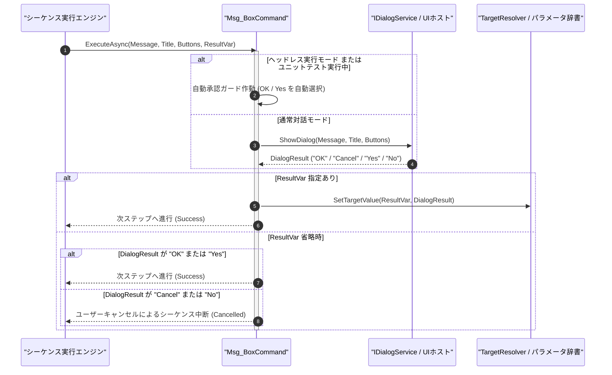

# コマンドリファレンス：Msg_Box

## 概要

`Msg_Box` は、オペレーターへの作業指示（ケーブル接続確認等）や通知を行うためのポップアップダイアログを表示する共通シーケンス・フロー制御・対話系コマンドです。  
ボタン種別（`OK` / `OKCancel` / `YesNo`）を指定でき、押下結果格納先（`<ResultVar>`）を指定した場合はユーザーの選択結果（`"OK"`, `"Cancel"`, `"Yes"`, `"No"`）をパラメータへ格納して後続の [`Judge`](./Judge.Md) 分岐を可能にします。また、自動テストや夜間ヘッドレス実行環境では、画面をブロックせず自動的に既定承認（`"OK"` / `"Yes"`）して進行する安全ガードを内包しています。

> 💡 **補足**  
> 本コマンドは 共通基盤コマンドです。

---

## 💡 書式・パラメータ仕様

### コマンド構文

```csv
,SEQUENCE, [ステップキー], Msg_Box, "[表示メッセージ(Message)]", "[タイトル(Title)]", "[ボタン種別(Buttons)]", "[結果格納先(ResultVar)]"
```

### パラメータ（引数）一覧

| 引数位置 | 引数名 | 説明 | 指定方法 / 有効な入力値 |
| :--- | :--- | :--- | :--- |
| 引数1 | Message | ダイアログに表示する本文メッセージ文字列（必須）。 | 任意の文字列（例: `"プローブをCH1へ接続してください"`）または `$PARAM$` 置換 |
| 引数2 | Title | ダイアログウィンドウのタイトルバー文字列（任意・省略可・既定値: `"確認"`）。 | 任意の文字列または `$PARAM$` 置換 |
| 引数3 | Buttons | 表示するボタンの組み合わせ種別（任意・省略可・既定値: `"OK"`）。 | `"OK"`, `"OKCancel"`, `"YesNo"` |
| 引数4 | ResultVar | 押下されたボタン名（`"OK"`, `"Cancel"`, `"Yes"`, `"No"`）を格納するパラメータキー（任意・省略可）。 | 自コマンド内の `PARAM` キー名。省略時は `Cancel` / `No` 押下時にシーケンスを中断 |

---

## 🔄 特殊置換規約・分岐規約の適用

本コマンドの引数における特殊記法および解釈ルールです。
* **動的置換（`$`）**: 引数内で `$PARAMキー$` のように記述すると、実行時に変数プール（PARAM）の値へ動的置換されます。（適用可能な引数: 全引数対応）
* **ジャンプ先指定（`#`）**: 本コマンド自体はジャンプを行いません（引数 4 の `<ResultVar>` と直後の [`Judge`](./Judge.Md) を組み合わせて分岐します）。（適用可能な引数: 非適用）
* **共通コマンド指定（`@`）**: 本コマンドは外部マクロを呼び出さないため適用されません。（適用可能な引数: 非適用）
* **カンマのエスケープ**: メッセージ文字列自体にカンマを含める場合は、必ず `","` と二重引用符で囲んで記述します。
* **エイリアス（別名）**: `MsgBox`, `Alert`, `MessageBox`, `DispMsg`, `GpibMsgBox`, `Analysis_Term_MsgBox`

---

## 💡 動作例（正しい構文での記述例）

### スクリプト記述例

※COMMAND ブロック配下の子要素行（PARAM, SEQUENCE）は必ず行頭カンマから開始し、スペースインデントや行末コメント（`;`）は記述しないでください。

```csv
COMMAND, "OPERATOR_CHECK", "USER_ANS"
,PARAM, "USER_ANS", Work, "オペレーター回答", ""
; Yes / No 確認ダイアログを表示し、選択結果を USER_ANS へ格納
,SEQUENCE, 010, Msg_Box, "校正用治具の接続は完了していますか？", "接続確認", "YesNo", "USER_ANS"
; "Yes" 以外（"No"）が押された場合は #ABORT_FLOW# へジャンプ
,SEQUENCE, 020, Judge, EQU, "$USER_ANS$", "Yes", #ABORT_FLOW#
,SEQUENCE, 030, Gpib_Send, "CAL:ALL"
,SEQUENCE, #ABORT_FLOW#, Exit
```

### 実行時の挙動・変数変化

* **実行前の状態**: `"USER_ANS"` が空文字列 `""` の状態。
* **実行後の状態**: 画面に「校正用治具の接続は完了していますか？」の Yes/No ダイアログが表示され、オペレーターが［はい（Yes）］を押下すると `"USER_ANS"` に `"Yes"` が格納され、ステップ `020` の `Judge` を通過してステップ `030` の校正コマンドが実行されます。

---

## 🔄 動作フロー（シーケンス図）

本コマンド実行時における、シーケンス実行エンジン、コマンドクラス（`Msg_BoxCommand`）、および UI ダイアログサービス間のインタラクションを示すシーケンス図です。



---

## 🚫 エラーハンドリング・安全設計（仕様制限）

入力データの異常や実行時エラーに対し、解析・実行エンジンが実行するセーフティ規約です。

1. **ヘッドレス環境・自動テスト時の非ブロッキング自動承認ガード**:
   - `Environment.UserInteractive == false` または `ErrorLogger.MinimumLevel == LogLevel.Test` の環境では、モーダルダイアログによる無人実行の永久停止を防ぐため、自動的に肯定応答（`"OK"` または `"Yes"`）を選択してログに記録し、処理を継続します。
2. **`<ResultVar>` 省略時のキャンセル安全停止**:
   - `<ResultVar>` が指定されていない状態でユーザーが `Cancel` または `No` を選択した場合は、オペレーターによる作業中止要求として安全にシーケンスを停止します。

---

## 🧪 ユニットテスト仕様

本コマンドクラス（`Msg_BoxCommand.cs`）に実装されている `RunUnitTest()` メソッドが検証するユニットテストの仕様です。

### テスト実行前提条件

* **実行トリガー**: `RunUnitTest()` メソッドの呼び出し
* **有効化条件**: システム全体の最小ログレベル（`ErrorLogger.MinimumLevel`）が `LogLevel.Test` であること（それ以外の場合は無効化ガードにより早期リターン）
* **検証結果出力**: `_log.LogTest` によるログ出力。検証失敗時は `_log.LogError`、予期せぬ例外発生時は `_log.LogCritical` で記録。

### テストケース一覧

| No | テストカテゴリ | テスト条件（入力値） | 期待される結果（出力値） | 検証の目的 / 観点 |
| :---: | :--- | :--- | :--- | :--- |
| **1** | 正常系 | テストモードでの `OK` ダイアログ呼出（`"テスト通知"`） | モーダル待機せず自動承認され `Success` が返る | ヘッドレス自動承認ガードの検証 |
| **2** | 正常系 | `YesNo` 指定＋`<ResultVar>` 指定（`"確認", "タイトル", "YesNo", "ANS"`） | `"ANS"` に `"Yes"` が格納され `Success` が返る | 選択結果のパラメータ格納検証 |
| **3** | 異常系 | 未定義のボタン種別文字列（`"INVALID_BTN"`）を指定 | 既定の `"OK"` にフォールバックまたはエラー記録で安全処理される | 不正引数指定時のクラッシュ防御検証 |

