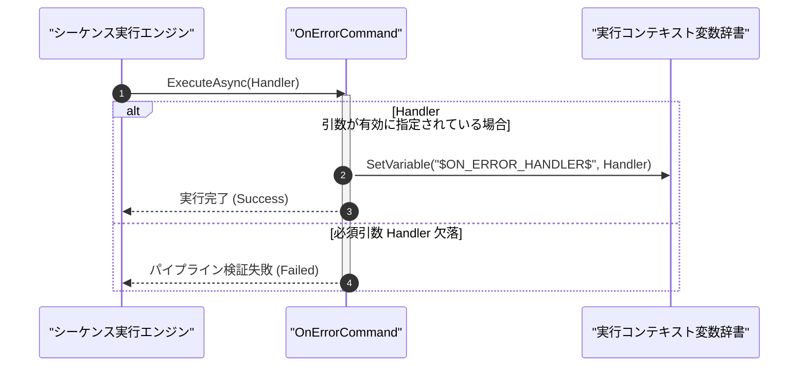

# コマンドリファレンス：OnError

## 概要

`OnError` は、後続ステップでエラー発生時（`SetError` 発火等）に適用するエラートラップ・ハンドラ動作（ジャンプ先ラベル、ステップ番号、`"Next"` 継続、または `"Halt"` 停止）をシステム変数 `$ON_ERROR_HANDLER$` へ登録する共通シーケンス制御系コマンドです。  
異常発生時の緊急シャットダウンルーチンやリカバリ処理への自動遷移を構成する際に使用します。

> 💡 **補足**  
> `Handler` には `#ERR_HANDLER#` のようなラベル名やステップ番号のほか、エラー無視継続を示す `"Next"`、標準の即時停止へ戻す `"Halt"` を指定できます。

---

## 💡 書式・パラメータ仕様

### コマンド構文

```csv
,SEQUENCE, [ステップキー], OnError, "[エラーハンドラ指定(Handler)]"
```

### パラメータ（引数）一覧

| 引数位置 | 引数名 | 説明 | 指定方法 / 有効な入力値 |
| :--- | :--- | :--- | :--- |
| 引数1 | `Handler` | エラー発生時の遷移先または制御ポリシー文字列（必須）。 | `#ラベル名#`、ステップ番号（例: `500`）、`"Next"`、または `"Halt"` |

---

## 🔄 特殊置換規約・分岐規約の適用

本コマンドの引数における特殊記法および解釈ルールです。
* **動的置換（`$`）**: 引数内で `$PARAMキー$` のように記述すると、実行時に変数プール（PARAM）の値へ動的置換されます。（適用可能な引数: 引数 1 `Handler`）
* **ジャンプ先指定（`#`）**: エラー発生時のトラップ先ラベルを `#ラベル名#` の形式で登録できます。（適用可能な引数: 引数 1 `Handler`）
* **共通コマンド指定（`@`）**: 本コマンドは外部マクロを呼び出さないため適用されません。（適用可能な引数: 非適用）
* **カンマのエスケープ**: 引数文字列自体にカンマを含める場合は、必ず `","` と二重引用符で囲んで記述します。
* **エイリアス（別名）**: `TrapError`, `Analysis_Term_OnError`

---

## 💡 動作例（正しい構文での記述例）

### スクリプト記述例

※COMMAND ブロック配下の子要素行（PARAM, SEQUENCE）は必ず行頭カンマから開始し、スペースインデントや行末コメント（`;`）は記述しないでください。

```csv
COMMAND, "SAFE_POWER_TEST", ""
; 冒頭でエラートラップ先を #SAFE_SHUTDOWN# に登録
,SEQUENCE, 010, OnError, #SAFE_SHUTDOWN#
,SEQUENCE, 020, SetError, -10, "過電流検出"
,SEQUENCE, #SAFE_SHUTDOWN#, ClearError
,SEQUENCE, 040, Exit
```

### 実行時の挙動・変数変化

* **実行前の状態**: `$ON_ERROR_HANDLER$` が未設定（既定の停止動作）の状態。
* **実行後の状態**: ステップ `010` により `$ON_ERROR_HANDLER$` に `"#SAFE_SHUTDOWN#"` が設定され、ステップ `020` でエラーが発生すると即座に `#SAFE_SHUTDOWN#` へトラップ遷移します。

---

## 🔄 動作フロー（シーケンス図）

本コマンド実行時における、シーケンス実行エンジン、`OnErrorCommand`、および実行コンテキスト変数辞書間のインタラクションを示すシーケンス図です。



---

## 🚫 エラーハンドリング・安全設計（仕様制限）

入力データの異常や実行時エラーに対し、解析・実行エンジンが実行するセーフティ規約です。

1. **必須ハンドラ指定の検証ガード**:
   - 引数 `Handler` が空または省略された場合は `CommandParameterPipeline` が実行前に検出し、意図しない未定義トラップ設定を防止します。
2. **トラップ解除手段（`"Halt"`）の明示サポート**:
   - クリティカル区間終了後に `OnError, "Halt"` を実行することで、いつでも標準の即時安全停止モードへ復帰できます。

---

## 🧪 ユニットテスト仕様

本コマンドクラス（`EqualCommand.cs` 内 `OnErrorCommand`）に実装されている `RunUnitTest()` メソッドが検証するユニットテストの仕様です。

### テスト実行前提条件

* **実行トリガー**: `RunUnitTest()` メソッドの呼び出し
* **有効化条件**: システム全体の最小ログレベル（`ErrorLogger.MinimumLevel`）が `LogLevel.Test` であること（それ以外の場合は無効化ガードにより早期リターン）
* **検証結果出力**: `_log.LogTest` によるログ出力。検証失敗時は `_log.LogError`、予期せぬ例外発生時は `_log.LogCritical` で記録。

### テストケース一覧

| No | テストカテゴリ | テスト条件（入力値） | 期待される結果（出力値） | 検証の目的 / 観点 |
| :---: | :--- | :--- | :--- | :--- |
| **1** | 正常系 | 引数 `("#ERR_HANDLER#")` を指定して実行 | `$ON_ERROR_HANDLER$` が `"#ERR_HANDLER#"` となり `Success` を返却 | エラートラップハンドラ登録の検証 |
| **2** | 異常系 | 引数を省略して実行 | パイプライン検証が `IsValid == false` となりエラー返却 | 必須引数欠落時の防御検証 |

