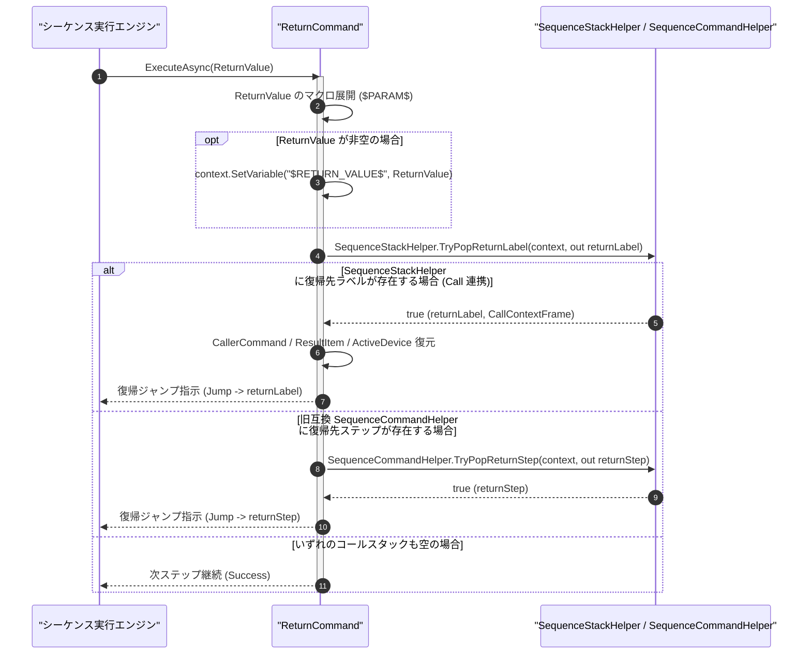

# コマンドリファレンス：Return

## 概要

`Return` は、コールスタック（[`Call`](../Param/Call.Md) と連携する `SequenceStackHelper`、および旧互換 `SequenceCommandHelper`）に退避されているサブルーチン呼出元の復帰先ラベル／ステップを取り出して制御を戻し、任意の戻り値（`ReturnValue`）をシステム変数 `$RETURN_VALUE$` および呼出元コマンドの戻り値パラメータ（`ResultItem`）へ設定する共通シーケンス制御系コマンドです。  
[`Call`](../Param/Call.Md) コマンドで呼び出されたサブルーチン処理の末尾で呼出元へ復帰する際に使用します。

> 💡 **補足**  
> `SequenceStackHelper` に `CallContextFrame` が退避されている場合は、呼出元コマンド（`CallerCommand`）およびアクティブデバイス名（`CallerDeviceName`）も自動的に復元されます。コールスタックが空の状態（トップレベル実行中）で呼び出された場合は例外エラーとせず、通常の次ステップへ安全に進行（`Success`）します。

---

## 💡 書式・パラメータ仕様

### コマンド構文

```csv
,SEQUENCE, [ステップキー], Return, "[戻り値(ReturnValue)]"
```

### パラメータ（引数）一覧

| 引数位置 | 引数名 | 説明 | 指定方法 / 有効な入力値 |
| :--- | :--- | :--- | :--- |
| 引数1 | `ReturnValue` | 呼出元へ返却し `$RETURN_VALUE$` に格納する文字列（任意・省略時既定値: `""`）。 | 任意の文字列リテラル（例: `"OK"`, `"0"`）または `$PARAM$` 置換 |

---

## 🔄 特殊置換規約・分岐規約の適用

本コマンドの引数における特殊記法および解釈ルールです。
* **動的置換（`$`）**: 引数内で `$PARAMキー$` のように記述すると、実行時に変数プール（PARAM）の値へ動的置換されます。（適用可能な引数: 引数 1 `ReturnValue`）
* **ジャンプ先指定（`#`）**: 復帰先はコールスタックから自動解決されるためラベル直接指定は行いません。（適用可能な引数: 非適用）
* **共通コマンド指定（`@`）**: 本コマンドは外部マクロを呼び出さないため適用されません。（適用可能な引数: 非適用）
* **カンマのエスケープ**: 引数文字列自体にカンマを含める場合は、必ず `","` と二重引用符で囲んで記述します。
* **エイリアス（別名）**: `Ret`, `Analysis_Term_Return`

---

## 💡 動作例（正しい構文での記述例）

### スクリプト記述例

※COMMAND ブロック配下の子要素行（PARAM, SEQUENCE）は必ず行頭カンマから開始し、スペースインデントや行末コメント（`;`）は記述しないでください。

```csv
COMMAND, "SUB_INIT_PROC", ""
; 初期化処理を実行し、戻り値 "OK" を設定して呼出元へ復帰
,SEQUENCE, 010, Wait, 50
,SEQUENCE, 020, Return, "OK"
```

### 実行時の挙動・変数変化

* **実行前の状態**: コールスタックに呼出元の復帰ステップ（例: `15`）が退避されている状態。
* **実行後の状態**: ステップ `020` の実行により、変数 `$RETURN_VALUE$` に `"OK"` が設定され、コールスタックからポップされたステップ `15` へ制御がジャンプ復帰します。

---

## 🔄 動作フロー（シーケンス図）

本コマンド実行時における、シーケンス実行エンジン、`ReturnCommand`、およびコールスタックヘルパー間のインタラクションを示すシーケンス図です。



---

## 🚫 エラーハンドリング・安全設計（仕様制限）

入力データの異常や実行時エラーに対し、解析・実行エンジンが実行するセーフティ規約です。

1. **`SequenceStackHelper` 統合による呼出元コンテキスト復元とアンダーフロー防止**:
   - [`Call`](../Param/Call.Md) 経由の呼出時は `SequenceStackHelper` から復帰ラベルと `CallContextFrame`（親コマンド・`ResultItem`・アクティブデバイス）を確実に復元し、サブルーチン外で単体実行された場合でもスタックアンダーフロー例外を送出せず安全に次ステップへ進行（`Success`）します。
2. **戻り値省略時の既存状態保全と過剰引数拒否**:
   - `ReturnValue` が空文字列（省略）の場合は不要な上書きを行わず、2 個以上の過剰引数が指定された場合は `CommandParameterPipeline` が実行前に拒否します。

---

## 🧪 ユニットテスト仕様

本コマンドクラス（`EqualCommand.cs` 内 `ReturnCommand`）に実装されている `RunUnitTest()` メソッドが検証するユニットテストの仕様です。

### テスト実行前提条件

* **実行トリガー**: `RunUnitTest()` メソッドの呼び出し
* **有効化条件**: システム全体の最小ログレベル（`ErrorLogger.MinimumLevel`）が `LogLevel.Test` であること（それ以外の場合は無効化ガードにより早期リターン）
* **検証結果出力**: `_log.LogTest` によるログ出力。検証失敗時は `_log.LogError`、予期せぬ例外発生時は `_log.LogCritical` で記録。

### テストケース一覧

| No | テストカテゴリ | テスト条件（入力値） | 期待される結果（出力値） | 検証の目的 / 観点 |
| :---: | :--- | :--- | :--- | :--- |
| **1** | 正常系 | `SequenceStackHelper.PushReturnLabel("25")` 有時に `("RET_CALL")` を実行 | `Status == Jump`（`NextStepOverride == 25`）かつ `$RETURN_VALUE$ == "RET_CALL"` | `Call` 連携コールスタック復帰と戻り値格納の検証 |
| **2** | 正常系 | 旧互換 `SequenceCommandHelper.PushReturnStep(15)` 有時に `("OK")` を実行 | `Status == Jump`（`NextStepOverride == 15`）かつ `$RETURN_VALUE$ == "OK"` | 旧互換ステップスタック復帰の検証 |
| **3** | 境界値・異常系 | スタック空状態で `Return` 実行、および過剰引数 `("OK", "EXTRA")` を検証 | スタック空時は `Status == Success` で継続し、過剰引数は `IsValid == false` で拒否 | スタックアンダーフロー防御および引数上限の検証 |

