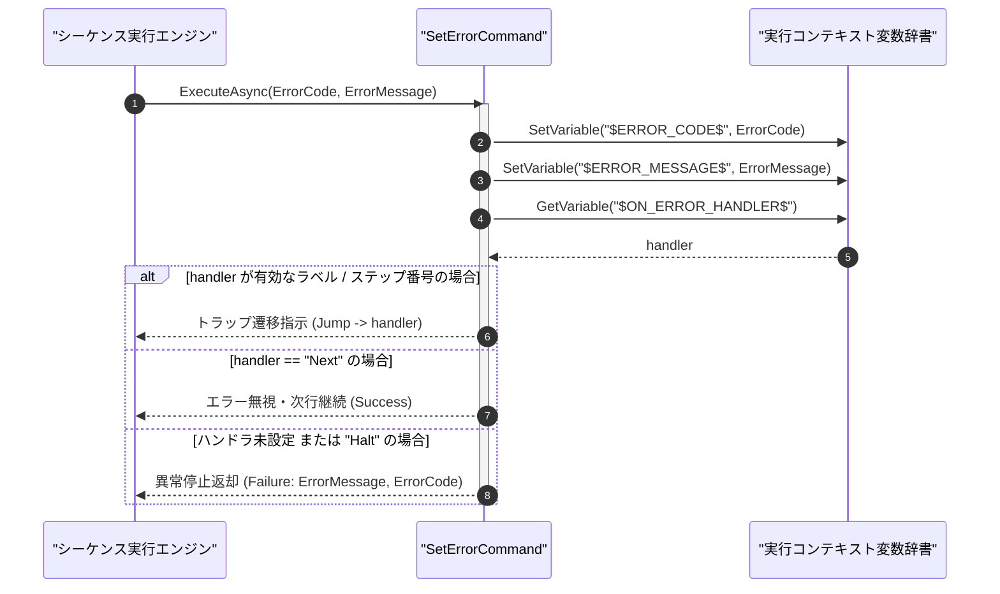

# コマンドリファレンス：SetError

## 概要

`SetError` は、指定された整数エラーコード（`ErrorCode`）およびエラーメッセージ（`ErrorMessage`）をシステム変数へ記録し、`OnError` ハンドラの設定に応じた分岐ジャンプ・継続・または異常停止を発火させる共通シーケンス制御系コマンドです。  
測定値の上下限規格外れや機器セルフテスト失敗など、業務ロジック上の異常を明示的に通知する際に使用します。

> 💡 **補足**  
> `$ON_ERROR_HANDLER$` にラベルまたはステップ番号が設定されている場合はその位置へジャンプし、`"Next"` の場合はエラーを無視して次行へ進み、未設定または `"Halt"` の場合は `AnalysisResult.Failure` でシーケンスを停止します。

---

## 💡 書式・パラメータ仕様

### コマンド構文

```csv
,SEQUENCE, [ステップキー], SetError, [エラーコード(ErrorCode)], "[エラーメッセージ(ErrorMessage)]"
```

### パラメータ（引数）一覧

| 引数位置 | 引数名 | 説明 | 指定方法 / 有効な入力値 |
| :--- | :--- | :--- | :--- |
| 引数1 | `ErrorCode` | 設定する整数エラーコード（必須）。`$ERROR_CODE$` に格納されます。 | 整数リテラル（例: `-99`, `1001`）または `$PARAM$` 置換 |
| 引数2 | `ErrorMessage` | エラー内容を示す説明メッセージ（任意・省略時は既定エラー文言）。`$ERROR_MESSAGE$` に格納されます。 | 任意の文字列リテラル（例: `"上限電圧超過"`）または `$PARAM$` 置換 |

---

## 🔄 特殊置換規約・分岐規約の適用

本コマンドの引数における特殊記法および解釈ルールです。
* **動的置換（`$`）**: 引数内で `$PARAMキー$` のように記述すると、実行時に変数プール（PARAM）の値へ動的置換されます。（適用可能な引数: 全引数対応）
* **ジャンプ先指定（`#`）**: 本コマンド自体の引数では指定しませんが、`OnError` で登録済みの `#ラベル名#` へ自動遷移します。（適用可能な引数: 非適用）
* **共通コマンド指定（`@`）**: 本コマンドは外部マクロを呼び出さないため適用されません。（適用可能な引数: 非適用）
* **カンマのエスケープ**: 引数文字列自体にカンマを含める場合は、必ず `","` と二重引用符で囲んで記述します。
* **エイリアス（別名）**: `RaiseError`, `Throw`, `Analysis_Term_SetError`

---

## 💡 動作例（正しい構文での記述例）

### スクリプト記述例

※COMMAND ブロック配下の子要素行（PARAM, SEQUENCE）は必ず行頭カンマから開始し、スペースインデントや行末コメント（`;`）は記述しないでください。

```csv
COMMAND, "VALIDATE_LIMIT", ""
,PARAM, "VOLT", Number, "測定電圧(V)", "15.5"
,SEQUENCE, 010, OnError, #ERROR_CLEANUP#
,SEQUENCE, 020, Judge, LE, "$VOLT$", 12.0, #NORMAL_END#
,SEQUENCE, 030, SetError, -99, "過電圧異常を検出しました"
,SEQUENCE, #ERROR_CLEANUP#, ClearError
,SEQUENCE, #NORMAL_END#, Exit
```

### 実行時の挙動・変数変化

* **実行前の状態**: `"VOLT"` が `"15.5"` であり、ステップ `010` で `$ON_ERROR_HANDLER$` に `"#ERROR_CLEANUP#"` が登録されている状態。
* **実行後の状態**: ステップ `030` で `$ERROR_CODE$` に `"-99"`、`$ERROR_MESSAGE$` に `"過電圧異常を検出しました"` が格納され、ハンドラ `#ERROR_CLEANUP#` へ即座にジャンプします。

---

## 🔄 動作フロー（シーケンス図）

本コマンド実行時における、シーケンス実行エンジン、`SetErrorCommand`、および実行コンテキスト間のインタラクションを示すシーケンス図です。



---

## 🚫 エラーハンドリング・安全設計（仕様制限）

入力データの異常や実行時エラーに対し、解析・実行エンジンが実行するセーフティ規約です。

1. **整数エラーコードの型安全性検証**:
   - 第 1 引数 `ErrorCode` に整数以外の文字列が渡された場合、`RequireInt` バリデータにより実行前に検出して不正なエラーコード汚染を防ぎます。
2. **ハンドラ未登録時の確実なフェイルセーフ停止**:
   - `OnError` が設定されていない状態では必ず `AnalysisResult.Failure` を返却し、異常を黙殺したまま後続のハードウェア制御が暴走することを防ぎます。

---

## 🧪 ユニットテスト仕様

本コマンドクラス（`EqualCommand.cs` 内 `SetErrorCommand`）に実装されている `RunUnitTest()` メソッドが検証するユニットテストの仕様です。

### テスト実行前提条件

* **実行トリガー**: `RunUnitTest()` メソッドの呼び出し
* **有効化条件**: システム全体の最小ログレベル（`ErrorLogger.MinimumLevel`）が `LogLevel.Test` であること（それ以外の場合は無効化ガードにより早期リターン）
* **検証結果出力**: `_log.LogTest` によるログ出力。検証失敗時は `_log.LogError`、予期せぬ例外発生時は `_log.LogCritical` で記録。

### テストケース一覧

| No | テストカテゴリ | テスト条件（入力値） | 期待される結果（出力値） | 検証の目的 / 観点 |
| :---: | :--- | :--- | :--- | :--- |
| **1** | 異常系 | ハンドラ未設定状態で `("-99", "TestError")` を実行 | `Status == Failed` かつ `ErrorCode == -99` を返却 | ハンドラ未設定時の安全停止動作検証 |
| **2** | 正常系 | `$ON_ERROR_HANDLER$ = "500"` 設定後に同引数を実行 | `Status == Jump` かつ `NextStepOverride == 500` を返却 | エラートラップハンドラへの自動ジャンプ検証 |

