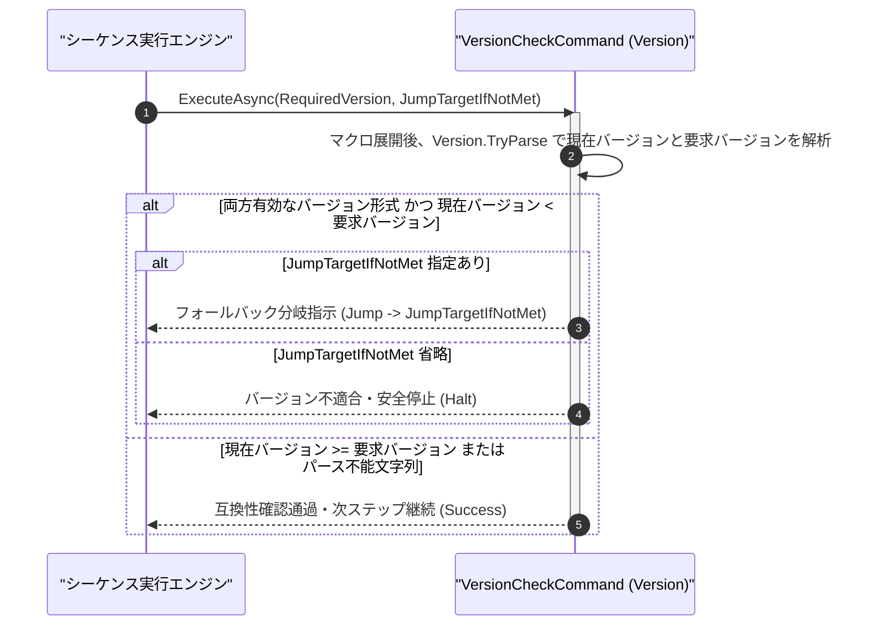

# コマンドリファレンス：Version

## 概要

`Version` は、実行中アプリケーションのアセンブリバージョンが指定された要求最小バージョン（`RequiredVersion`）以上であるかを検査し、満たさない場合に指定先（`JumpTargetIfNotMet`）へ分岐するか実行を安全停止（`Halt`）する共通シーケンス制御系コマンドです。  
新機能コマンドを使用するマクロスクリプトの冒頭で、実行環境のバージョン互換性を事前検証する際に使用します。

> 💡 **補足**  
> 第 2 引数 `JumpTargetIfNotMet` を省略した場合、バージョン不足検出時は直ちに `AnalysisResult.Halt` でシーケンスを安全停止します。

---

## 💡 書式・パラメータ仕様

### コマンド構文

```csv
,SEQUENCE, [ステップキー], Version, "[要求バージョン(RequiredVersion)]", "[不一致時ジャンプ先(JumpTargetIfNotMet)]"
```

### パラメータ（引数）一覧

| 引数位置 | 引数名 | 説明 | 指定方法 / 有効な入力値 |
| :--- | :--- | :--- | :--- |
| 引数1 | `RequiredVersion` | 実行に必要な最小バージョン文字列（必須）。 | `Major.Minor[.Build[.Revision]]` 形式（例: `"1.0.0"`, `"2.1"`） |
| 引数2 | `JumpTargetIfNotMet` | 要求バージョン未満の場合に遷移するステップ番号またはラベル（任意・既定値: `""`＝即時停止）。 | `#ラベル名#` またはステップ番号（省略時は `Halt` 停止） |

---

## 🔄 特殊置換規約・分岐規約の適用

本コマンドの引数における特殊記法および解釈ルールです。
* **動的置換（`$`）**: 引数内で `$PARAMキー$` のように記述すると、実行時に変数プール（PARAM）の値へ動的置換されます。（適用可能な引数: 全引数対応）
* **ジャンプ先指定（`#`）**: バージョン不足時のフォールバック先ラベルを `#ラベル名#` で指定できます。（適用可能な引数: 引数 2 `JumpTargetIfNotMet`）
* **共通コマンド指定（`@`）**: 本コマンドは外部マクロを呼び出さないため適用されません。（適用可能な引数: 非適用）
* **カンマのエスケープ**: 引数文字列自体にカンマを含める場合は、必ず `","` と二重引用符で囲んで記述します。
* **エイリアス（別名）**: `Term_Version`, `Analysis_Term_Version`

---

## 💡 動作例（正しい構文での記述例）

### スクリプト記述例

※COMMAND ブロック配下の子要素行（PARAM, SEQUENCE）は必ず行頭カンマから開始し、スペースインデントや行末コメント（`;`）は記述しないでください。

```csv
COMMAND, "CHECK_APP_VERSION", ""
; 実行環境が v1.0.0 未満であれば #OLD_ENV# へ分岐
,SEQUENCE, 010, Version, "1.0.0", #OLD_ENV#
,SEQUENCE, 020, Exit
,SEQUENCE, #OLD_ENV#, Msg_Box, "本マクロの実行には v1.0.0 以上が必要です。"
,SEQUENCE, 040, Exit
```

### 実行時の挙動・変数変化

* **実行前の状態**: アプリケーションの実行中アセンブリバージョンが `1.2.0.0` である状態。
* **実行後の状態**: ステップ `010` にて `1.2.0.0 >= 1.0.0` と判定され、ジャンプせず正常完了（`Success`）としてステップ `020` へ進みます。

---

## 🔄 動作フロー（シーケンス図）

本コマンド実行時における、シーケンス実行エンジンと `VersionCheckCommand` 間のインタラクションを示すシーケンス図です。



---

## 🚫 エラーハンドリング・安全設計（仕様制限）

入力データの異常や実行時エラーに対し、解析・実行エンジンが実行するセーフティ規約です。

1. **旧バージョン環境での未対応コマンド実行防止**:
   - 要求バージョンに満たない環境では、後続の未対応コマンドが呼ばれる前に `Halt` または代替ラベル分岐（`Jump`）で確実に保護します。
2. **`System.Version.TryParse` による非破壊素通り（`Success`）動作**:
   - `RequiredVersion`（または現在アセンブリのバージョン文字列）に `System.Version.TryParse` で解析できない不正な形式の文字列が指定された場合は、`FormatException` の送出や `Halt` 停止を行わず、 **`AnalysisResult.Success`（合格素通り）** として次ステップへ安全に進行します。

---

## 🧪 ユニットテスト仕様

本コマンドクラス（`EqualCommand.cs` 内 `VersionCheckCommand`）に実装されている `RunUnitTest()` メソッドが検証するユニットテストの仕様です。

### テスト実行前提条件

* **実行トリガー**: `RunUnitTest()` メソッドの呼び出し
* **有効化条件**: システム全体の最小ログレベル（`ErrorLogger.MinimumLevel`）が `LogLevel.Test` であること（それ以外の場合は無効化ガードにより早期リターン）
* **検証結果出力**: `_log.LogTest` によるログ出力。検証失敗時は `_log.LogError`、予期せぬ例外発生時は `_log.LogCritical` で記録。

### テストケース一覧

| No | テストカテゴリ | テスト条件（入力値） | 期待される結果（出力値） | 検証の目的 / 観点 |
| :---: | :--- | :--- | :--- | :--- |
| **1** | 正常系 | 最小要求バージョン `("0.0.1")` を指定して実行 | 現在バージョンが要件を満たし `Status == Success` を返却 | バージョン適合判定の基本動作検証 |
| **2** | 異常系・境界値 | 現行より高いバージョンを `("9999.0.0")` および `("9999.0.0", "#OLD_VER#")` で指定 | 省略時は `Status == Halt`、指定時は `Status == Jump`（`TargetLabel == "#OLD_VER#"`）を返却 | バージョン未達時の安全停止および代替ラベル分岐検証 |

