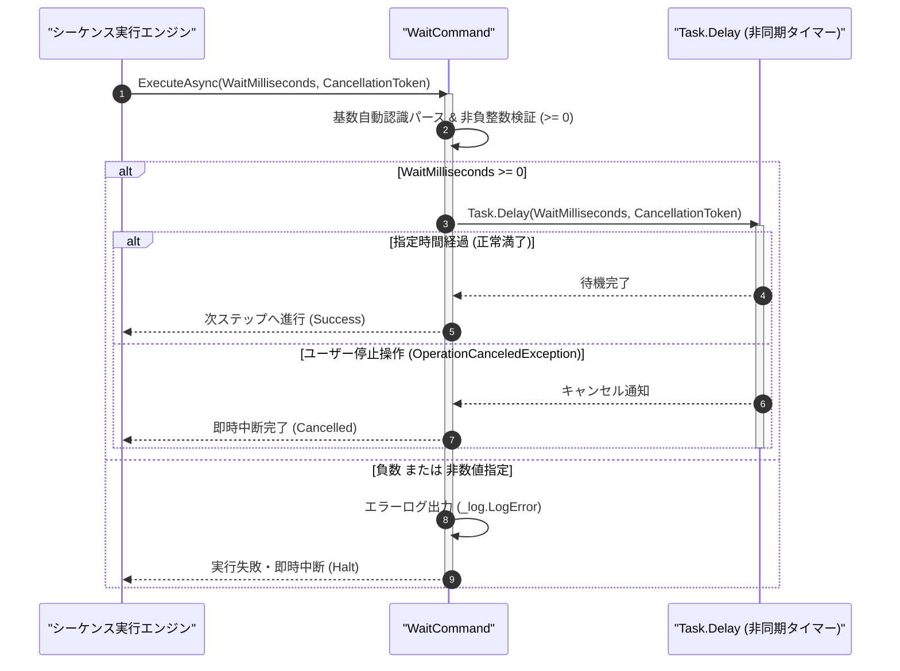

# コマンドリファレンス：Wait

## 概要

`Wait` は、指定されたミリ秒間（`<WaitMilliseconds>`）、UI スレッドをブロックせずに非同期タイマー待機（`Task.Delay`）を実行する共通シーケンス・フロー制御系コマンドです。  
機器の応答安定待ちやリレー整定時間待機などに使用され、旧 Term の `WaitTime`（`Analysis_Term_WaitTime`）および旧 GPIB Work の `GpibWait`（ミリ秒スリープ）を共通基盤へ完全統合しています。

> 💡 **補足**  
> 本コマンドは 共通基盤コマンドです。なお、GPIB バス上の SRQ イベント発生を待機する場合は、本コマンドではなく GPIB 専用コマンドの [`Gpib_Wait`](https://github.com/Monaca-App/GpibAddIn/tree/main/Manual/GPIB/Gpib_Wait.Md) を使用します。

---

## 💡 書式・パラメータ仕様

### コマンド構文

```csv
,SEQUENCE, [ステップキー], Wait, "[待機時間ミリ秒(WaitMilliseconds)]"
```

### パラメータ（引数）一覧

| 引数位置 | 引数名 | 説明 | 指定方法 / 有効な入力値 |
| :--- | :--- | :--- | :--- |
| 引数1 | WaitMilliseconds | 待機する時間（ミリ秒単位・0 以上の整数・必須）。 | 非負整数リテラル（例: `"500"`, `"1000"`, `"0x3E8"`）または `$PARAM$` 置換 |

---

## 🔄 特殊置換規約・分岐規約の適用

本コマンドの引数における特殊記法および解釈ルールです。
* **動的置換（`$`）**: 引数内で `$PARAMキー$` のように記述すると、実行時に変数プール（PARAM）の値へ動的置換されます。（適用可能な引数: 引数 1 `WaitMilliseconds`）
* **ジャンプ先指定（`#`）**: 本コマンドはジャンプ制御を行わないため適用されません。（適用可能な引数: 非適用）
* **共通コマンド指定（`@`）**: 本コマンドは外部マクロを呼び出さないため適用されません。（適用可能な引数: 非適用）
* **カンマのエスケープ**: 引数文字列自体にカンマを含める場合は、必ず `","` と二重引用符で囲んで記述します。
* **エイリアス（別名）**: `WaitTime`, `Analysis_Term_WaitTime`, `Sleep`, `Delay`

---

## 💡 動作例（正しい構文での記述例）

### スクリプト記述例

※COMMAND ブロック配下の子要素行（PARAM, SEQUENCE）は必ず行頭カンマから開始し、スペースインデントや行末コメント（`;`）は記述しないでください。

```csv
COMMAND, "POWER_ON_DELAY", "STATUS"
,PARAM, "SETTLE_MS", Number, "安定待機時間(ms)", "1500"
,PARAM, "STATUS", Work, "状態", "INIT"
,SEQUENCE, 010, Gpib_Send, "OUTP ON"
; 出力ON後、1500ミリ秒（1.5秒）非同期待機
,SEQUENCE, 020, Wait, "$SETTLE_MS$"
,SEQUENCE, 030, Param_Set, "POWER_ON_DELAY", "READY", "STATUS"
,SEQUENCE, 040, Exit
```

### 実行時の挙動・変数変化

* **実行前の状態**: ステップ `010` で電源出力を ON にした直後の状態（`"SETTLE_MS"` = `"1500"`）。
* **実行後の状態**: 画面の応答性（停止ボタン操作やログ描画）を維持したまま 1500 ms 待機し、経過後にステップ `030` へ進んで `"STATUS"` が `"READY"` に更新されます。

---

## 🔄 動作フロー（シーケンス図）

本コマンド実行時における、シーケンス実行エンジン、コマンドクラス（`WaitCommand`）、および非同期タイマー間のインタラクションを示すシーケンス図です。



---

## 🚫 エラーハンドリング・安全設計（仕様制限）

入力データの異常や実行時エラーに対し、解析・実行エンジンが実行するセーフティ規約です。

1. **待機中の即時キャンセル応答（UI フリーズ防止）**:
   - `Thread.Sleep` ではなく `Task.Delay(ms, cancellationToken)` を使用するため、長時間待機中であってもユーザーが停止ボタンを押下した瞬間に待機を中断して安全に終了します。
2. **負数または非数値文字列の指定**:
   - `<WaitMilliseconds>` に負の値（例: `"-100"`）や非数値が指定された場合はエラーログ（`_log.LogError`）を記録して直ちに安全停止（Halt）します。

---

## 🧪 ユニットテスト仕様

本コマンドクラス（`WaitCommand.cs`）に実装されている `RunUnitTest()` メソッドが検証するユニットテストの仕様です。

### テスト実行前提条件

* **実行トリガー**: `RunUnitTest()` メソッドの呼び出し
* **有効化条件**: システム全体の最小ログレベル（`ErrorLogger.MinimumLevel`）が `LogLevel.Test` であること（それ以外の場合は無効化ガードにより早期リターン）
* **検証結果出力**: `_log.LogTest` によるログ出力。検証失敗時は `_log.LogError`、予期せぬ例外発生時は `_log.LogCritical` で記録。

### テストケース一覧

| No | テストカテゴリ | テスト条件（入力値） | 期待される結果（出力値） | 検証の目的 / 観点 |
| :---: | :--- | :--- | :--- | :--- |
| **1** | 正常系 | 短時間待機（`"50"` ミリ秒） | 約 50 ms 経過後に `Success` が返却される | 非同期タイマー待機の基本動作検証 |
| **2** | 正常系 | 待機中キャンセルトークン発火（`"5000"` ms 待機中に Cancel） | 5000 ms 待たずに即座にキャンセル終了する | キャンセル応答性の検証 |
| **3** | 異常系 | 負の待機時間指定（`"-10"`） | エラーログが出力され `Failure` で安全停止する | 不正待機時間ガードの検証 |

