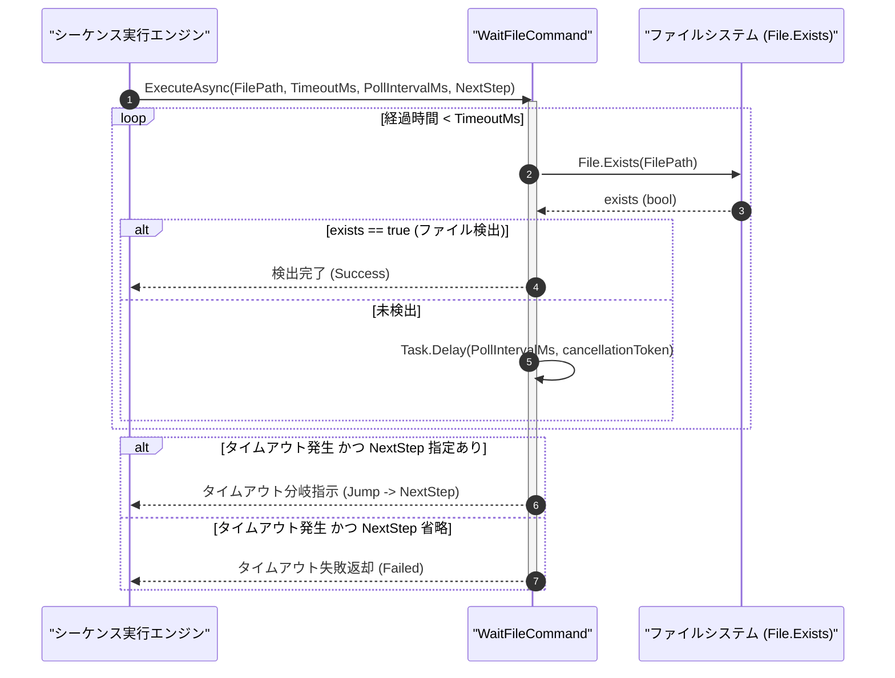

# コマンドリファレンス：WaitFile

## 概要

`WaitFile` は、指定されたファイルパス（`FilePath`）がディスク上に生成・出現するまで一定周期（`PollIntervalMs`）で非同期監視を行う共通待機・同期制御系コマンドです。  
外部計測ソフトウェアや変換スクリプトによる結果 CSV ファイルの出力完了を待ち合わせる連携処理で使用します。

> 💡 **補足**  
> 指定時間 `TimeoutMs`（既定値: `5000` ms）以内にファイルが確認できない場合、第 4 引数 `NextStep` が指定されていればそのラベル／ステップへジャンプし、省略時は `Failed` で安全停止します。

---

## 💡 書式・パラメータ仕様

### コマンド構文

```csv
,SEQUENCE, [ステップキー], WaitFile, "[監視ファイルパス(FilePath)]", "[タイムアウトms(TimeoutMs)]", "[ポーリング周期ms(PollIntervalMs)]", "[タイムアウト時遷移先(NextStep)]"
```

### パラメータ（引数）一覧

| 引数位置 | 引数名 | 説明 | 指定方法 / 有効な入力値 |
| :--- | :--- | :--- | :--- |
| 引数1 | `FilePath` | 出現を待機する対象ファイルパス（必須）。 | 相対パス（例: `"./out/result.csv"`）または `$PARAM$` 置換 |
| 引数2 | `TimeoutMs` | 最大待機タイムアウト時間［ミリ秒］（任意・既定値: `5000`）。 | `10` 〜 `600000` の整数または `$PARAM$` 置換 |
| 引数3 | `PollIntervalMs` | ファイル存在確認のポーリング間隔［ミリ秒］（任意・既定値: `100`）。 | `10` 〜 `5000` の整数または `$PARAM$` 置換 |
| 引数4 | `NextStep` | タイムアウト発生時のジャンプ先ラベルまたはステップ番号（任意・既定値: `""`＝失敗停止）。 | `#ラベル名#` またはステップ番号（省略時は `Failed`） |

---

## 🔄 特殊置換規約・分岐規約の適用

本コマンドの引数における特殊記法および解釈ルールです。
* **動的置換（`$`）**: 引数内で `$PARAMキー$` のように記述すると、実行時に変数プール（PARAM）の値へ動的置換されます。（適用可能な引数: 全引数対応）
* **ジャンプ先指定（`#`）**: タイムアウト時の遷移先ラベルを `#ラベル名#` で指定できます。（適用可能な引数: 引数 4 `NextStep`）
* **共通コマンド指定（`@`）**: 本コマンドは外部マクロを呼び出さないため適用されません。（適用可能な引数: 非適用）
* **カンマのエスケープ**: 引数文字列自体にカンマを含める場合は、必ず `","` と二重引用符で囲んで記述します。
* **エイリアス（別名）**: `WaitForFile`

---

## 💡 動作例（正しい構文での記述例）

### スクリプト記述例

※COMMAND ブロック配下の子要素行（PARAM, SEQUENCE）は必ず行頭カンマから開始し、スペースインデントや行末コメント（`;`）は記述しないでください。

```csv
COMMAND, "WAIT_EXPORT_CSV", "REPORT_TEXT"
,PARAM, "OUT_PATH", Text, "出力待ちファイル", "./data/export_done.txt"
,PARAM, "REPORT_TEXT", Work, "読込結果", ""
; 最大 10000ms 間ファイルの生成を待ち、生成後に Read_File で読み込む
,SEQUENCE, 010, WaitFile, "$OUT_PATH$", 10000, 200, #FILE_TIMEOUT#
,SEQUENCE, 020, Read_File, "$OUT_PATH$", "REPORT_TEXT"
,SEQUENCE, 030, Exit
,SEQUENCE, #FILE_TIMEOUT#, SetError, -30, "出力ファイル生成タイムアウト"
```

### 実行時の挙動・変数変化

* **実行前の状態**: `"./data/export_done.txt"` がまだ生成されていない状態（外部バッチ処理が出力準備中）。
* **実行後の状態**: `200` ms 周期で監視が行われ、タイムアウト前にファイルが出現した時点でステップ `020` の `Read_File` へ進みます。

---

## 🔄 動作フロー（シーケンス図）

本コマンド実行時における、シーケンス実行エンジン、`WaitFileCommand`、および OS ファイルシステム間のインタラクションを示すシーケンス図です。



---

## 🚫 エラーハンドリング・安全設計（仕様制限）

入力データの異常や実行時エラーに対し、解析・実行エンジンが実行するセーフティ規約です。

1. **ディスク I/O 過負荷防止のための最小ポーリング間隔（`min: 10` ms）**:
   - ファイルシステムへの過剰なアクセス負荷を防ぐため、`PollIntervalMs` は最小 `10` ms 以上に制約されています。
2. **タイムアウト上限とキャンセル即時解除**:
   - `TimeoutMs`（最大 10 分）超過時は確実にループを終了して `NextStep` 分岐または `Failed` を返し、待機中のキャンセル要求にも即座に応答します。

---

## 🧪 ユニットテスト仕様

本コマンドクラス（`WaitMsCommand.cs` 内 `WaitFileCommand`）に実装されている `RunUnitTest()` メソッドが検証するユニットテストの仕様です。

### テスト実行前提条件

* **実行トリガー**: `RunUnitTest()` メソッドの呼び出し
* **有効化条件**: システム全体の最小ログレベル（`ErrorLogger.MinimumLevel`）が `LogLevel.Test` であること（それ以外の場合は無効化ガードにより早期リターン）
* **検証結果出力**: `_log.LogTest` によるログ出力。検証失敗時は `_log.LogError`、予期せぬ例外発生時は `_log.LogCritical`、一時ファイルは `finally` で完全削除。

### テストケース一覧

| No | テストカテゴリ | テスト条件（入力値） | 期待される結果（出力値） | 検証の目的 / 観点 |
| :---: | :--- | :--- | :--- | :--- |
| **1** | 異常系 | 未作成の一時ファイルパスに対し `("...", "40", "10", "JumpErr")` を実行 | タイムアウト後に `Status == Jump`（`"JumpErr"`）を返却 | ファイル未出現時のタイムアウト分岐検証 |
| **2** | 正常系 | 一時ファイル作成後に `(tempFile, "100")` を実行 | 即座に `Status == Success` を返却し `finally` で一時ファイル削除 | ファイル存在検出とクリーンアップの検証 |

