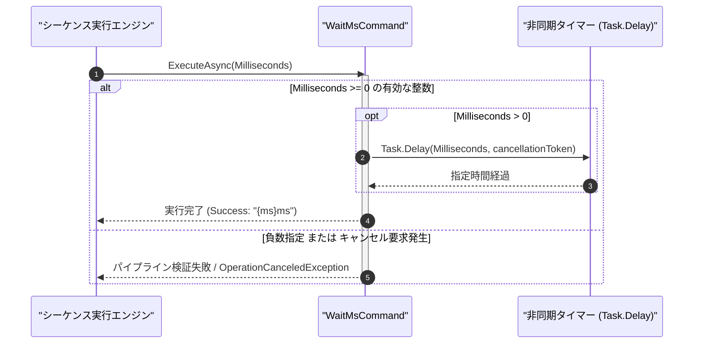

# コマンドリファレンス：WaitMs

## 概要

`WaitMs` は、指定されたミリ秒（`Milliseconds`）の間、UI スレッドをブロックすることなく非同期タイマー（`Task.Delay`）でシーケンス実行を一時待機する共通待機・同期制御系コマンドです。  
リレー接点のチャタリング収束待ちや機器コマンド間の短いインターバル確保で使用します。

> 💡 **補足**  
> 待機中はキャンセルトークン（`CancellationToken`）を監視しており、中断ボタン押下時には残りの待機時間を待たずに即座にキャンセル応答します。

---

## 💡 書式・パラメータ仕様

### コマンド構文

```csv
,SEQUENCE, [ステップキー], WaitMs, [待機ミリ秒(Milliseconds)]
```

### パラメータ（引数）一覧

| 引数位置 | 引数名 | 説明 | 指定方法 / 有効な入力値 |
| :--- | :--- | :--- | :--- |
| 引数1 | `Milliseconds` | 非同期待機する時間［ミリ秒］（必須・`0` 以上の整数）。 | `0` 以上の整数リテラル（例: `100`, `500`）または `$PARAM$` 置換 |

---

## 🔄 特殊置換規約・分岐規約の適用

本コマンドの引数における特殊記法および解釈ルールです。
* **動的置換（`$`）**: 引数内で `$PARAMキー$` のように記述すると、実行時に変数プール（PARAM）の値へ動的置換されます。（適用可能な引数: 引数 1 `Milliseconds`）
* **ジャンプ先指定（`#`）**: 本コマンドはジャンプ制御を行わないため適用されません。（適用可能な引数: 非適用）
* **共通コマンド指定（`@`）**: 本コマンドは外部マクロを呼び出さないため適用されません。（適用可能な引数: 非適用）
* **カンマのエスケープ**: 引数文字列自体にカンマを含める場合は、必ず `","` と二重引用符で囲んで記述します。
* **エイリアス（別名）**: `Delay`

---

## 💡 動作例（正しい構文での記述例）

### スクリプト記述例

※COMMAND ブロック配下の子要素行（PARAM, SEQUENCE）は必ず行頭カンマから開始し、スペースインデントや行末コメント（`;`）は記述しないでください。

```csv
COMMAND, "SETTLE_DELAY_MS", ""
,PARAM, "SETTLE_MS", Number, "セトリング待機(ms)", "250"
; 出力変更後に 250ms 非同期待機してから次ステップへ進行
,SEQUENCE, 010, WaitMs, "$SETTLE_MS$"
,SEQUENCE, 020, Exit
```

### 実行時の挙動・変数変化

* **実行前の状態**: `"SETTLE_MS"` が `"250"` に設定されている状態。
* **実行後の状態**: ステップ `010` で UI 応答性を維持したまま `250` ミリ秒間待機し、完了メッセージ `"250ms"` とともにステップ `020` へ進みます。

---

## 🔄 動作フロー（シーケンス図）

本コマンド実行時における、シーケンス実行エンジン、`WaitMsCommand`、および非同期タイマー間のインタラクションを示すシーケンス図です。



---

## 🚫 エラーハンドリング・安全設計（仕様制限）

入力データの異常や実行時エラーに対し、解析・実行エンジンが実行するセーフティ規約です。

1. **負数待機時間の事前排除（`min: 0`）**:
   - `-1` などの負数が指定された場合、`ArgumentOutOfRangeException` を防ぐため `ParameterSpec` の `min: 0` 制約で実行前にエラー検出します。
2. **`Thread.Sleep` 不使用による UI フリーズ完全防止**:
   - スレッド同期スリープを一切用いず `await Task.Delay` で待機するため、長時間待機中でも画面描画やキャンセル操作が妨げられません。

---

## 🧪 ユニットテスト仕様

本コマンドクラス（`WaitMsCommand.cs` 内 `WaitMsCommand`）に実装されている `RunUnitTest()` メソッドが検証するユニットテストの仕様です。

### テスト実行前提条件

* **実行トリガー**: `RunUnitTest()` メソッドの呼び出し
* **有効化条件**: システム全体の最小ログレベル（`ErrorLogger.MinimumLevel`）が `LogLevel.Test` であること（それ以外の場合は無効化ガードにより早期リターン）
* **検証結果出力**: `_log.LogTest` によるログ出力。検証失敗時は `_log.LogError`、予期せぬ例外発生時は `_log.LogCritical` で記録。

### テストケース一覧

| No | テストカテゴリ | テスト条件（入力値） | 期待される結果（出力値） | 検証の目的 / 観点 |
| :---: | :--- | :--- | :--- | :--- |
| **1** | 正常系 | 引数 `("5")`（5 ミリ秒）を指定して実行 | 非同期待機完了後に `Status == Success` を返却 | ミリ秒非同期待機の基本動作検証 |
| **2** | 異常系・境界値 | 境界値 `("0")` の実行、および負数 `("-1")` の検証を実行 | `"0"` は `Status == Success` で即時完了し、`"-1"` は `IsValid == false` で安全拒否 | 0ms 即時通過および下限境界（`min: 0`）検証の確認 |

