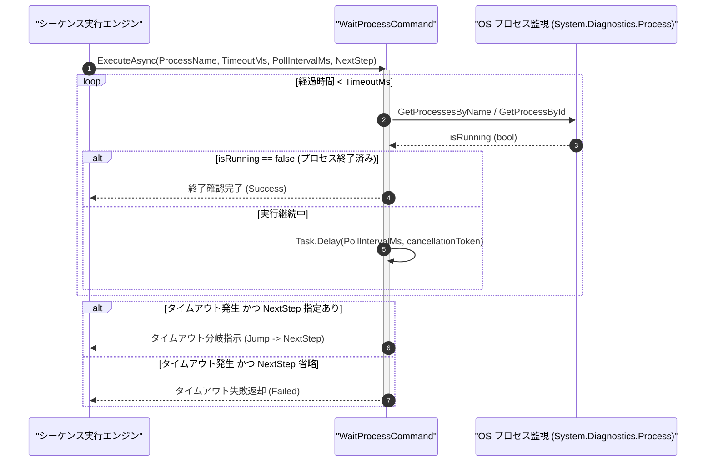

# コマンドリファレンス：WaitProcess

## 概要

`WaitProcess` は、指定されたプロセス名またはプロセス ID（`ProcessName`）の外部プロセスが終了するまで一定周期（`PollIntervalMs`）で非同期監視を行う共通待機・同期制御系コマンドです。  
バックグラウンドで起動中の外部ツール、ファームウェア書込ユーティリティ、またはバッチ処理の完全終了を待ち合わせる際に使用します。

> 💡 **補足**  
> `ProcessName` には拡張子 `.exe` 付き／なしのプロセス名（例: `"fw_updater.exe"` または `"fw_updater"`）のほか、数値のプロセス ID（PID）を指定することも可能です。対象プロセスが最初から存在しない場合は「終了済み」として即座に正常完了します。

---

## 💡 書式・パラメータ仕様

### コマンド構文

```csv
,SEQUENCE, [ステップキー], WaitProcess, "[プロセス名またはPID(ProcessName)]", "[タイムアウトms(TimeoutMs)]", "[ポーリング周期ms(PollIntervalMs)]", "[タイムアウト時遷移先(NextStep)]"
```

### パラメータ（引数）一覧

| 引数位置 | 引数名 | 説明 | 指定方法 / 有効な入力値 |
| :--- | :--- | :--- | :--- |
| 引数1 | `ProcessName` | 終了を待機する対象のプロセス名または PID（必須）。 | プロセス名（例: `"calc"`, `"batch_tool.exe"`）または整数 PID |
| 引数2 | `TimeoutMs` | 最大待機タイムアウト時間［ミリ秒］（任意・既定値: `10000`）。 | `10` 〜 `600000` の整数または `$PARAM$` 置換 |
| 引数3 | `PollIntervalMs` | プロセス生存確認のポーリング間隔［ミリ秒］（任意・既定値: `200`）。 | `20` 〜 `5000` の整数または `$PARAM$` 置換 |
| 引数4 | `NextStep` | タイムアウト発生時のジャンプ先ラベルまたはステップ番号（任意・既定値: `""`＝失敗停止）。 | `#ラベル名#` またはステップ番号（省略時は `Failed`） |

---

## 🔄 特殊置換規約・分岐規約の適用

本コマンドの引数における特殊記法および解釈ルールです。
* **動的置換（`$`）**: 引数内で `$PARAMキー$` のように記述すると、実行時に変数プール（PARAM）の値へ動的置換されます。（適用可能な引数: 全引数対応）
* **ジャンプ先指定（`#`）**: タイムアウト時の遷移先ラベルを `#ラベル名#` で指定できます。（適用可能な引数: 引数 4 `NextStep`）
* **共通コマンド指定（`@`）**: 本コマンドは外部マクロを呼び出さないため適用されません。（適用可能な引数: 非適用）
* **カンマのエスケープ**: 引数文字列自体にカンマを含める場合は、必ず `","` と二重引用符で囲んで記述します。
* **エイリアス（別名）**: `WaitForProcess`

---

## 💡 動作例（正しい構文での記述例）

### スクリプト記述例

※COMMAND ブロック配下の子要素行（PARAM, SEQUENCE）は必ず行頭カンマから開始し、スペースインデントや行末コメント（`;`）は記述しないでください。

```csv
COMMAND, "WAIT_UPDATER_EXIT", ""
,PARAM, "TARGET_PROC", Text, "監視対象プロセス名", "fw_writer.exe"
; fw_writer.exe が終了するまで最大 30000ms（200ms周期）待機
,SEQUENCE, 010, WaitProcess, "$TARGET_PROC$", 30000, 200, #PROC_TIMEOUT#
,SEQUENCE, 020, Exit
,SEQUENCE, #PROC_TIMEOUT#, SetError, -40, "外部プロセス終了待ちタイムアウト"
```

### 実行時の挙動・変数変化

* **実行前の状態**: `"TARGET_PROC"` に `"fw_writer.exe"` が設定されている状態。
* **実行後の状態**: `fw_writer` プロセスが終了した時点でステップ `010` が正常完了（`Success`）し、30 秒を超えても動作中の場合は `#PROC_TIMEOUT#` へ分岐します。

---

## 🔄 動作フロー（シーケンス図）

本コマンド実行時における、シーケンス実行エンジン、`WaitProcessCommand`、および OS プロセス管理 API 間のインタラクションを示すシーケンス図です。



---

## 🚫 エラーハンドリング・安全設計（仕様制限）

入力データの異常や実行時エラーに対し、解析・実行エンジンが実行するセーフティ規約です。

1. **拡張子自動正規化と終了済み PID 安全判定**:
   - `"tool.exe"` のように拡張子付きで指定された場合も `Path.GetFileNameWithoutExtension` で自動正規化し、PID 指定時に既にプロセスが消滅していた場合も安全に「終了済み」として扱います。
2. **タイムアウト保護およびポーリング下限ガード（`min: 20` ms）**:
   - ハングアップした外部プロセスによる永久停止を防ぐため `TimeoutMs` で確実に打ち切り、OS プロセス列挙負荷を抑えるため `PollIntervalMs` は `20` ms 以上に制限します。

---

## 🧪 ユニットテスト仕様

本コマンドクラス（`WaitMsCommand.cs` 内 `WaitProcessCommand`）に実装されている `RunUnitTest()` メソッドが検証するユニットテストの仕様です。

### テスト実行前提条件

* **実行トリガー**: `RunUnitTest()` メソッドの呼び出し
* **有効化条件**: システム全体の最小ログレベル（`ErrorLogger.MinimumLevel`）が `LogLevel.Test` であること（それ以外の場合は無効化ガードにより早期リターン）
* **検証結果出力**: `_log.LogTest` によるログ出力。検証失敗時は `_log.LogError`、予期せぬ例外発生時は `_log.LogCritical` で記録。

### テストケース一覧

| No | テストカテゴリ | テスト条件（入力値） | 期待される結果（出力値） | 検証の目的 / 観点 |
| :---: | :--- | :--- | :--- | :--- |
| **1** | 正常系 | 存在しないプロセス名 `("non_existing_proc_xyz_123", "100")` を指定 | 終了済みと判定され即座に `Status == Success` を返却 | プロセス非稼働時の正常完了判定検証 |
| **2** | 異常系 | `PollIntervalMs` に下限未満（`"5"`）または必須引数欠落を指定 | パイプライン検証で `IsValid == false` となり安全拒否 | パラメータ境界ガードの検証 |

