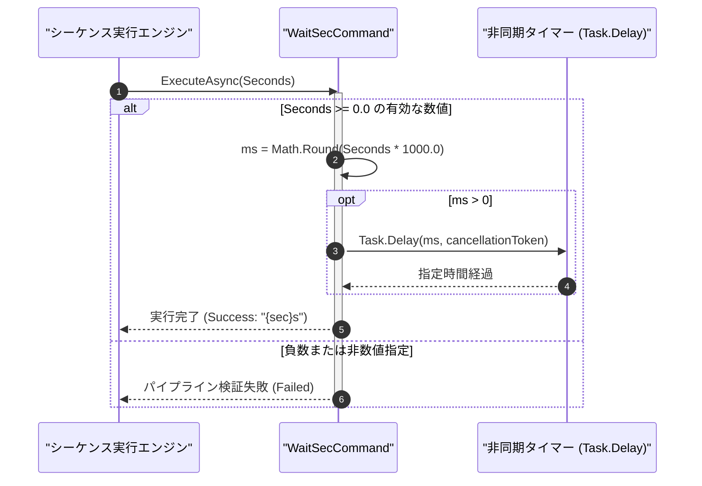

# コマンドリファレンス：WaitSec

## 概要

`WaitSec` は、指定された秒数（`Seconds`：小数指定対応）の間、非同期タイマー（`Task.Delay`）でシーケンス実行を一時待機する共通待機・同期制御系コマンドです。  
ウォームアップ待機やエージング時間確保など、秒単位（例: `1.5` 秒、`10` 秒）で直感的に待機時間を記述したい場合に使用します。

> 💡 **補足**  
> 内部で `Math.Round(Seconds * 1000.0)` によりミリ秒精度へ変換して非同期待機するため、`0.25` 秒（`250` ms）のような小数秒指定も可能です。

---

## 💡 書式・パラメータ仕様

### コマンド構文

```csv
,SEQUENCE, [ステップキー], WaitSec, [待機秒数(Seconds)]
```

### パラメータ（引数）一覧

| 引数位置 | 引数名 | 説明 | 指定方法 / 有効な入力値 |
| :--- | :--- | :--- | :--- |
| 引数1 | `Seconds` | 非同期待機する時間［秒］（必須・`0.0` 以上の実数）。 | `0.0` 以上の整数・小数リテラル（例: `1.5`, `0.5`, `10`）または `$PARAM$` 置換 |

---

## 🔄 特殊置換規約・分岐規約の適用

本コマンドの引数における特殊記法および解釈ルールです。
* **動的置換（`$`）**: 引数内で `$PARAMキー$` のように記述すると、実行時に変数プール（PARAM）の値へ動的置換されます。（適用可能な引数: 引数 1 `Seconds`）
* **ジャンプ先指定（`#`）**: 本コマンドはジャンプ制御を行わないため適用されません。（適用可能な引数: 非適用）
* **共通コマンド指定（`@`）**: 本コマンドは外部マクロを呼び出さないため適用されません。（適用可能な引数: 非適用）
* **カンマのエスケープ**: 引数文字列自体にカンマを含める場合は、必ず `","` と二重引用符で囲んで記述します。
* **エイリアス（別名）**: `WaitSeconds`

---

## 💡 動作例（正しい構文での記述例）

### スクリプト記述例

※COMMAND ブロック配下の子要素行（PARAM, SEQUENCE）は必ず行頭カンマから開始し、スペースインデントや行末コメント（`;`）は記述しないでください。

```csv
COMMAND, "WARMUP_WAIT_SEC", ""
,PARAM, "WAIT_S", Number, "安定待ち秒数(s)", "1.5"
; 電源投入後に 1.5 秒（1500ms）待機
,SEQUENCE, 010, WaitSec, "$WAIT_S$"
,SEQUENCE, 020, Exit
```

### 実行時の挙動・変数変化

* **実行前の状態**: `"WAIT_S"` が `"1.5"` に設定されている状態。
* **実行後の状態**: ステップ `010` にて `1500` ミリ秒へ換算されて非同期待機が行われ、経過後に正常完了（`Success`）でステップ `020` へ進みます。

---

## 🔄 動作フロー（シーケンス図）

本コマンド実行時における、シーケンス実行エンジン、`WaitSecCommand`、および非同期タイマー間のインタラクションを示すシーケンス図です。



---

## 🚫 エラーハンドリング・安全設計（仕様制限）

入力データの異常や実行時エラーに対し、解析・実行エンジンが実行するセーフティ規約です。

1. **負数秒指定の事前検証ガード（`min: 0.0`）**:
   - マイナスの秒数が指定された場合は `ParameterSpec.RequireDouble(min: 0.0)` によって実行前に拒否されます。
2. **キャンセル即時応答設計**:
   - 長時間の秒数待機中であっても、`CancellationToken` 発火時には即座に待機を解除して安全に中断します。

---

## 🧪 ユニットテスト仕様

本コマンドクラス（`WaitMsCommand.cs` 内 `WaitSecCommand`）に実装されている `RunUnitTest()` メソッドが検証するユニットテストの仕様です。

### テスト実行前提条件

* **実行トリガー**: `RunUnitTest()` メソッドの呼び出し
* **有効化条件**: システム全体の最小ログレベル（`ErrorLogger.MinimumLevel`）が `LogLevel.Test` であること（それ以外の場合は無効化ガードにより早期リターン）
* **検証結果出力**: `_log.LogTest` によるログ出力。検証失敗時は `_log.LogError`、予期せぬ例外発生時は `_log.LogCritical` で記録。

### テストケース一覧

| No | テストカテゴリ | テスト条件（入力値） | 期待される結果（出力値） | 検証の目的 / 観点 |
| :---: | :--- | :--- | :--- | :--- |
| **1** | 正常系 | 小数秒引数 `("0.005")`（5 ミリ秒相当）を指定して実行 | 非同期待機完了後に `Status == Success` を返却 | 小数秒→ミリ秒換算待機の動作検証 |
| **2** | 異常系・境界値 | 境界値 `("0")` の実行、および負数 `("-0.5")` の検証を実行 | `"0"` は `Status == Success` で即時完了し、`"-0.5"` は `IsValid == false` で安全拒否 | 0秒即時通過および最小値境界（`0.0`）検証の確認 |

