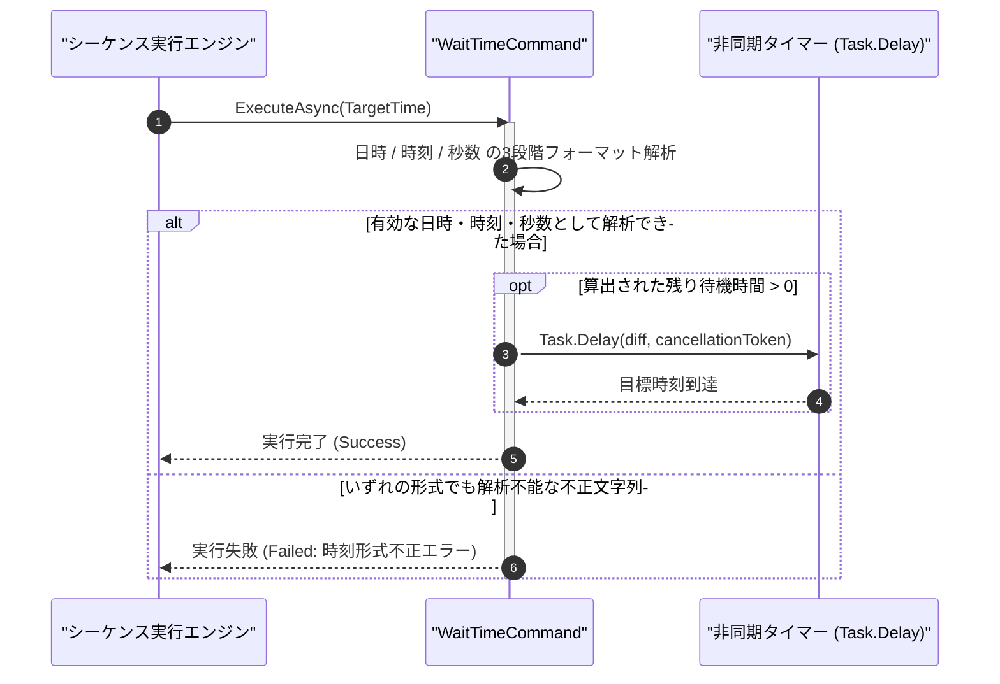

# コマンドリファレンス：WaitTime

## 概要

`WaitTime` は、指定された目標日時・時刻（`TargetTime`）に到達するまで非同期待機する共通待機・同期制御系コマンドです。  
定刻開始試験（例: `"09:00:00"` や `"2026-12-01 00:00:00"`）のほか、レガシー互換として秒数文字列（例: `"2.5"`）による相対時間待機にも対応しています。

> 💡 **補足**  
> `"HH:mm:ss"` のように時刻のみを指定し、その時刻が当日すでに過ぎている場合は自動的に **翌日の同一時刻** をターゲットとして算出します。一方、完全日時（`"yyyy-MM-dd HH:mm:ss"`）で過去日時が指定された場合は待機せず即時完了します。

---

## 💡 書式・パラメータ仕様

### コマンド構文

```csv
,SEQUENCE, [ステップキー], WaitTime, "[目標日時・時刻または秒数(TargetTime)]"
```

### パラメータ（引数）一覧

| 引数位置 | 引数名 | 説明 | 指定方法 / 有効な入力値 |
| :--- | :--- | :--- | :--- |
| 引数1 | `TargetTime` | 待機目標の日時・時刻文字列、または相対待機秒数（必須）。 | `"yyyy-MM-dd HH:mm:ss"`、`"HH:mm:ss"`、または秒数（`"1.5"`） |

---

## 🔄 特殊置換規約・分岐規約の適用

本コマンドの引数における特殊記法および解釈ルールです。
* **動的置換（`$`）**: 引数内で `$PARAMキー$` のように記述すると、実行時に変数プール（PARAM）の値へ動的置換されます。（適用可能な引数: 引数 1 `TargetTime`）
* **ジャンプ先指定（`#`）**: 本コマンドはジャンプ制御を行わないため適用されません。（適用可能な引数: 非適用）
* **共通コマンド指定（`@`）**: 本コマンドは外部マクロを呼び出さないため適用されません。（適用可能な引数: 非適用）
* **カンマのエスケープ**: 引数文字列自体にカンマを含める場合は、必ず `","` と二重引用符で囲んで記述します。
* **エイリアス（別名）**: `WaitUntilTime`, `WaitClock`, `Analysis_Term_WaitTime`

---

## 💡 動作例（正しい構文での記述例）

### スクリプト記述例

※COMMAND ブロック配下の子要素行（PARAM, SEQUENCE）は必ず行頭カンマから開始し、スペースインデントや行末コメント（`;`）は記述しないでください。

```csv
COMMAND, "SCHEDULED_START", ""
,PARAM, "START_CLOCK", Text, "測定開始時刻", "13:00:00"
; 指定時刻 13:00:00 になるまで非同期待機してから測定開始
,SEQUENCE, 010, WaitTime, "$START_CLOCK$"
,SEQUENCE, 020, Exit
```

### 実行時の挙動・変数変化

* **実行前の状態**: 現在時刻が `12:59:55`、`"START_CLOCK"` が `"13:00:00"` の状態。
* **実行後の状態**: ステップ `010` で残り `5` 秒間非同期待機し、`13:00:00` 到達とともに正常完了（`Success`）でステップ `020` へ進みます。

---

## 🔄 動作フロー（シーケンス図）

本コマンド実行時における、シーケンス実行エンジン、`WaitTimeCommand`、および非同期タイマー間のインタラクションを示すシーケンス図です。



---

## 🚫 エラーハンドリング・安全設計（仕様制限）

入力データの異常や実行時エラーに対し、解析・実行エンジンが実行するセーフティ規約です。

1. **不正な日時・時刻文字列に対する安全エラー返却**:
   - 日時・時刻・数値のいずれとしてもパースできない文字列（例: `"INVALID_TIME"`）が渡された場合、例外クラッシュさせず `AnalysisResult.Failed` を返却して停止します。
2. **過去完全日時指定時の無限待機防止**:
   - `"2020-01-01 00:00:00"` のように過去の完全日時が指定された場合は `diff <= 0` と判定して即座に正常完了させ、フリーズを防止します。

---

## 🧪 ユニットテスト仕様

本コマンドクラス（`WaitMsCommand.cs` 内 `WaitTimeCommand`）に実装されている `RunUnitTest()` メソッドが検証するユニットテストの仕様です。

### テスト実行前提条件

* **実行トリガー**: `RunUnitTest()` メソッドの呼び出し
* **有効化条件**: システム全体の最小ログレベル（`ErrorLogger.MinimumLevel`）が `LogLevel.Test` であること（それ以外の場合は無効化ガードにより早期リターン）
* **検証結果出力**: `_log.LogTest` によるログ出力。検証失敗時は `_log.LogError`、予期せぬ例外発生時は `_log.LogCritical` で記録。

### テストケース一覧

| No | テストカテゴリ | テスト条件（入力値） | 期待される結果（出力値） | 検証の目的 / 観点 |
| :---: | :--- | :--- | :--- | :--- |
| **1** | 正常系 | 秒数互換文字列 `("0.005")` および過去日時文字列を指定 | いずれも `Status == Success` で正常完了 | 秒数フォールバックおよび過去日時即時通過の検証 |
| **2** | 異常系 | 解析不能な文字列（`"NOT_A_TIME"`）を指定して実行 | 例外送出せず `Status == Failed` を返却 | 不正時刻入力時の安全エラー処理検証 |

