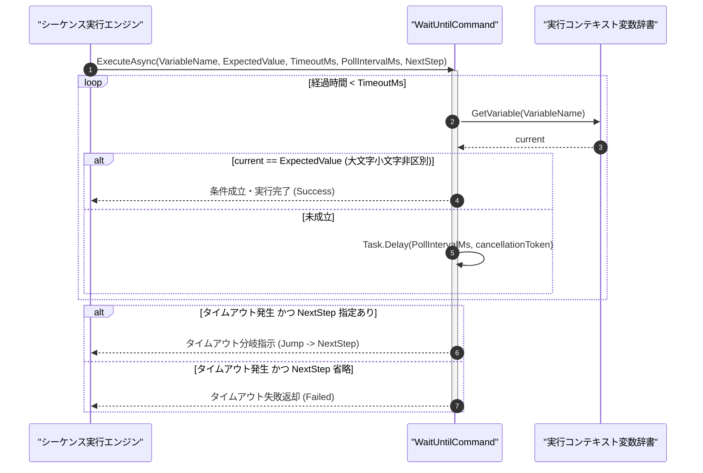

# コマンドリファレンス：WaitUntil

## 概要

`WaitUntil` は、指定された変数（`VariableName`）の値が期待値（`ExpectedValue`）と等しくなるまで一定間隔（`PollIntervalMs`）で非同期ポーリング監視を行う共通待機・同期制御系コマンドです。  
バックグラウンド通知や共有状態変数が `"READY"` へ変化するまで待機し、タイムアウト時には指定ラベル（`NextStep`）へ分岐する用途で使用します。

> 💡 **補足**  
> 文字列比較は大文字・小文字を区別しない形式（`OrdinalIgnoreCase`）で行われます。タイムアウト発生時、`NextStep` が指定されていればそのステップ／ラベルへジャンプし、省略時は `Failed` を返却します。

---

## 💡 書式・パラメータ仕様

### コマンド構文

```csv
,SEQUENCE, [ステップキー], WaitUntil, "[監視変数名(VariableName)]", "[期待値(ExpectedValue)]", "[タイムアウトms(TimeoutMs)]", "[ポーリング周期ms(PollIntervalMs)]", "[タイムアウト時遷移先(NextStep)]"
```

### パラメータ（引数）一覧

| 引数位置 | 引数名 | 説明 | 指定方法 / 有効な入力値 |
| :--- | :--- | :--- | :--- |
| 引数1 | `VariableName` | 値を監視する対象変数名（必須）。 | 変数識別子（例: `"Status"`, `"READY_FLG"`）または `$PARAM$` 置換 |
| 引数2 | `ExpectedValue` | 待機完了とみなす期待値文字列（必須）。 | 文字列リテラル（例: `"READY"`, `"1"`）または `$PARAM$` 置換 |
| 引数3 | `TimeoutMs` | 最大待機タイムアウト時間［ミリ秒］（任意・既定値: `5000`）。 | `10` 〜 `600000` の整数または `$PARAM$` 置換 |
| 引数4 | `PollIntervalMs` | 変数再確認のポーリング間隔［ミリ秒］（任意・既定値: `50`）。 | `5` 〜 `5000` の整数または `$PARAM$` 置換 |
| 引数5 | `NextStep` | タイムアウト発生時のジャンプ先ラベルまたはステップ番号（任意・既定値: `""`＝失敗停止）。 | `#ラベル名#` またはステップ番号（省略時は `Failed`） |

---

## 🔄 特殊置換規約・分岐規約の適用

本コマンドの引数における特殊記法および解釈ルールです。
* **動的置換（`$`）**: 引数内で `$PARAMキー$` のように記述すると、実行時に変数プール（PARAM）の値へ動的置換されます。（適用可能な引数: 全引数対応）
* **ジャンプ先指定（`#`）**: タイムアウト時の遷移先ラベルを `#ラベル名#` で指定できます。（適用可能な引数: 引数 5 `NextStep`）
* **共通コマンド指定（`@`）**: 本コマンドは外部マクロを呼び出さないため適用されません。（適用可能な引数: 非適用）
* **カンマのエスケープ**: 引数文字列自体にカンマを含める場合は、必ず `","` と二重引用符で囲んで記述します。
* **エイリアス（別名）**: `WaitCondition`

---

## 💡 動作例（正しい構文での記述例）

### スクリプト記述例

※COMMAND ブロック配下の子要素行（PARAM, SEQUENCE）は必ず行頭カンマから開始し、スペースインデントや行末コメント（`;`）は記述しないでください。

```csv
COMMAND, "WAIT_DEVICE_READY", ""
,PARAM, "DEV_STATE", Work, "機器準備状態", "READY"
; DEV_STATE が "READY" になるまで最大 3000ms（100ms周期）待機し、超過時は #TIMEOUT_ERR# へ分岐
,SEQUENCE, 010, WaitUntil, "DEV_STATE", "READY", 3000, 100, #TIMEOUT_ERR#
,SEQUENCE, 020, Exit
,SEQUENCE, #TIMEOUT_ERR#, SetError, -20, "機器準備完了待ちタイムアウト"
```

### 実行時の挙動・変数変化

* **実行前の状態**: 変数 `"DEV_STATE"` が `"READY"` に設定されている状態。
* **実行後の状態**: ステップ `010` の初回チェックで `"READY"` 一致が確認され、即座に正常完了（`Success`）してステップ `020` へ進みます。

---

## 🔄 動作フロー（シーケンス図）

本コマンド実行時における、シーケンス実行エンジン、`WaitUntilCommand`、および実行コンテキスト変数辞書間のインタラクションを示すシーケンス図です。



---

## 🚫 エラーハンドリング・安全設計（仕様制限）

入力データの異常や実行時エラーに対し、解析・実行エンジンが実行するセーフティ規約です。

1. **ポーリング周期およびタイムアウト上限の境界保護**:
   - CPU ビジーループを防ぐため `PollIntervalMs` は最小 `5` ms 以上、無限待機を防ぐため `TimeoutMs` は最大 `600000` ms（10 分）以内に制限されています。
2. **タイムアウト時の安全なリカバリ分岐**:
   - `WaitCommandHelper.CreateTimeoutResult` により、`NextStep` 指定時は例外を投げずに指定エラー処理ステップへクリーンにジャンプします。

---

## 🧪 ユニットテスト仕様

本コマンドクラス（`WaitMsCommand.cs` 内 `WaitUntilCommand`）に実装されている `RunUnitTest()` メソッドが検証するユニットテストの仕様です。

### テスト実行前提条件

* **実行トリガー**: `RunUnitTest()` メソッドの呼び出し
* **有効化条件**: システム全体の最小ログレベル（`ErrorLogger.MinimumLevel`）が `LogLevel.Test` であること（それ以外の場合は無効化ガードにより早期リターン）
* **検証結果出力**: `_log.LogTest` によるログ出力。検証失敗時は `_log.LogError`、予期せぬ例外発生時は `_log.LogCritical` で記録。

### テストケース一覧

| No | テストカテゴリ | テスト条件（入力値） | 期待される結果（出力値） | 検証の目的 / 観点 |
| :---: | :--- | :--- | :--- | :--- |
| **1** | 正常系 | `"Status" = "READY"` 状態で `("Status", "READY", "100")` を実行 | 即座に `Status == Success` で正常完了 | 条件一致時の待機完了動作検証 |
| **2** | 異常系 | 不一致値 `"BUSY"` で `("Status", "BUSY", "40", "10", "JumpStep5")` を実行 | 40ms 経過後に `Status == Jump`（`"JumpStep5"`）を返却 | タイムアウト検出と分岐遷移の検証 |

