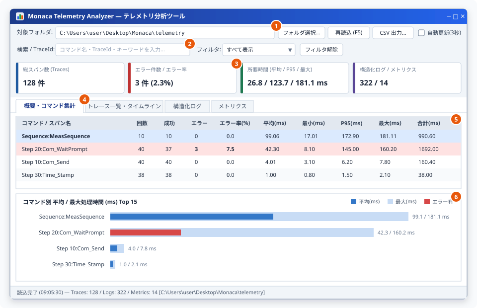
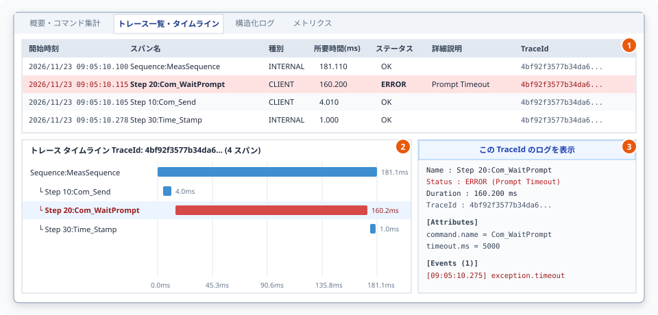

# Monaca Telemetry Analyzer（テレメトリ分析ツール）操作説明書

## 1. 概要

**Monaca Telemetry Analyzer（テレメトリ分析ツール）** は、Monaca 共通解析エンジン（`Monaca.Common.Analysis`）が出力する NDJSON（JSON Lines）形式のテレメトリログ群を視覚的に集計・分析する GUI ツールです。

本機能は Excel 共通基盤（`Monaca.Common.Excel.Core.dll`）に統合されており、 **`TermAddIn` および `GpibAddIn` の Excel リボン「アドイン」タブ →「ツール」グループ →「テレメトリ分析」ボタン** からワンクリックで起動できます。

### 対象ファイル

| ファイル名 | 記録内容 |
| :--- | :--- |
| **`telemetry_traces.jsonl`** | コマンド／ミニシーケンス実行時のスパン情報（処理名、開始・終了時刻、所要時間、成否、親子関係、属性、イベント） |
| **`telemetry_logs.jsonl`** | 解析エンジン実行中の構造化ログ（時刻、重大度、ロガー名、メッセージ、`TraceId` / `SpanId`、属性） |
| **`telemetry_metrics.jsonl`** | カウンタ・ヒストグラム等のメトリクスデータポイント（時刻、メトリクス名、値、合計、最小、最大、タグ） |

> [!NOTE]
> **既定の出力先フォルダ**: 通常は `ErrorLogger.FileDir\telemetry\`（例：`%USERPROFILE%\Desktop\Monaca\telemetry\`）に自動出力されます。本ツールは起動時にこの既定フォルダを自動検出し、他プロセスが追記中でも安全に読み込める共有読み取りモードで開きます。

---

## 2. 起動方法

Excel の「アドイン」タブ → 共通「ツール」グループ → **「テレメトリ分析 (`Telemetry_Analyzer`)」** をクリックします。既に開いている場合は最新データへ再読み込みしつつ最前面に表示されます。

---

## 3. 画面構成と主な機能

| 図番 | 画面エリア | 主な機能 |
| :---: | :--- | :--- |
| **①** | ** 上部ツールバー** | 対象フォルダ指定、`フォルダ選択...`、`再読込 (F5)`、`CSV 出力...`、`自動更新(3秒)` チェックボックス |
| **②** | ** 検索・フィルタバー** | コマンド名・メッセージ・`TraceId`・属性値のインクリメンタル検索、`すべて表示` / `ERROR` / `WARN+` 絞り込み |
| **③** | **KPI サマリーカード帯** | 総スパン数、エラー件数／エラー率、平均／P95／最大所要時間、構造化ログ／メトリクス件数を常時表示 |
| **④** | ** 分析タブバー** | `概要・コマンド集計` / `トレース一覧・タイムライン` / `構造化ログ` / `メトリクス` の 4 タブ切替 |
| **⑤** | ** コマンド別集計表** | コマンド／スパンごとの実行回数・成功・エラー・エラー率・平均/最小/P95/最大/合計時間 (ms) を集計（ダブルクリックでトレースへ遷移） |
| **⑥** | ** 処理時間棒グラフ** | コマンド別の平均／最大処理時間 Top 15 を水平棒グラフ表示（エラー発生コマンドは赤色で強調） |

### 3.1 上部ツールバー・フィルタ
- **対象フォルダ / `フォルダ選択...`**: 任意の `telemetry` フォルダを選択できます（ウィンドウへのフォルダ／`.jsonl` ファイルのドラッグ＆ドロップにも対応）。
- **`再読込 (F5)`**: 対象フォルダの最新ログを再読み込みします。
- **`CSV 出力...`**: 現在表示中のタブ（集計表・トレース一覧・構造化ログ一覧）を、フィルタ適用後の状態で Shift-JIS CSV ファイルへ出力します。
- **`自動更新 (3秒)`**: チェックを入れると 3 秒間隔で自動的に最新データを取り込みます（リアルタイム監視向け）。
- **検索 / `TraceId` ＆ フィルタ**: コマンド名・メッセージ・`TraceId`・属性値でのインクリメンタル検索、および `すべて表示` / `エラーのみ (ERROR)` / `警告以上 (WARN+)` の絞り込みが可能です。

### 3.2 KPI サマリーカード帯
画面上部に 4 つの指標カードを常時表示します（検索・フィルタに連動）。
- **総スパン数 (Traces)**: 表示対象のスパン総数
- **エラー件数 / エラー率**: `STATUS=ERROR` のスパン件数と割合（％）
- **所要時間 (平均 / P95 / 最大)**: 処理時間の平均・95 パーセンタイル・最大値（ms）
- **構造化ログ / メトリクス**: 表示中の構造化ログ件数およびメトリクス件数

### 3.3 分析タブ（4 タブ構成）

| タブ名 | 主な機能 |
| :--- | :--- |
| **概要・コマンド集計** | コマンド／スパン名ごとの実行回数・成功数・エラー数・エラー率・平均/最小/P95/最大/合計時間 (ms) を自動集計表示します。エラーを含む行は淡赤で強調され、行をダブルクリックするとそのコマンド名で「トレース一覧」タブへ自動遷移します。下段には平均／最大処理時間 Top 15 の水平棒グラフを表示します。 |
| **トレース一覧・タイムライン ** | 個別スパンを時系列降順で一覧表示します。行を選択すると下段左に同一 `TraceId` の親子スパン構成を ** ウォーターフォールタイムライン** で描画し、下段右に属性（Attributes）とイベント（Events）詳細を表示します。「この TraceId のログを表示」ボタンで該当 `TraceId` の構造化ログへ即座に絞り込み移動できます。 |
| **構造化ログ** | `telemetry_logs.jsonl` の一覧を重大度別の色分け（ERROR/FATAL: 赤系、WARN: 黄系）で表示します。行を選択すると下段にメッセージ全文と整形済み Raw JSON を表示します。 |
| **メトリクス** | `telemetry_metrics.jsonl` に記録されたメトリクス名・種別・単位・Value・Count・Sum・Min・Max・Tags を一覧表示します。 |

| 図番 | 画面エリア | 主な機能 |
| :---: | :--- | :--- |
| **①** | ** スパン一覧テーブル** | 時系列降順で全スパンを表示（エラー終了スパンは淡赤で強調表示） |
| **②** | ** ウォーターフォールタイムライン** | 選択スパンと同一 `TraceId` に属する親子スパンの処理時間軸を階層表示 |
| **③** | ** 詳細インスペクタ＆ログ連携** | 属性（Attributes）・イベント（Events）の詳細表示、および「この TraceId のログを表示」ボタンによる構造化ログへのワンクリック遷移 |

---

## 4. よくある活用パターン

- **遅いコマンドの特定**: 「概要・コマンド集計」タブの棒グラフまたは `P95(ms)` / `最大(ms)` 列を確認し、ボトルネック行をダブルクリックして該当スパンのウォーターフォールを確認します。
- **エラー原因の追跡**: フィルタを `エラーのみ (ERROR)` に切り替え、「トレース一覧」で赤色のスパンを選択 →「この TraceId のログを表示」をクリックして前後の構造化ログを確認します。
- **Excel での二次分析**: `CSV 出力...` で集計結果やトレース一覧を Shift-JIS CSV に保存し、Excel でピボット集計や報告書作成に活用できます。
