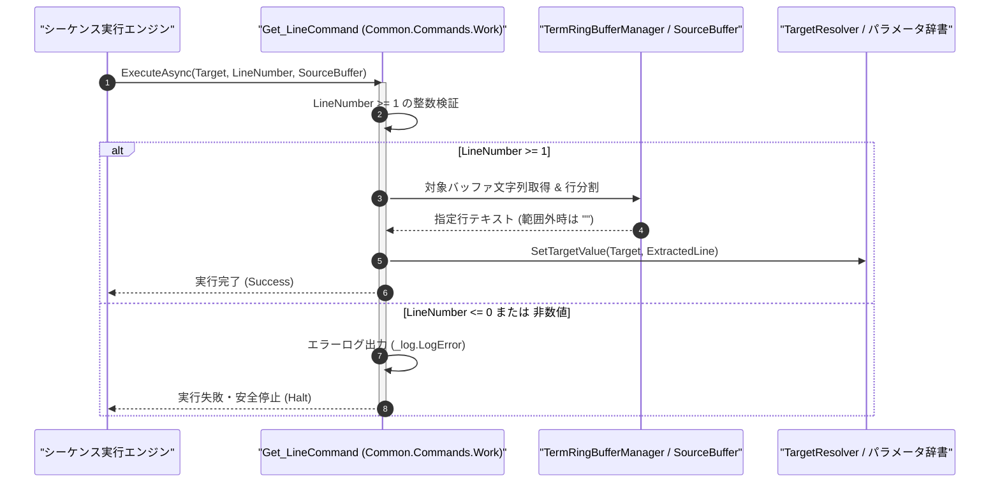

# コマンドリファレンス：Get_Line

## 概要

`Get_Line` は、Term 非同期受信リングバッファまたは指定されたワーク領域（`<SourceBuffer>`）内の指定行（`<LineNumber>`: 1 始まり）を抽出し、格納先パラメータ（`<Target>`）へ格納する Term / GPIB 共通データ・ワーク処理系コマンド（`Common.Commands.Work.dll`）です。  
複数行にわたるシリアル・Telnet 応答ログの中から特定の行のみを取り出す際に使用します。

> 💡 **補足**  
> 本コマンドは 共通基盤コマンドです。

---

## 💡 書式・パラメータ仕様

### コマンド構文

```csv
,SEQUENCE, [ステップキー], Get_Line, "[格納先キー(Target)]", "[行番号(LineNumber)]", "[取得元キー(SourceBuffer)]"
```

### パラメータ（引数）一覧

| 引数位置 | 引数名 | 説明 | 指定方法 / 有効な入力値 |
| :--- | :--- | :--- | :--- |
| 引数1 | Target | 抽出した 1 行テキストを格納するパラメータキーまたはレジスタ名（必須）。 | 自コマンド内の `PARAM` キー名（例: `"LINE_OUT"`, `"1"`） |
| 引数2 | LineNumber | 抽出する行番号（1 始まり・必須、フォーマット指定子対応）。 | 1 以上の整数（例: `"1"`, `"3"`）または `$PARAM$` 置換 |
| 引数3 | SourceBuffer | 抽出元の複数行テキストを保持するパラメータキー名（任意・省略可）。 | 省略時は Term 非同期受信リングバッファを対象とする |

---

## 🔄 特殊置換規約・分岐規約の適用

本コマンドの引数における特殊記法および解釈ルールです。
* **動的置換（`$`）**: 引数内で `$PARAMキー$` のように記述すると、実行時に変数プール（PARAM）の値へ動的置換されます。（適用可能な引数: 全引数対応）
* **ジャンプ先指定（`#`）**: 本コマンドはジャンプ制御を行わないため適用されません。（適用可能な引数: 非適用）
* **共通コマンド指定（`@`）**: 本コマンドは外部マクロを呼び出さないため適用されません。（適用可能な引数: 非適用）
* **カンマのエスケープ**: 引数文字列自体にカンマを含める場合は、必ず `","` と二重引用符で囲んで記述します。
* **エイリアス（別名）**: `GetLine`, `Analysis_Term_GetLine`, `GpibGetLine`

---

## 💡 動作例（正しい構文での記述例）

### スクリプト記述例

※COMMAND ブロック配下の子要素行（PARAM, SEQUENCE）は必ず行頭カンマから開始し、スペースインデントや行末コメント（`;`）は記述しないでください。

```csv
COMMAND, "EXTRACT_STAT_LINE", "SECOND_LINE"
,PARAM, "RAW_LOG", Work, "全受信ログ", ""
,PARAM, "SECOND_LINE", Work, "2行目抽出結果", ""
,SEQUENCE, 010, Com_Send, "STATUS"
,SEQUENCE, 020, Com_WaitPrompt, ">"
,SEQUENCE, 030, Set_Data, "RAW_LOG"
; RAW_LOG 内の 2 行目を抽出し SECOND_LINE へ格納
,SEQUENCE, 040, Get_Line, "SECOND_LINE", 2, "RAW_LOG"
```

### 実行時の挙動・変数変化

* **実行前の状態**: `"RAW_LOG"` に `"=== STATUS ===\r\nTEMP: 25.4C\r\nVOLT: 5.01V"` が格納されている状態。
* **実行後の状態**: ステップ `040` の `Get_Line` 実行により、2 行目の `"TEMP: 25.4C"` が `"SECOND_LINE"` に格納されます。

---

## 🔄 動作フロー（シーケンス図）

本コマンド実行時における、シーケンス実行エンジン、コマンドクラス（`Get_LineCommand`）、および受信バッファ／パラメータ辞書間のインタラクションを示すシーケンス図です。



---

## 🚫 エラーハンドリング・安全設計（仕様制限）

入力データの異常や実行時エラーに対し、解析・実行エンジンが実行するセーフティ規約です。

1. **バッファ行数を超える行番号指定時の安全空文字返却**:
   - 保持されている総行数を超える `<LineNumber>` が指定された場合は、例外を発生させず安全に空文字列 `""` を `<Target>` へ格納します。
2. **0 以下の行番号指定時のエラー停止**:
   - 1 始まり規約に反する `0` 以下の行番号が指定された場合は、エラーログ（`_log.LogError`）を記録して直ちに安全停止（Halt）します。

---

## 🧪 ユニットテスト仕様

本コマンドクラス（`Get_LineCommand.cs`）に実装されている `RunUnitTest()` メソッドが検証するユニットテストの仕様です。

### テスト実行前提条件

* **実行トリガー**: `RunUnitTest()` メソッドの呼び出し
* **有効化条件**: システム全体の最小ログレベル（`ErrorLogger.MinimumLevel`）が `LogLevel.Test` であること（それ以外の場合は無効化ガードにより早期リターン）
* **検証結果出力**: `_log.LogTest` によるログ出力。検証失敗時は `_log.LogError`、予期せぬ例外発生時は `_log.LogCritical` で記録。

### テストケース一覧

| No | テストカテゴリ | テスト条件（入力値） | 期待される結果（出力値） | 検証の目的 / 観点 |
| :---: | :--- | :--- | :--- | :--- |
| **1** | 正常系 | 3行テキストから2行目抽出（`"DST", "2", "SRC"`） | 2行目の文字列が `"DST"` に格納される | 行単位抽出の基本動作検証 |
| **2** | 正常系 | 存在しない行番号（`"99"`）を指定 | `"DST"` に空文字列 `""` が格納され `Success` 返却 | 範囲外行番号指定時の安全動作検証 |
| **3** | 異常系 | 0以下の行番号（`"0"`）を指定 | エラーログが出力され `Failure` で安全停止する | 不正行番号ガードの検証 |

