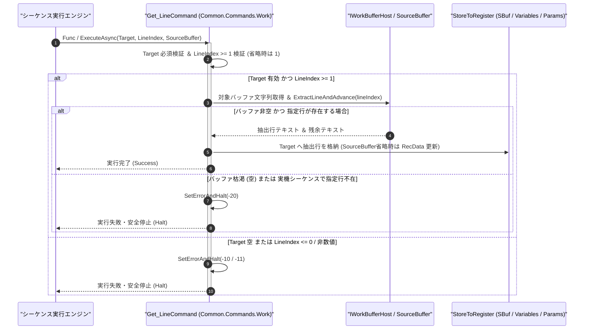

# コマンドリファレンス：Get_Line

## 概要

`Get_Line` は、通信受信バッファ（`RecData` / `ReceiveDataBuffer` / `ReceiveLineBuffer`）または指定されたワーク領域（`<SourceBuffer>`）内の指定行（`<LineIndex>`: 1 始まり、省略時は先頭 1 行目）を抽出し、格納先パラメータ（`<Target>`）へ格納する Term / GPIB 共通データ・ワーク処理系コマンド（`Common.Commands.Work.dll`）です。  
複数行にわたる通信応答ログの中から先頭行を順次取り出す場合や、特定の行番号のみを取り出す場合に使用します。

> 💡 **補足**  
> 本コマンドは共通基盤コマンドです。第 3 引数 `SourceBuffer` を省略して受信バッファから抽出した場合、抽出行より後の残余テキストで `RecData` が自動的に前進更新されます。

---

## 💡 書式・パラメータ仕様

### コマンド構文

```csv
,SEQUENCE, [ステップキー], Get_Line, "[格納先キー(Target)]", "[行番号(LineIndex): 1]", "[取得元キー(SourceBuffer)]"
```

### パラメータ（引数）一覧

| 引数位置 | 引数名 | 説明 | 指定方法 / 有効な入力値 |
| :--- | :--- | :--- | :--- |
| 引数1 | `Target` | 抽出した 1 行テキストを格納するパラメータキーまたはレジスタ名（必須）。 | 自コマンド内の `PARAM` キー名（例: `"LINE_OUT"`, `"1"`） |
| 引数2 | `LineIndex` | 抽出する行番号（1 始まり・任意・省略可・既定値: `1`）。省略時は先頭 1 行目を抽出します。 | `1`〜`1000000` の整数（例: `"1"`, `"2"`）または `$PARAM$` 置換 |
| 引数3 | `SourceBuffer` | 抽出元の複数行テキストを保持するパラメータキー名（任意・省略可・既定値: `""`）。 | 省略時は共通受信バッファ（`RecData` / `IWorkBufferHost`）を対象とする |

---

## 🔄 特殊置換規約・分岐規約の適用

本コマンドの引数における特殊記法および解釈ルールです。
* **動的置換（`$`）**: 引数内で `$PARAMキー$` のように記述すると、実行時に変数プール（PARAM）の値へ動的置換されます。（適用可能な引数: 全引数対応）
* **ジャンプ先指定（`#`）**: 本コマンドはジャンプ制御を行わないため適用されません。（適用可能な引数: 非適用）
* **共通コマンド指定（`@`）**: 本コマンドは外部マクロを呼び出さないため適用されません。（適用可能な引数: 非適用）
* **カンマのエスケープ**: 引数文字列自体にカンマを含める場合は、必ず `","` と二重引用符で囲んで記述します。
* **エイリアス（別名）**: `LineGet`, `Term_GetLine`, `Analysis_Term_GetLine`, `Gpib_GetLine`

---

## 💡 動作例（正しい構文での記述例）

### スクリプト記述例

※COMMAND ブロック配下の子要素行（PARAM, SEQUENCE）は必ず行頭カンマから開始し、スペースインデントや行末コメント（`;`）は記述しないでください。

```csv
COMMAND, "EXTRACT_STAT_LINE", "SECOND_LINE"
,PARAM, "RAW_LOG", Work, "全受信ログ", ""
,PARAM, "FIRST_LINE", Work, "先頭行抽出結果", ""
,PARAM, "SECOND_LINE", Work, "2行目抽出結果", ""
,SEQUENCE, 010, Com_Send, "STATUS"
,SEQUENCE, 020, Com_WaitPrompt, ">"
,SEQUENCE, 030, Set_Data, "RAW_LOG"
; LineIndex 省略（既定値 1）により受信バッファの先頭行を FIRST_LINE へ抽出
,SEQUENCE, 040, Get_Line, "FIRST_LINE"
; RAW_LOG 内の 2 行目を抽出し SECOND_LINE へ格納
,SEQUENCE, 050, Get_Line, "SECOND_LINE", 2, "RAW_LOG"
```

### 実行時の挙動・変数変化

* **実行前の状態**: 受信バッファおよび `"RAW_LOG"` に `"=== STATUS ===\r\nTEMP: 25.4C\r\nVOLT: 5.01V"` が格納されている状態。
* **実行後の状態**: ステップ `040` の `Get_Line`（`LineIndex` 省略＝`1`）により先頭行 `"=== STATUS ==="` が `"FIRST_LINE"` に格納されて残余バッファが前進し、ステップ `050` の `Get_Line` により `"RAW_LOG"` の 2 行目 `"TEMP: 25.4C"` が `"SECOND_LINE"` に格納されます。

---

## 🔄 動作フロー（シーケンス図）

本コマンド実行時における、シーケンス実行エンジン、コマンドクラス（`Get_LineCommand`）、および受信バッファ／パラメータ辞書間のインタラクションを示すシーケンス図です。



---

## 🚫 エラーハンドリング・安全設計（仕様制限）

入力データの異常や実行時エラーに対し、解析・実行エンジンが実行するセーフティ規約です。

1. **受信バッファ枯渇（空状態）および行不在時の安全停止**:
   - 対象バッファが空（未受信または枯渇状態）の場合、または実機シーケンス実行（`Func`）において総行数を超える `LineIndex` が指定された場合は、`SetErrorAndHalt(-20, ...)`（`ExecuteAsync` で空バッファ時は `Failed`）により例外クラッシュを防いで安全停止します。
2. **`0` 以下の行番号または非数値指定時のエラー停止**:
   - 1 始まり規約に反する `0` 以下の行番号や非数値文字列が `LineIndex` に指定された場合は、`SetErrorAndHalt(-11, ...)` を記録して直ちに安全停止（Halt）します。

---

## 🧪 ユニットテスト仕様

本コマンドクラス（`Get_LineCommand.cs`）に実装されている `RunUnitTest()` メソッドが検証するユニットテストの仕様です。

### テスト実行前提条件

* **実行トリガー**: `RunUnitTest()` メソッドの呼び出し
* **有効化条件**: システム全体の最小ログレベル（`ErrorLogger.MinimumLevel`）が `LogLevel.Test` であること（それ以外の場合は無効化ガードにより早期リターン）
* **検証結果出力**: `_log.LogTest` によるログ出力。検証失敗時は `_log.LogError`、予期せぬ例外発生時は `_log.LogCritical` で記録し、`finally` ブロックでテスト用 `SBuf` および `Variables` をクリアします。

### テストケース一覧

| No | テストカテゴリ | テスト条件（入力値） | 期待される結果（出力値） | 検証の目的 / 観点 |
| :---: | :--- | :--- | :--- | :--- |
| **1** | 正常系 | `ReceiveDataBuffer = "LINE_1_DATA\r\nLINE_2_DATA"` に対し `LineIndex` 省略 `("REG_LINE")` で実行 | `"REG_LINE"` に `"LINE_1_DATA"` が格納され、`RecData` が `"LINE_2_DATA"` へ進行する | `LineIndex` 省略時（既定値 `1`）の先頭行抽出と残余バッファ進行の検証 |
| **2** | 正常系 | `ReceiveDataBuffer = "LINE_A\r\nLINE_B\r\nLINE_C"` に対し `("REG_LINE2", "2")` を指定して実行 | `"REG_LINE2"` に 2 行目の `"LINE_B"` がエラーなく格納される | `LineIndex = 2` 明示指定による任意行抽出の検証 |
| **3** | 異常系 | 受信バッファが空の状態でヘッドレスモード（`IsHeadless = true`）にて `("REG_EMPTY")` を実行 | `HasError == true`・`jump == true`・`lstep == "-1"` で安全停止する | バッファ枯渇・空状態におけるエラー停止防護の検証 |
| **4** | 正常系 | `"RAW_LOG"` に `"HDR\r\nSTAT_OK\r\nEND"` を格納し `("SECOND_LINE", "2", "RAW_LOG")` を実行 | `"SECOND_LINE"` に `"STAT_OK"` がエラーなく格納される | 第 3 引数 `SourceBuffer` 指定による任意パラメータからの行抽出検証 |

