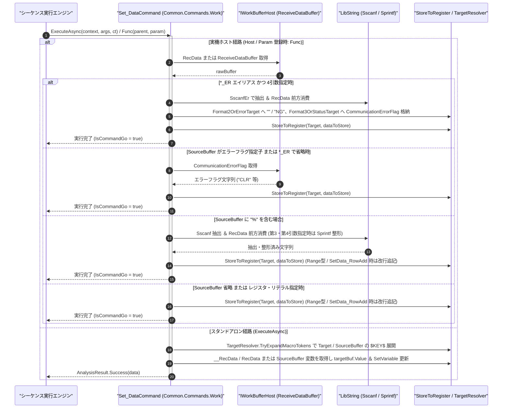

# コマンドリファレンス：Set_Data

## 概要

`Set_Data` は、共通ワークバッファホスト（`IWorkBufferHost`：Term 受信バッファ `ReceiveDataBuffer` ／ GPIB `SBuf` ／ `RecData`）または指定された取得元（`SourceBuffer`）からデータを取得し、指定されたターゲット（`Target`：コマンドパラメータ `PARAM`、文字列バッファ `SBuf`、およびコンテキスト変数 `Variables`）へ格納する共通データ・ワーク処理系コマンド（`Common.Commands.Work.dll`）です。  
全文取り込みのほか、実機ホスト経路（`Func`）では `"%"` 書式指定による `Sscanf` データ抽出とバッファ前方消費、最大 2 段階の `Sprintf` 書式整形、`Range` 型パラメータや `SetData_RowAdd` エイリアスによる改行区切り行追記、および通信エラーフラグ状態の取得に対応しています。

> 💡 **補足**  
> 本コマンドは共通基盤コマンドです。第 2 引数省略時は受信バッファ全文を末尾の改行コード（`\r\n`）をトリムせずそのまま格納します。実機ホスト経路（`Func`：`Host` / `Param` 登録時）では、第 2 引数へのエラーフラグ指定子（`"COM_ERR_FLG"`, `"ERR_FLG"`, `"ER"`, `"ERR"`, `"ERROR"`）または `*_ER` エイリアス（第 2 引数省略または 4 引数 `SscanfEr` 呼出）による `CommunicationErrorFlag` 取得、`"%"` 書式による `Sscanf` / `Sprintf` 抽出・整形、および `SetData_RowAdd` / `Range` 型への行追記が動作します。一方、スタンドアロン `ExecuteAsync` 経路（`Host` / `Param` 未登録時）では、`Target` および `SourceBuffer` の `$KEY$` マクロトークンを展開し、受信変数（`__RecData` / `RecData`）または指定変数・リテラル値を `TargetResolver.TryResolve` 解決バッファおよびコンテキスト変数へ格納します。

---

## 💡 書式・パラメータ仕様

### コマンド構文

```csv
,SEQUENCE, [ステップキー], Set_Data, "[格納先キー(Target)]", "[取得元・抽出書式(SourceBuffer)]", "[整形書式1 / エラー格納先(Format2OrErrorTarget)]", "[整形書式2 / 通信状態格納先(Format3OrStatusTarget)]"
```

### パラメータ（引数）一覧

| 引数位置 | 引数名 | 説明 | 指定方法 / 有効な入力値 |
| :--- | :--- | :--- | :--- |
| 引数1 | `Target` | 取得または抽出・整形した文字列を格納する対象パラメータキーまたはレジスタ名（必須）。 | `PARAM` キー名（例: `"RECV_BUF"`, `"1"`）、内部変数名、レジスタ名、または `$PARAM$` 置換（実機ホスト経路で `Range` 型または `SetData_RowAdd` 呼出時は既存値へ改行追記） |
| 引数2 | `SourceBuffer` | 取得元指定、`Sscanf` 抽出書式、または通信エラーフラグ指定子（任意・省略可・既定値: `""`）。 | 省略時は受信バッファ全文（`\r\n` 保持、実機 `*_ER` 呼出時は `CommunicationErrorFlag`）。実機 `Func` 経路では `"COM_ERR_FLG"` / `"ERR_FLG"` / `"ER"` / `"ERR"` / `"ERROR"` で通信エラーフラグ取得、`"%"` を含む文字列で `_libString.Sscanf` 抽出＆ `RecData` 前方消費（`"%s"` 単独時は全文）。その他は変数・パラメータ検索（未一致時はリテラル文字列）、`$PARAM$` 置換可 |
| 引数3 | `Format2OrErrorTarget` | 実機ホスト経路（`Func`）における第 1 段の `Sprintf` 整形書式、または `*_ER` 4 引数呼出時のスキャンエラー格納先キー（任意・省略可・既定値: `""`）。 | 通常モード（引数 2 が `"%"` 書式時）は抽出値に適用する `_libString.Sprintf` 書式文字列。`*_ER` 4 引数モード時は `SscanfEr` 失敗時に `"NG"`、成功時に `""` を格納する対象キー名 |
| 引数4 | `Format3OrStatusTarget` | 実機ホスト経路（`Func`）における第 2 段の `Sprintf` 整形書式、または `*_ER` 4 引数呼出時の通信エラーフラグ格納先キー（任意・省略可・既定値: `""`）。 | 通常モード（引数 2 が `"%"` 書式時）はさらに重ねて適用する `_libString.Sprintf` 書式文字列。`*_ER` 4 引数モード時は `CommunicationErrorFlag`（`"CLR"` 等）を格納する対象キー名 |

---

## 🔄 特殊置換規約・分岐規約の適用

本コマンドの引数における特殊記法および解釈ルールです。
* **動的置換（`$`）**: 引数内で `$PARAMキー$` のように記述すると、実行時に変数プール（PARAM）の値へ動的置換されます。（適用可能な引数: 実機ホスト経路 `Func` は全 4 引数対応、スタンドアロン `ExecuteAsync` 経路は `Target`・`SourceBuffer` 対応）
* **ジャンプ先指定（`#`）**: 本コマンドはジャンプ制御を行わないため適用されません。（適用可能な引数: 非適用）
* **共通コマンド指定（`@`）**: 本コマンドは外部マクロを呼び出さないため適用されません。（適用可能な引数: 非適用）
* **カンマのエスケープ**: 引数文字列自体にカンマを含める場合は、必ず `","` と二重引用符で囲んで記述します。
* **エイリアス（別名）**: `GetData`, `SetData`, `SetData_RowAdd`, `GpibSetData`, `GpibSetData_ER`, `Term_SetData`, `Analysis_Term_SetData`, `Gpib_SetData`, `SetData_ER`, `Term_SetData_ER`, `Analysis_Term_SetData_ER`

---

## 💡 動作例（正しい構文での記述例）

### スクリプト記述例

※COMMAND ブロック配下の子要素行（PARAM, SEQUENCE）は必ず行頭カンマから開始し、スペースインデントや行末コメント（`;`）は記述しないでください。

```csv
COMMAND, "READ_SERIAL_VER", "VOLT_FMT"
,PARAM, "RAW_ALL", Work, "生受信全文", ""
,PARAM, "VOLT_FMT", Work, "抽出・整形後電圧", ""
; 1. 通信応答の待機（ウェイト）
,SEQUENCE, 010, Wait, 500
; 2. 受信バッファの全文（末尾改行含む）を RAW_ALL へ取り込み
,SEQUENCE, 020, Set_Data, "RAW_ALL"
; 3. Sscanf 書式で数値を抽出し、Sprintf 書式 "%.2f" で小数2桁へ整形して格納
,SEQUENCE, 030, Set_Data, "VOLT_FMT", "VOLT=%f", "%.2f"
,SEQUENCE, 040, Exit
```

### 実行時の挙動・変数変化

* **実行前の状態**: 機器からの応答として、受信バッファに `"VOLT=5.126\r\n"` が蓄積されている状態。
* **実行後の状態**: ステップ `020` で `"RAW_ALL"` に全文 `"VOLT=5.126\r\n"`（`\r\n` 保持）が格納され、ステップ `030` で `Sscanf` 抽出および `Sprintf` 整形により `"VOLT_FMT"` に `"5.13"` が格納されます。

---

## 🔄 動作フロー（シーケンス図）

本コマンド実行時における、シーケンス実行エンジン、`Set_DataCommand`、`IWorkBufferHost`、および文字列書式処理（`LibString`）間のインタラクションを示すシーケンス図です。



---

## 🚫 エラーハンドリング・安全設計（仕様制限）

入力データの異常や実行時エラーに対し、解析・実行エンジンが実行するセーフティ規約です。

1. **受信バッファが空の場合および未定義キー指定時の安全格納**:
   - 受信バッファにデータが存在しない場合は空文字列 `""` を格納して正常に次ステップへ進みます。また、`Target` に `PARAM` 未定義のキー名が指定された場合でも停止せず、内部バッファ（`SBuf` および `Variables`）へ格納して処理を継続します。
2. **引数個数範囲外（0 個または 5 個以上）および空ターゲット指定時の安全停止**:
   - 必須引数 `Target` が省略・空文字の場合、または引数が 5 個以上渡された場合は、`ParameterSpec`（4 引数定義）のパイプライン検証または `Func` の `ValidateParamRange(1, 4)` / `SetErrorAndHalt(-10)` によりエラーログを記録して直ちに安全停止（`Halt`）します（なお `ExecuteAsync` で `context == null` の場合は `AnalysisResult.Failed` を返します）。

---

## 🧪 ユニットテスト仕様

本コマンドクラス（`Set_DataCommand.cs`）に実装されている `RunUnitTest()` メソッドが検証するユニットテストの仕様です。

### テスト実行前提条件

* **実行トリガー**: `RunUnitTest()` メソッドの呼び出し
* **有効化条件**: システム全体の最小ログレベル（`ErrorLogger.MinimumLevel`）が `LogLevel.Test` であること（それ以外の場合は無効化ガードにより早期リターン）
* **検証結果出力**: `_log.LogTest` によるログ出力。検証失敗時は `_log.LogError`、予期せぬ例外発生時は `_log.LogCritical` で記録し、`finally` ブロックで `SBuf` および `Variables` をクリアします。

### テストケース一覧

| No | テストカテゴリ | テスト条件（入力値） | 期待される結果（出力値） | 検証の目的 / 観点 |
| :---: | :--- | :--- | :--- | :--- |
| **1** | 正常系 | `ReceiveDataBuffer = "TEST_LOG_DATA_01"` の状態で `Set_Data, "REG1"` を実行 | `"REG1"` に `"TEST_LOG_DATA_01"` が格納されエラーが発生しない | 受信バッファからの基本データ取り込み検証 |
| **2** | 正常系 | `"SRC_REG" = "CUSTOM_SOURCE_VALUE"` の状態で `Set_Data, "DEST_REG", "SRC_REG"` を実行 | `"DEST_REG"` に `"CUSTOM_SOURCE_VALUE"` が格納される | 第 2 引数 `SourceBuffer` 指定による別レジスタからの転記検証 |
| **3** | 正常系 | `CommunicationErrorFlag = "CLR"` の状態で `SetData_ER, "ERR_REG"` を実行 | `"ERR_REG"` に `"CLR"` が格納されエラーが発生しない | `SetData_ER` エイリアスによる通信エラーフラグ取得検証 |
| **4** | 異常系 | 必須引数 `Target` を省略して `Set_Data` を実行 | `HasError == true`・`LegacyJump == true`・`LegacyStep == "-1"`（`Halt`）で安全停止する | 必須引数欠落時のエラー停止防御検証 |
