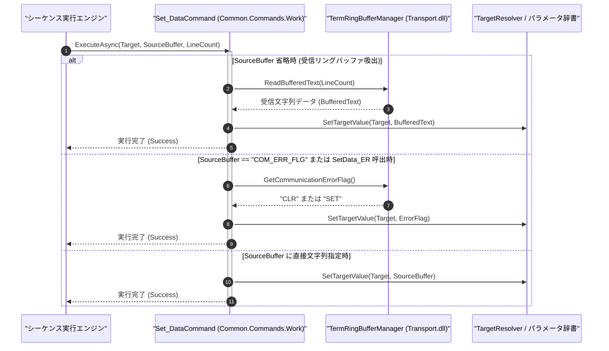

# コマンドリファレンス：Set_Data

## 概要

`Set_Data` は、通信共通基盤の非同期受信リングバッファ（または指定された `<SourceBuffer>`）から最新の受信データを取り込み、指定されたターゲット（`<Target>`：レジスタまたはコマンドパラメータ `$KEY$`）へ格納する共通データ・ワーク処理系コマンドです。  
外部機器との通信によって受信バッファへ蓄積された応答文字列をマクロ変数へ吸い出す際に使用します。

> 💡 **補足**  
> 本コマンドは 共通基盤コマンドです。なお、エイリアス `SetData_ER`（または第 2 引数 `"COM_ERR_FLG"` 指定）により、直前の通信実行時における通信エラーフラグ状態（正常: `"CLR"` / 異常: `"SET"`）を取得することも可能です。

---

## 💡 書式・パラメータ仕様

### コマンド構文

```csv
,SEQUENCE, [ステップキー], Set_Data, "[格納先キー(Target)]", "[取得元バッファまたは直接値(SourceBuffer)]", "[取得行数(LineCount)]"
```

### パラメータ（引数）一覧

| 引数位置 | 引数名 | 説明 | 指定方法 / 有効な入力値 |
| :--- | :--- | :--- | :--- |
| 引数1 | Target | 取り込んだデータを格納する対象パラメータキーまたはレジスタ名（必須）。 | 自コマンド内の `PARAM` キー名（例: `"RECV_BUF"`, `"1"`）またはレジスタ（`"$0"`〜`"$9"`） |
| 引数2 | SourceBuffer | 取得元バッファ指定または直接格納文字列（任意・省略可）。 | 省略時は Term 非同期受信リングバッファから吸出。`"COM_ERR_FLG"` 指定時は通信エラー状態（`"CLR"`/`"SET"`）を取得 |
| 引数3 | LineCount | 受信リングバッファから吸い出す行数（任意・省略可・既定値: 全未読行）。 | 1 以上の整数または `$PARAM$` 置換 |

---

## 🔄 特殊置換規約・分岐規約の適用

本コマンドの引数における特殊記法および解釈ルールです。
* **動的置換（`$`）**: 引数内で `$PARAMキー$` のように記述すると、実行時に変数プール（PARAM）の値へ動的置換されます。（適用可能な引数: 全引数対応）
* **ジャンプ先指定（`#`）**: 本コマンドはジャンプ制御を行わないため適用されません。（適用可能な引数: 非適用）
* **共通コマンド指定（`@`）**: 本コマンドは外部マクロを呼び出さないため適用されません。（適用可能な引数: 非適用）
* **カンマのエスケープ**: 引数文字列自体にカンマを含める場合は、必ず `","` と二重引用符で囲んで記述します。
* **エイリアス（別名）**: `SetData`, `GetData`, `Analysis_Term_SetData`, `SetData_ER`, `Analysis_Term_SetData_ER`, `GpibSetData`, `GpibSetData_ER`

---

## 💡 動作例（正しい構文での記述例）

### スクリプト記述例

※COMMAND ブロック配下の子要素行（PARAM, SEQUENCE）は必ず行頭カンマから開始し、スペースインデントや行末コメント（`;`）は記述しないでください。

```csv
COMMAND, "READ_SERIAL_VER", "FW_VER"
,PARAM, "FW_VER", Work, "ファームウェアバージョン", ""
; 1. 通信応答の待機（ウェイト）
,SEQUENCE, 010, Wait, 500
; 2. 受信リングバッファに蓄積された応答データを FW_VER へ取り込み
,SEQUENCE, 020, Set_Data, "FW_VER"
,SEQUENCE, 030, Exit
```

### 実行時の挙動・変数変化

* **実行前の状態**: 機器からの応答として、受信リングバッファに `"VER 1.04\r\n"` が蓄積されている状態。
* **実行後の状態**: ステップ `020` の `Set_Data` 実行により、受信リングバッファから応答テキストが吸い出され、`"FW_VER"` に `"VER 1.04"` が格納されます。

---

## 🔄 動作フロー（シーケンス図）

本コマンド実行時における、シーケンス実行エンジン、コマンドクラス（`Set_DataCommand`）、および `TermAnalysis.Transport.dll` の受信リングバッファ間のインタラクションを示すシーケンス図です。



---

## 🚫 エラーハンドリング・安全設計（仕様制限）

入力データの異常や実行時エラーに対し、解析・実行エンジンが実行するセーフティ規約です。

1. **受信リングバッファが空の場合の安全な空文字格納**:
   - 受信リングバッファに未読データが存在しない状態で `Set_Data` が呼び出された場合、ブロッキング待機や例外クラッシュを起こさず、安全に空文字列 `""` を `<Target>` へ格納して次行へ進みます。
2. **未定義のターゲットパラメータキー指定**:
   - `<Target>` に指定されたキーが `PARAM` にもホストレジスタにも存在しない場合は、エラーログ（`_log.LogError`）を記録して直ちに安全停止（Halt）します。

---

## 🧪 ユニットテスト仕様

本コマンドクラス（`Set_DataCommand.cs`）に実装されている `RunUnitTest()` メソッドが検証するユニットテストの仕様です。

### テスト実行前提条件

* **実行トリガー**: `RunUnitTest()` メソッドの呼び出し
* **有効化条件**: システム全体の最小ログレベル（`ErrorLogger.MinimumLevel`）が `LogLevel.Test` であること（それ以外の場合は無効化ガードにより早期リターン）
* **検証結果出力**: `_log.LogTest` によるログ出力。検証失敗時は `_log.LogError`、予期せぬ例外発生時は `_log.LogCritical` で記録。

### テストケース一覧

| No | テストカテゴリ | テスト条件（入力値） | 期待される結果（出力値） | 検証の目的 / 観点 |
| :---: | :--- | :--- | :--- | :--- |
| **1** | 正常系 | リングバッファに `"OK\r\n"` がある状態で `Set_Data, "RES"` 実行 | `"RES"` に `"OK"` が格納される | 受信リングバッファからの吸出検証 |
| **2** | 正常系 | 通信エラーフラグ取得（`Set_Data, "ERR_STAT", "COM_ERR_FLG"`） | `"ERR_STAT"` に `"CLR"` または `"SET"` が格納される | `SetData_ER` 互換エラー状態取得の検証 |
| **3** | 異常系 | 未定義ターゲットキー（`"UNDEFINED_TARGET"`）を指定 | エラーログが出力され `Failure` で安全停止する | 未定義キーアクセス防御の検証 |

