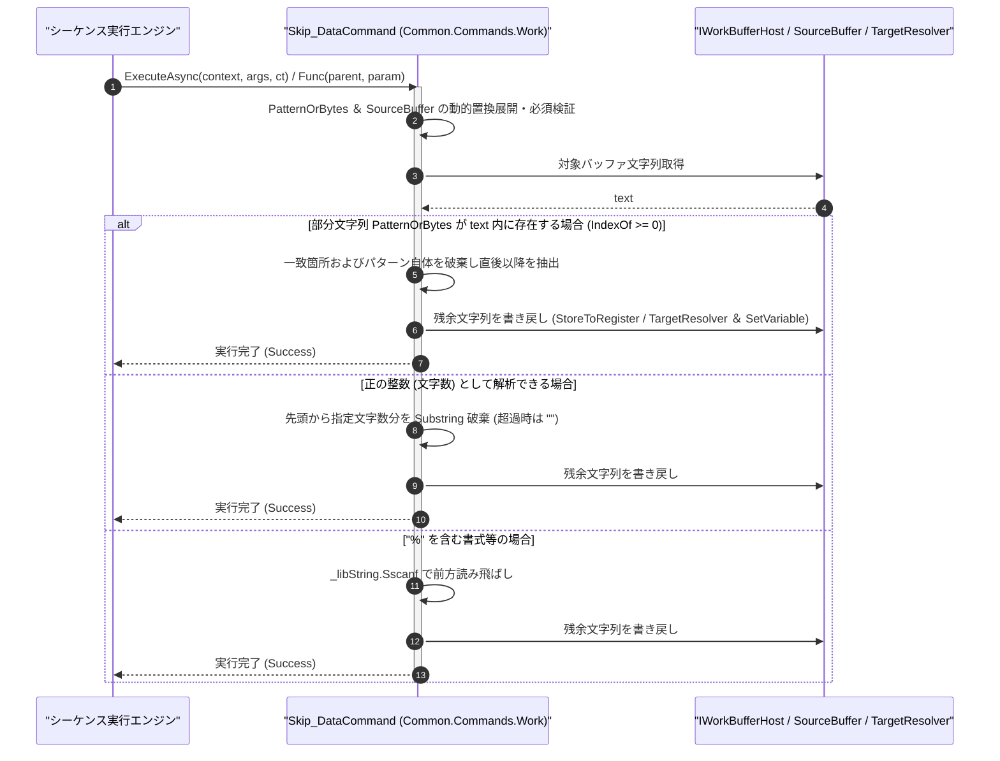

# コマンドリファレンス：Skip_Data

## 概要

`Skip_Data` は、共通ワークバッファホスト（`IWorkBufferHost`：`RecData` / `ReceiveDataBuffer`）または指定された `<SourceBuffer>` 内において、指定された検索パターン文字列の末尾位置、指定文字数、または `"%"` を含む `Sscanf` 書式で一致した領域まで前方データを読み飛ばして破棄する Term / GPIB 共通データ・ワーク処理系コマンド（`Common.Commands.Work.dll`）です。  
不特定の長さの起動ログやヘッダ文字列を読み飛ばし、目的のキーワード（例: `"SKIP_HEADER:"`）の直後や特定オフセット位置からデータ抽出を開始する際に使用します。

> 💡 **補足**  
> 本コマンドは共通基盤コマンドです。実機ホスト経路（`Func`）およびスタンドアロン経路（`ExecuteAsync`）の双方で `$KEY$` マクロトークン展開に対応しています。検索パターン文字列に一致した場合は **一致したパターン文字列自体も一緒に破棄** され、その直後の文字列が残ります（例: `"SKIP_HEADER:VALUE_123"` に対して `"SKIP_HEADER:"` を指定すると `"VALUE_123"` が残ります）。

---

## 💡 書式・パラメータ仕様

### コマンド構文

```csv
,SEQUENCE, [ステップキー], Skip_Data, "[検索パターン・文字数・Sscanf書式(PatternOrBytes)]", "[対象バッファキー(SourceBuffer)]"
```

### パラメータ（引数）一覧

| 引数位置 | 引数名 | 説明 | 指定方法 / 有効な入力値 |
| :--- | :--- | :--- | :--- |
| 引数1 | `PatternOrBytes` | 読み飛ばし基準となる完全一致検索文字列、先頭から破棄する文字数（正の整数）、または `_libString.Sscanf` 書式（必須）。 | パターン文字列（例: `"SKIP_HEADER:"`）、正の整数（例: `"10"`）、`Sscanf` 書式（例: `"%s"`）、または `$PARAM$`（実機 `Func` 時は `@REG` も可）置換 |
| 引数2 | `SourceBuffer` | 操作対象のテキストを保持するパラメータキー名（任意・省略可・既定値: `""`）。 | 省略時は共通受信バッファ（`RecData` / `IWorkBufferHost`）を対象とする（`$PARAM$` 置換可） |

---

## 🔄 特殊置換規約・分岐規約の適用

本コマンドの引数における特殊記法および解釈ルールです。
* **動的置換（`$`）**: 引数内で `$PARAMキー$`（実機ホスト経路 `Func` では `@キー名` も対応）のように記述すると、実行時に変数・レジスタの値へ動的置換されます。（適用可能な引数: 全引数対応）
* **ジャンプ先指定（`#`）**: 本コマンドはジャンプ制御を行わないため適用されません。（適用可能な引数: 非適用）
* **共通コマンド指定（`@`）**: 本コマンドは外部マクロを呼び出さないため適用されません。（適用可能な引数: 非適用）
* **カンマのエスケープ**: 検索パターン自体にカンマを含める場合は、必ず `","` と二重引用符で囲んで記述します。
* **エイリアス（別名）**: `DataSkip`, `Term_SkipData`, `Analysis_Term_SkipData`, `Gpib_SkipData`

---

## 💡 動作例（正しい構文での記述例）

### スクリプト記述例

※COMMAND ブロック配下の子要素行（PARAM, SEQUENCE）は必ず行頭カンマから開始し、スペースインデントや行末コメント（`;`）は記述しないでください。

```csv
COMMAND, "PARSE_SENSOR_OUT", "SENSOR_VAL"
,PARAM, "RAW_BUF", Text, "受信バッファ", "CH01:TEMP=+25.4"
,PARAM, "SENSOR_VAL", Work, "抽出数値", ""
; "RAW_BUF" の先頭 10 文字 ("CH01:TEMP=") を読み飛ばして "+25.4" のみを残す
,SEQUENCE, 010, Skip_Data, 10, "RAW_BUF"
,SEQUENCE, 020, Param_Set, "PARSE_SENSOR_OUT", "$RAW_BUF$", "SENSOR_VAL"
```

### 実行時の挙動・変数変化

* **実行前の状態**: `"RAW_BUF"` に `"CH01:TEMP=+25.4"`（15 文字）が格納されている状態。
* **実行後の状態**: ステップ `010` の `Skip_Data, 10, "RAW_BUF"` により先頭 10 文字 `"CH01:TEMP="` が破棄され、`"RAW_BUF"` および `"SENSOR_VAL"` に `"+25.4"` が残ります。

---

## 🔄 動作フロー（シーケンス図）

本コマンド実行時における、シーケンス実行エンジン、`Skip_DataCommand`、および `IWorkBufferHost`／パラメータ辞書間のインタラクションを示すシーケンス図です。



---

## 🚫 エラーハンドリング・安全設計（仕様制限）

入力データの異常や実行時エラーに対し、解析・実行エンジンが実行するセーフティ規約です。

1. **文字列長を超えるスキップ数の指定時**:
   - バッファ長以上の文字数が指定された場合やパターン一致位置が末尾であった場合でも `ArgumentOutOfRangeException` を発生させず、バッファを空文字列 `""` に更新して安全に完了します。
2. **必須引数欠落・空パターンの指定防止**:
   - 引数 1 `PatternOrBytes` が省略された場合や展開結果が空文字列の場合は、`ParameterSpec`（`RequireString`）の事前検証または `Func` の `ValidateParamCount(1)` / `SetErrorAndHalt(-10)`（`Halt`）によりエラーログを記録して安全停止します。

---

## 🧪 ユニットテスト仕様

本コマンドクラス（`Skip_DataCommand.cs`）に実装されている `RunUnitTest()` メソッドが検証するユニットテストの仕様です。

### テスト実行前提条件

* **実行トリガー**: `RunUnitTest()` メソッドの呼び出し
* **有効化条件**: システム全体の最小ログレベル（`ErrorLogger.MinimumLevel`）が `LogLevel.Test` であること（それ以外の場合は無効化ガードにより早期リターン）
* **検証結果出力**: `_log.LogTest` によるログ出力。検証失敗時は `_log.LogError`、予期せぬ例外発生時は `_log.LogCritical` で記録し、`finally` ブロックで `SBuf` および `Variables` をクリアします。

### テストケース一覧

| No | テストカテゴリ | テスト条件（入力値） | 期待される結果（出力値） | 検証の目的 / 観点 |
| :---: | :--- | :--- | :--- | :--- |
| **1** | 正常系 | `RecData = "SKIP_HEADER:VALUE_123"` の状態で `Skip_Data, "SKIP_HEADER:"` を実行 | 一致パターン自体も含めて破棄され、`RecData == "VALUE_123"` となりエラーが発生しない | 指定文字列パターンの前方スキップ基本動作検証 |
| **2** | 正常系 | `RecData = "PROMPT>OK"`、`"TARGET_TOKEN" = "PROMPT>"` の状態で `Skip_Data, "@TARGET_TOKEN"` を実行 | 展開された `"PROMPT>"` が破棄され、`RecData == "OK"` となりエラーが発生しない | マクロ変数展開された文字列パターンのスキップ検証 |
| **3** | 異常系 | 必須引数 `PatternOrBytes` を省略して `Skip_Data` を実行 | `HasError == true`・`LegacyJump == true`・`LegacyStep == "-1"`（`Halt`）で安全停止する | 引数未指定時の安全停止ガード検証 |
| **4** | 正常系 | `"RAW_BUF" = "CH01:TEMP=+25.4"` の状態で `Skip_Data, "10", "RAW_BUF"` を実行 | 先頭 10 文字 `"CH01:TEMP="` が破棄され、`"RAW_BUF"` が `"+25.4"` に更新される | 第 2 引数 `SourceBuffer` 指定による任意パラメータバッファの先頭文字数スキップ検証 |
