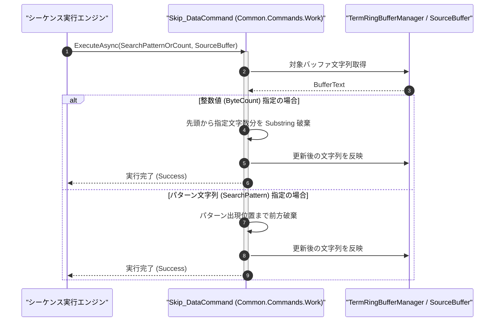

# コマンドリファレンス：Skip_Data

## 概要

`Skip_Data` は、Term 非同期受信リングバッファ（または指定された `<SourceBuffer>`）内において、指定された検索パターン（`<SearchPattern>`）または指定バイト数／文字数に到達する位置まで前方データを読み飛ばして破棄する Term / GPIB 共通データ・ワーク処理系コマンド（`Common.Commands.Work.dll`）です。  
不特定の長さの起動ログやヘッダ文字列を読み飛ばし、目的のキーワード（例: `"DATA_START:"`）や特定オフセット位置からデータ抽出を開始する際に使用します。

> 💡 **補足**  
> 本コマンドは 共通基盤コマンドです。

---

## 💡 書式・パラメータ仕様

### コマンド構文

```csv
,SEQUENCE, [ステップキー], Skip_Data, "[検索パターンまたは文字数(SearchPattern/ByteCount)]", "[対象バッファキー(SourceBuffer)]"
```

### パラメータ（引数）一覧

| 引数位置 | 引数名 | 説明 | 指定方法 / 有効な入力値 |
| :--- | :--- | :--- | :--- |
| 引数1 | SearchPattern / ByteCount | 読み飛ばし基準となる検索パターン文字列、または先頭から破棄する文字数／バイト数（必須）。 | パターン文字列（例: `"VAL="`）、正の整数（例: `"8"`）、または `$PARAM$` 置換 |
| 引数2 | SourceBuffer | 操作対象のテキストを保持するパラメータキー名（任意・省略可）。 | 省略時は Term 非同期受信リングバッファを対象とする |

---

## 🔄 特殊置換規約・分岐規約の適用

本コマンドの引数における特殊記法および解釈ルールです。
* **動的置換（`$`）**: 引数内で `$PARAMキー$` のように記述すると、実行時に変数プール（PARAM）の値へ動的置換されます。（適用可能な引数: 全引数対応）
* **ジャンプ先指定（`#`）**: 本コマンドはジャンプ制御を行わないため適用されません。（適用可能な引数: 非適用）
* **共通コマンド指定（`@`）**: 本コマンドは外部マクロを呼び出さないため適用されません。（適用可能な引数: 非適用）
* **カンマのエスケープ**: 検索パターン自体にカンマを含める場合は、必ず `","` と二重引用符で囲んで記述します。
* **エイリアス（別名）**: `SkipData`, `Analysis_Term_SkipData`, `GpibSkipData`

---

## 💡 動作例（正しい構文での記述例）

### スクリプト記述例

※COMMAND ブロック配下の子要素行（PARAM, SEQUENCE）は必ず行頭カンマから開始し、スペースインデントや行末コメント（`;`）は記述しないでください。

```csv
COMMAND, "PARSE_SENSOR_OUT", "SENSOR_VAL"
,PARAM, "RAW_BUF", Text, "受信バッファ", "CH01:TEMP=+25.4"
,PARAM, "SENSOR_VAL", Work, "抽出数値", ""
; "RAW_BUF" の先頭 10 文字 ("CH01:TEMP=") を読み飛ばして "+25.4" のみを残す
,SEQUENCE, 010, Skip_Data, 10, "RAW_BUF"
,SEQUENCE, 020, Param_Set, "PARSE_SENSOR_OUT", "$RAW_BUF$", "SENSOR_VAL"
```

### 実行時の挙動・変数変化

* **実行前の状態**: `"RAW_BUF"` に `"CH01:TEMP=+25.4"`（15 文字）が格納されている状態。
* **実行後の状態**: ステップ `010` の `Skip_Data, 10, "RAW_BUF"` により先頭 10 文字 `"CH01:TEMP="` が破棄され、`"RAW_BUF"` および `"SENSOR_VAL"` に `"+25.4"` が残ります。

---

## 🔄 動作フロー（シーケンス図）

本コマンド実行時における、シーケンス実行エンジン、コマンドクラス（`Skip_DataCommand`）、および受信リングバッファ／パラメータ辞書間のインタラクションを示すシーケンス図です。



---

## 🚫 エラーハンドリング・安全設計（仕様制限）

入力データの異常や実行時エラーに対し、解析・実行エンジンが実行するセーフティ規約です。

1. **文字列長を超えるスキップ数の指定時**:
   - バッファ長を超える文字数が指定された場合でも `ArgumentOutOfRangeException` を発生させず、バッファを空文字列 `""` にクリアして安全に完了します。
2. **空パターンの指定防止**:
   - 引数 1 が未指定または空文字列の場合は、構文エラーとして `_log.LogError` に記録し安全停止します。

---

## 🧪 ユニットテスト仕様

本コマンドクラス（`Skip_DataCommand.cs`）に実装されている `RunUnitTest()` メソッドが検証するユニットテストの仕様です。

### テスト実行前提条件

* **実行トリガー**: `RunUnitTest()` メソッドの呼び出し
* **有効化条件**: システム全体の最小ログレベル（`ErrorLogger.MinimumLevel`）が `LogLevel.Test` であること（それ以外の場合は無効化ガードにより早期リターン）
* **検証結果出力**: `_log.LogTest` によるログ出力。検証失敗時は `_log.LogError`、予期せぬ例外発生時は `_log.LogCritical` で記録。

### テストケース一覧

| No | テストカテゴリ | テスト条件（入力値） | 期待される結果（出力値） | 検証の目的 / 観点 |
| :---: | :--- | :--- | :--- | :--- |
| **1** | 正常系 | 文字数指定スキップ（`"VOLT:5.00"` に対し `"5"` を指定） | 先頭 `"VOLT:"` が破棄され `"5.00"` が残る | 文字数スキップの基本動作検証 |
| **2** | 正常系 | パターン指定スキップ（`"HEADER\r\nDATA:123"` に対し `"DATA:"` 指定） | `"DATA:"` 以前が破棄され `"DATA:123"`（または該当行以降）が残る | パターンマッチングスキップの検証 |
| **3** | 正常系 | バッファ長超過指定（`"ABC"` に対し `"100"` を指定） | 例外を投げず空文字 `""` になる | 境界値超過時の安全処理検証 |

