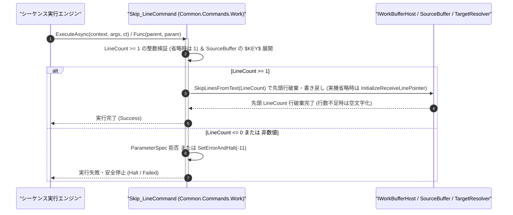

# コマンドリファレンス：Skip_Line

## 概要

`Skip_Line` は、通信受信バッファ（`RecData`）または指定された `<SourceBuffer>` の先頭から指定行数分（`<LineCount>`、既定 1 行）を読み飛ばして破棄し、受信行読み取りポインタを進める Term / GPIB 共通データ・ワーク処理系コマンド（`Common.Commands.Work.dll`）です。  
シリアル・Telnet・GPIB 通信におけるコマンドエコーバック行や不要なバナーヘッダ行を除去してから後続の [`Set_Data`](./Set_Data.Md) / [`Get_Line`](./Get_Line.Md) で本データを抽出する際に使用します。

> 💡 **補足**  
> 本コマンドは共通基盤コマンドです。実機ホスト経路（`Func`）およびスタンドアロン経路（`ExecuteAsync`）の双方で `$KEY$` マクロトークン展開に対応しており、`SourceBuffer` 指定時は該当パラメータ・変数バッファの先頭行を破棄して書き戻し、省略時は共通受信バッファ（`RecData` / `__RecData`）を更新します（実機 `Func` 時は併せて `IWorkBufferHost.InitializeReceiveLinePointer` を呼び出します）。

---

## 💡 書式・パラメータ仕様

### コマンド構文

```csv
,SEQUENCE, [ステップキー], Skip_Line, "[読み飛ばし行数(LineCount): 1]", "[対象バッファキー(SourceBuffer)]"
```

### パラメータ（引数）一覧

| 引数位置 | 引数名 | 説明 | 指定方法 / 有効な入力値 |
| :--- | :--- | :--- | :--- |
| 引数1 | `LineCount` | 先頭から読み飛ばして破棄する行数（任意・省略可・既定値: `1`）。 | `1`〜`1000000` の整数（例: `"1"`, `"2"`）または `$PARAM$` 置換 |
| 引数2 | `SourceBuffer` | 操作対象のテキストを保持するパラメータキー名（任意・省略可・既定値: `""`）。 | 省略時は共通受信バッファ（`RecData` / `IWorkBufferHost`）を対象とする（`$PARAM$` 置換可） |

---

## 🔄 特殊置換規約・分岐規約の適用

本コマンドの引数における特殊記法および解釈ルールです。
* **動的置換（`$`）**: 引数内で `$PARAMキー$` のように記述すると、実行時に変数プール（PARAM）の値へ動的置換されます。（適用可能な引数: 全引数対応）
* **ジャンプ先指定（`#`）**: 本コマンドはジャンプ制御を行わないため適用されません。（適用可能な引数: 非適用）
* **共通コマンド指定（`@`）**: 本コマンドは外部マクロを呼び出さないため適用されません。（適用可能な引数: 非適用）
* **カンマのエスケープ**: 引数文字列自体にカンマを含める場合は、必ず `","` と二重引用符で囲んで記述します。
* **エイリアス（別名）**: `LineSkip`, `Term_SkipLine`, `Analysis_Term_SkipLine`, `Gpib_SkipLine`

---

## 💡 動作例（正しい構文での記述例）

### スクリプト記述例

※COMMAND ブロック配下の子要素行（PARAM, SEQUENCE）は必ず行頭カンマから開始し、スペースインデントや行末コメント（`;`）は記述しないでください。

```csv
COMMAND, "READ_WITHOUT_ECHO", "RESULT_LINE"
,PARAM, "RESULT_LINE", Work, "エコー除去後データ", ""
,SEQUENCE, 010, Com_Send, "READ_ADC"
,SEQUENCE, 020, Com_WaitPrompt, ">"
; 先頭 1 行（コマンドエコーバック "READ_ADC"）を読み飛ばして破棄
,SEQUENCE, 030, Skip_Line, 1
; 残りの測定値行を RESULT_LINE へ取り込み
,SEQUENCE, 040, Set_Data, "RESULT_LINE"
```

### 実行時の挙動・変数変化

* **実行前の状態**: 受信バッファに `"READ_ADC\r\n4095\r\n"`（1 行目がエコーバック、2 行目が ADC 値）が蓄積されている状態。
* **実行後の状態**: ステップ `030` の `Skip_Line, 1` により先頭の `"READ_ADC\r\n"` が破棄されて受信バッファ残余が `"4095\r\n"` となり、ステップ `040` の `Set_Data`（末尾改行保持）により `"RESULT_LINE"` に `"4095\r\n"` が格納されます（※末尾改行を除いた 1 行文字列として取得したい場合は [`Get_Line`](./Get_Line.Md) を使用します）。

---

## 🔄 動作フロー（シーケンス図）

本コマンド実行時における、シーケンス実行エンジン、コマンドクラス（`Skip_LineCommand`）、および受信バッファ間のインタラクションを示すシーケンス図です。



---

## 🚫 エラーハンドリング・安全設計（仕様制限）

入力データの異常や実行時エラーに対し、解析・実行エンジンが実行するセーフティ規約です。

1. **バッファ内の残行数より多い `<LineCount>` が指定された場合**:
   - 例外クラッシュを発生させず、バッファ内の全行を安全に破棄（空文字列 `""` にクリア）して正常終了します。
2. **`0` 以下の数値・範囲外または非数値の指定**:
   - `<LineCount>` に `0` 以下の整数（または上限 `1000000` 超過）や非数値文字列が指定された場合は、`ParameterSpec`（`OptionalInt`）による事前検証または `Func` の `SetErrorAndHalt(-11, ...)` により直ちに安全停止します。

---

## 🧪 ユニットテスト仕様

本コマンドクラス（`Skip_LineCommand.cs`）に実装されている `RunUnitTest()` メソッドが検証するユニットテストの仕様です。

### テスト実行前提条件

* **実行トリガー**: `RunUnitTest()` メソッドの呼び出し
* **有効化条件**: システム全体の最小ログレベル（`ErrorLogger.MinimumLevel`）が `LogLevel.Test` であること（それ以外の場合は無効化ガードにより早期リターン）
* **検証結果出力**: `_log.LogTest` によるログ出力。検証失敗時は `_log.LogError`、予期せぬ例外発生時は `_log.LogCritical` で記録し、`finally` ブロックでテスト用 `SBuf` および `Variables` をクリアします。

### テストケース一覧

| No | テストカテゴリ | テスト条件（入力値） | 期待される結果（出力値） | 検証の目的 / 観点 |
| :---: | :--- | :--- | :--- | :--- |
| **1** | 正常系 | `RecData = "LINE1\r\nLINE2\r\nLINE3"` に対して `("2")` を指定して実行 | 先頭 2 行が破棄されて `RecData == "LINE3"` となり、`LastInitializedLineCount == 2` に更新される | 指定行数（`LineCount = 2`）スキップの基本動作検証 |
| **2** | 正常系 | `RecData = "HEADER\r\nPAYLOAD"` に対して引数省略 `()` で実行 | 既定の 1 行が破棄されて `RecData == "PAYLOAD"` となり、`LastInitializedLineCount == 1` に更新される | `LineCount` 省略時（既定値 `1`）のスキップ動作検証 |
| **3** | 異常系 | 非数値文字列 `("INVALID_NUM")` を指定して実行 | `HasError == true`・`LegacyJump == true`・`LegacyStep == "-1"` で安全停止する | 不正な `LineCount` 指定時の安全停止ガード検証 |
| **4** | 正常系 | `"RAW_BUF"` に `"ECHO_CMD\r\n4095"` を格納し `("1", "RAW_BUF")` を実行 | `"RAW_BUF"` の先頭行が破棄され `"4095"` に更新される | 第 2 引数 `SourceBuffer` 指定による任意パラメータバッファの行スキップ検証 |
