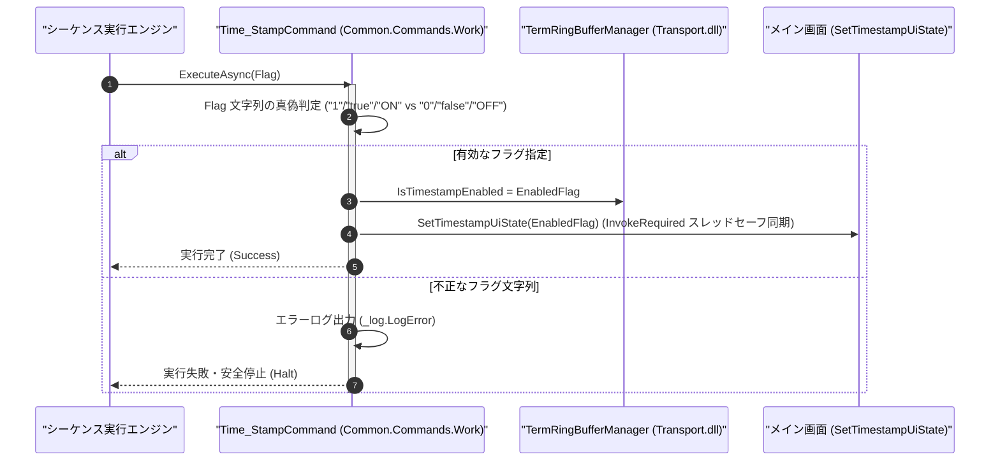

# コマンドリファレンス：Time_Stamp

## 概要

`Time_Stamp` は、Term の画面表示ログおよび非同期受信データストリームの各行頭に対するミリ秒タイムスタンプ自動付与の有効（ON）／無効（OFF）を動的に切り替える Term / GPIB 共通データ・ワーク処理系コマンド（`Common.Commands.Work.dll`）です。  
旧 Term の `Term_TimeOn` / `Term_TimeOff`（`TimeOn` / `TimeOff`）を単一コマンドへ完全統合しており、メイン画面のタイムスタンプメニュー状態ともスレッドセーフに連動します。

> 💡 **補足**  
> 本コマンドは 共通基盤コマンドです。生の測定値のみを [`Set_Data`](./Set_Data.Md) で抽出したい区間では一時的に `"OFF"`（`"0"`）にし、時刻付き通信ログを記録したい区間では `"ON"`（`"1"`）に切り替える使い分けが可能です。

---

## 💡 書式・パラメータ仕様

### コマンド構文

```csv
,SEQUENCE, [ステップキー], Time_Stamp, "[有効/無効フラグ(Flag: ON / OFF / 1 / 0 / true / false)]"
```

### パラメータ（引数）一覧

| 引数位置 | 引数名 | 説明 | 指定方法 / 有効な入力値 |
| :--- | :--- | :--- | :--- |
| 引数1 | Flag | タイムスタンプ付与の有効／無効切り替えフラグ（必須 ※旧 `TimeOn`/`TimeOff` 呼出時は省略可）。 | 有効化: `"1"`, `"true"`, `"ON"`<br/>無効化: `"0"`, `"false"`, `"OFF"` |

---

## 🔄 特殊置換規約・分岐規約の適用

本コマンドの引数における特殊記法および解釈ルールです。
* **動的置換（`$`）**: 引数内で `$PARAMキー$` のように記述すると、実行時に変数プール（PARAM）の値へ動的置換されます。（適用可能な引数: 引数 1 `Flag`）
* **ジャンプ先指定（`#`）**: 本コマンドはジャンプ制御を行わないため適用されません。（適用可能な引数: 非適用）
* **共通コマンド指定（`@`）**: 本コマンドは外部マクロを呼び出さないため適用されません。（適用可能な引数: 非適用）
* **カンマのエスケープ**: 引数文字列自体にカンマを含める場合は、必ず `","` と二重引用符で囲んで記述します。
* **エイリアス（別名）**: `TimeStamp`, `Term_TimeOn`, `Term_TimeOff`, `TimeOn`, `TimeOff`, `Analysis_Term_TimeOn`, `Analysis_Term_TimeOff`, `GpibTimeStamp`, `GpibTimeOn`, `GpibTimeOff`

---

## 💡 動作例（正しい構文での記述例）

### スクリプト記述例

※COMMAND ブロック配下の子要素行（PARAM, SEQUENCE）は必ず行頭カンマから開始し、スペースインデントや行末コメント（`;`）は記述しないでください。

```csv
COMMAND, "RAW_VALUE_READ", "PURE_VAL"
,PARAM, "PURE_VAL", Work, "時刻なしの生測定値", ""
; 1. 測定値パース中に時刻文字列が混入しないようタイムスタンプを一時 OFF に設定
,SEQUENCE, 010, Time_Stamp, "OFF"
,SEQUENCE, 020, Com_Send, "MEAS?"
,SEQUENCE, 030, Com_WaitPrompt, ">"
,SEQUENCE, 040, Set_Data, "PURE_VAL"
; 2. 抽出完了後、タイムスタンプ表示を ON に戻す
,SEQUENCE, 050, Time_Stamp, "ON"
,SEQUENCE, 060, Exit
```

### 実行時の挙動・変数変化

* **実行前の状態**: タイムスタンプ表示が ON（受信行頭に `[08:15:00.123] ` が付与される状態）。
* **実行後の状態**: ステップ `010` でタイムスタンプ付与が OFF になり、ステップ `040` で時刻文字列を含まない純粋な測定値が `"PURE_VAL"` に格納された後、ステップ `050` で再びタイムスタンプ付与が ON に復帰します。

---

## 🔄 動作フロー（シーケンス図）

本コマンド実行時における、シーケンス実行エンジン、コマンドクラス（`Time_StampCommand`）、および `TermAnalysis.Transport.dll`／メイン UI 間のインタラクションを示すシーケンス図です。



---

## 🚫 エラーハンドリング・安全設計（仕様制限）

入力データの異常や実行時エラーに対し、解析・実行エンジンが実行するセーフティ規約です。

1. **UI スレッドとのスレッドセーフ連動（`InvokeRequired` 対応）**:
   - バックグラウンドのシーケンス実行スレッドからメイン画面のメニュー状態（`MnuTimeOn` / `MnuTimeOff`）を更新する際、クロススレッド例外を防ぐため必ず `InvokeRequired` チェックを介してスレッドセーフに反映します。
2. **不正なフラグ値の検証**:
   - `"1"`, `"0"`, `"true"`, `"false"`, `"ON"`, `"OFF"` 以外の解釈不能な文字列が指定された場合は、エラーログ（`_log.LogError`）を記録して安全停止します。

---

## 🧪 ユニットテスト仕様

本コマンドクラス（`Time_StampCommand.cs`）に実装されている `RunUnitTest()` メソッドが検証するユニットテストの仕様です。

### テスト実行前提条件

* **実行トリガー**: `RunUnitTest()` メソッドの呼び出し
* **有効化条件**: システム全体の最小ログレベル（`ErrorLogger.MinimumLevel`）が `LogLevel.Test` であること（それ以外の場合は無効化ガードにより早期リターン）
* **検証結果出力**: `_log.LogTest` によるログ出力。検証失敗時は `_log.LogError`、予期せぬ例外発生時は `_log.LogCritical` で記録。

### テストケース一覧

| No | テストカテゴリ | テスト条件（入力値） | 期待される結果（出力値） | 検証の目的 / 観点 |
| :---: | :--- | :--- | :--- | :--- |
| **1** | 正常系 | `"ON"` / `"1"` / `"true"` を指定 | `IsTimestampEnabled` が `true` に設定され `Success` が返る | タイムスタンプ有効化動作の検証 |
| **2** | 正常系 | `"OFF"` / `"0"` / `"false"` を指定 | `IsTimestampEnabled` が `false` に設定され `Success` が返る | タイムスタンプ無効化動作の検証 |
| **3** | 異常系 | 不正なフラグ文字列（`"INVALID"`）を指定 | エラーログが出力され `Failure` で安全停止する | 不正入力に対するバリデーション検証 |

