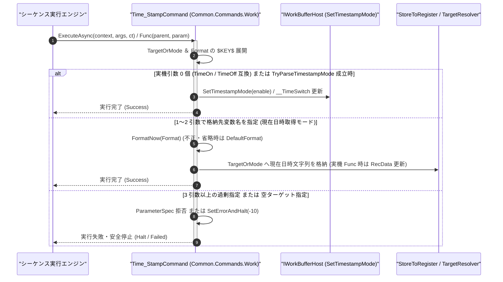

# コマンドリファレンス：Time_Stamp

## 概要

`Time_Stamp` は、通信ログおよび受信データストリームに対するタイムスタンプ自動付与モードの有効（ON）／無効（OFF）切替、または現在日時文字列の指定書式による取得・変数格納を行う Term / GPIB 共通データ・ワーク処理系コマンド（`Common.Commands.Work.dll`）です。  
旧 Term の `Term_TimeOn` / `Term_TimeOff`（`TimeOn` / `TimeOff`）および現在日時取得コマンド `TimeGet` / `Gpib_TimeStamp` を単一コマンドへ完全統合しています。

> 💡 **補足**  
> 本コマンドは共通基盤コマンドです。実機ホスト経路（`Func`）では、引数 0 個時（`TimeOff` 系エイリアス呼出時は OFF、それ以外は ON）または第 1 引数単独で `"ON"` / `"TRUE"` / `"ENABLE"` / `"1"`・`"OFF"` / `"FALSE"` / `"DISABLE"` / `"0"` を指定した場合に `IWorkBufferHost.SetTimestampMode` でタイムスタンプ付与モードを切り替え、それ以外の文字列（または第 2 引数 `Format` 併用時）は **現在日時文字列取得モードの格納先変数・パラメータキー名** として動作します。スタンドアロン経路（`ExecuteAsync`）でも `$KEY$` トークン展開後に `TryParseTimestampMode` 成立時は `"__TimeSwitch"` 変数を `"ON"` / `"OFF"` に更新し、不成立時は現在日時文字列を `TargetResolver.TryResolve` 解決バッファおよびコンテキスト変数へ格納します。

---

## 💡 書式・パラメータ仕様

### コマンド構文

```csv
,SEQUENCE, [ステップキー], Time_Stamp, "[モードまたは格納先キー(TargetOrMode)]", "[日時書式(Format)]"
```

### パラメータ（引数）一覧

| 引数位置 | 引数名 | 説明 | 指定方法 / 有効な入力値 |
| :--- | :--- | :--- | :--- |
| 引数1 | `TargetOrMode` | タイムスタンプ表示モード切替フラグ、または現在日時文字列の格納先キー（任意・省略可・既定値: `"ON"`。実機 `Func` で引数 0 個時は呼出エイリアス名に応じ ON/OFF 切替）。 | モード切替時は `"ON"` / `"TRUE"` / `"ENABLE"` / `"1"` または `"OFF"` / `"FALSE"` / `"DISABLE"` / `"0"`。現在日時取得時は格納先 `PARAM` キー名・内部変数名・レジスタ名（`$PARAM$` 置換可） |
| 引数2 | `Format` | 現在日時取得モード時に適用する日時フォーマット文字列（任意・省略時既定値: `"yyyy/MM/dd HH:mm:ss"`）。 | 標準 `.NET` 日時書式文字列（例: `"yyyyMMdd"`, `"HH:mm:ss.fff"`）または `$PARAM$` 置換 |

---

## 🔄 特殊置換規約・分岐規約の適用

本コマンドの引数における特殊記法および解釈ルールです。
* **動的置換（`$`）**: 引数内で `$PARAMキー$` のように記述すると、実行時に変数プール（PARAM）の値へ動的置換されます。（適用可能な引数: 全引数対応）
* **ジャンプ先指定（`#`）**: 本コマンドはジャンプ制御を行わないため適用されません。（適用可能な引数: 非適用）
* **共通コマンド指定（`@`）**: 本コマンドは外部マクロを呼び出さないため適用されません。（適用可能な引数: 非適用）
* **カンマのエスケープ**: 引数文字列自体にカンマを含める場合は、必ず `","` と二重引用符で囲んで記述します。
* **エイリアス（別名）**: `TimeGet`, `TimeStamp`, `TimeOn`, `TimeOff`, `Term_TimeOn`, `Term_TimeOff`, `Analysis_Term_TimeOn`, `Analysis_Term_TimeOff`, `Gpib_TimeStamp`

---

## 💡 動作例（正しい構文での記述例）

### スクリプト記述例

※COMMAND ブロック配下の子要素行（PARAM, SEQUENCE）は必ず行頭カンマから開始し、スペースインデントや行末コメント（`;`）は記述しないでください。

```csv
COMMAND, "RAW_VALUE_READ", "PURE_VAL"
,PARAM, "PURE_VAL", Work, "時刻なしの生測定値", ""
,PARAM, "EXEC_DATE", Work, "測定実施日", ""
; 1. 測定値パース中に時刻文字列が混入しないようタイムスタンプを一時 OFF に設定
,SEQUENCE, 010, Time_Stamp, "OFF"
,SEQUENCE, 020, Com_Send, "MEAS?"
,SEQUENCE, 030, Com_WaitPrompt, ">"
,SEQUENCE, 040, Set_Data, "PURE_VAL"
; 2. 現在日付を "yyyyMMdd" 書式で EXEC_DATE へ取得格納
,SEQUENCE, 050, Time_Stamp, "EXEC_DATE", "yyyyMMdd"
; 3. 抽出完了後、タイムスタンプ表示を ON に戻す
,SEQUENCE, 060, Time_Stamp, "ON"
,SEQUENCE, 070, Exit
```

### 実行時の挙動・変数変化

* **実行前の状態**: タイムスタンプ表示が ON であり、`"EXEC_DATE"` が空文字列 `""` の状態。
* **実行後の状態**: ステップ `010` でタイムスタンプ付与が OFF になり、ステップ `040` で純粋な測定値が `"PURE_VAL"` に格納された後、ステップ `050` で現在日付文字列（例: `"20261118"`）が `"EXEC_DATE"` に格納され、ステップ `060` でタイムスタンプ付与が ON に復帰します。

---

## 🔄 動作フロー（シーケンス図）

本コマンド実行時における、シーケンス実行エンジン、`Time_StampCommand`、および `IWorkBufferHost`／レジスタ辞書間のインタラクションを示すシーケンス図です。



---

## 🚫 エラーハンドリング・安全設計（仕様制限）

入力データの異常や実行時エラーに対し、解析・実行エンジンが実行するセーフティ規約です。

1. **不正な日時フォーマット文字列指定時の既定書式フォールバック**:
   - 第 2 引数 `Format` に `DateTime.ToString` で例外となる書式文字列が渡された場合でもクラッシュさせず、`_log.LogCritical` に記録した上で既定書式 `"yyyy/MM/dd HH:mm:ss"` にフォールバックして現在日時を格納します。
2. **過剰引数（3 個以上）または空ターゲット指定時の安全停止**:
   - 引数が 3 個以上指定された場合、または日時取得モードで格納先キーが空文字となった場合は、`ParameterSpec`（2 引数定義）の事前検証または `Func` の `SetErrorAndHalt(-10)` により安全停止（`Halt`）します。

---

## 🧪 ユニットテスト仕様

本コマンドクラス（`Time_StampCommand.cs`）に実装されている `RunUnitTest()` メソッドが検証するユニットテストの仕様です。

### テスト実行前提条件

* **実行トリガー**: `RunUnitTest()` メソッドの呼び出し
* **有効化条件**: システム全体の最小ログレベル（`ErrorLogger.MinimumLevel`）が `LogLevel.Test` であること（それ以外の場合は無効化ガードにより早期リターン）
* **検証結果出力**: `_log.LogTest` によるログ出力。検証失敗時は `_log.LogError`、予期せぬ例外発生時は `_log.LogCritical` で記録し、`finally` ブロックでテスト用 `SBuf` および `Variables` をクリアします。

### テストケース一覧

| No | テストカテゴリ | テスト条件（入力値） | 期待される結果（出力値） | 検証の目的 / 観点 |
| :---: | :--- | :--- | :--- | :--- |
| **1** | 正常系 | `TimeSwitch = false` の状態で `Time_Stamp, "ON"` を実行 | `TimeSwitch` が `true` に設定されエラーが発生しない | タイムスタンプ有効化切替の検証 |
| **2** | 正常系 | `TimeSwitch = true` の状態で `Time_Stamp, "OFF"` を実行 | `TimeSwitch` が `false` に設定されエラーが発生しない | タイムスタンプ無効化切替の検証 |
| **3** | 正常系 | レジスタ名とカスタム書式 `("REG_NOW", "yyyyMMdd")` を指定して実行 | `"REG_NOW"` に現在日付文字列（`yyyyMMdd`）が格納される | 現在日時取得モードおよびカスタム書式指定の検証 |
| **4** | 異常系 | 3 引数 `("REG_NOW", "yyyyMMdd", "EXTRA")` 指定および `null` パラメータ呼出 | `IsCommandGo == false`（`Halt`）で安全停止し、`null` 入力時もクラッシュしない | 過剰引数時の安全停止および `null` 防御の検証 |
