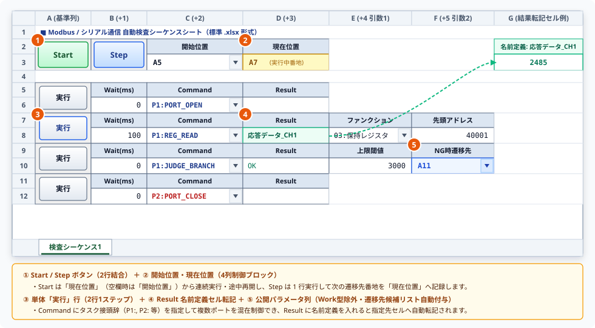

# Excelアドイン取扱説明書 (User Manual)

本ドキュメントは、Excel 上からシリアル機器（RS-232C / UART）、ネットワーク機器（Telnet）、産業用 Modbus 機器、および三菱電機 MELSEC シーケンサ（計算機リンク／MCプロトコル）のテストシーケンスを構築・実行するための **Excel アドイン（TermAddIn）** の総合取扱説明書です。リボン機能、4 列制御ブロックと 3 種実行ボタン（単体・`Step`・`Start`）、Excel エクステンション順序制御、設定ファイル（`Setting.xml`）、除外キャッシュ機構、32bit / 64bit 動作環境、および関連マクロコマンドリファレンスを本書 1 冊に統合して解説します。

---

# 目次

- [📖 1. 概要](#-1-概要)
- [🛠️ 2. リボンメニューの説明 (個別機能)](#️-2-リボンメニューの説明-個別機能)
  - [2.1 【ツール】グループ (`tool`：全製品共通リボン機能)](#21-ツールグループ-tool全製品共通リボン機能)
  - [2.2 【Term制御】グループ (`Term`：Term専用リボン機能)](#22-term制御グループ-termterm専用リボン機能)
- [🗂️ 3. シート上の実行ボタンと順序制御仕様](#️-3-シート上の実行ボタンと順序制御仕様)
- [💾 4. 設定の自動保存・復元機能](#-4-設定の自動保存復元機能)
- [⚙️ 5. 設定ファイル (Setting.xml) について](#️-5-設定ファイル-settingxml-について)
- [⚡ 6. 高速ファイルオープンと除外キャッシュ機能（オーバーヘッド防止）](#-6-高速ファイルオープンと除外キャッシュ機能オーバーヘッド防止)
- [💻 7. 動作環境と Excel 32bit / 64bit 運用上の留意事項](#-7-動作環境と-excel-32bit--64bit-運用上の留意事項)
- [📚 8. マクロコマンド・関連マニュアル一覧](#-8-マクロコマンド関連マニュアル一覧)

---

## 📖 1. 概要
本 Excel アドイン（TermAddIn）は、Excel のワークシート上に通信コマンドのシーケンス（実行手順）を 2 行 1 ステップ構成で定義し、単体実行・1 ステップ実行（`Step`）・連続一括実行（`Start`）を非同期に行えるアドインです。コマンド名や待機時間（ウェイト）、パラメータ、条件分岐・ループ遷移先、実行結果を Excel 画面上で視覚的に管理・編集できます。

### 💡 本アドイン最大の特長：VBAマクロ不要・標準 `.xlsx` 形式での完全動作
*   **マクロ無効形式（`.xlsx`）のまま動作**:
    一般的なマクロ機能とは異なり、ブック内部に VBA コードを一切保持しません。Excel シート上のコマンド実行ボタン（ActiveX ボタン）はアドイン側から動的に制御されるため、 **標準的な `.xlsx` 形式のままボタンの配置・保存・自動実行が可能** です。
*   **セキュリティ警告・ブロックの解消**:
    マクロ有効ブック（`.xlsm`）を使用しないため、セキュリティポリシーによるマクロ実行ブロックや警告に煩わされることなく、安全にシーケンスシートを作成・運用・共有できます。
*   **VBE（マクロ）の保守不要**:
    Excel のバージョンアップによる参照設定トラブルやマクロコード破損の心配がなく、長期的なシステムの安定性を保ちます。

### 📌 共通基盤アーキテクチャの責務
1. **VBA/VBE 参照の完全非依存**:
   * マクロ有効形式（`.xlsm`）や VBE 参照を必要とせず、標準的な `.xlsx` 形式のまま動作します。
2. **ActiveX 動的生成・行移動追従・GC 生存管理**:
   * `Forms.CommandButton.1` を OLEObject として動的配置し、クリック発生時点のセル行座標をリアルタイム取得するため、新規配置直後から行挿入・行削除に自動追従します。また COM 参照およびイベントデリゲートを `ActiveXEventManager` により GC 回収から保護します。
3. **安全な COM リソース解放**:
   * シート操作・セル走査完了後は `Marshal.FinalReleaseComObject` を徹底し、Excel プロセスの残存を完全に防止します。
4. **多層動的リンク解決との統合**:
   * 各種ドキュメント参照は `DocPathResolver` を経由し、ユーザー作業フォルダ（`<設定場所>\Manual\`）・開発環境・GitHub Web・AppData を動的に切り替えます。

---

## 🛠️ 2. リボンメニューの説明 (個別機能)
Excel の上部メニュー（Office のアドインタブ `TabAddIns`：表示名 **「アドイン」** ）に追加される専用リボン内の各ボタンの個別説明です。  
リボンは共通機能である **「ツール (`tool`)」** グループと、個別機能である **「Term制御 (`Term`)」** グループの 2 つで構成されています。  
※ `GpibAddIn` と `TermAddIn`（および将来の拡張アドイン）を同一 PC に同時導入した場合、プロセス環境変数のオーナー調停機構（`ClaimCommonToolGroupOwnership`）により、アドインタブ（`TabAddIns`）内には共通の **「ツール」** グループが 1 つだけ表示され、その横に **「GPIB制御」「Term制御」** が並んで表示されます。

| 図番 | グループID / 表示名 | ボタンID / 表示名 | 主な機能概要 |
| :---: | :--- | :--- | :--- |
| **①〜②** | **`tool`** (ツール) | **`Make_Doc`** (マニュアル配置) | 共通基盤（`Core`）および各製品・拡張プラグインの取扱説明書一式を `<設定場所>\Manual\` へ差分同期展開 |
| **②** | | **`Save_Style`** (スタイル保存) | 選択行（単体実行行 9 キー／制御ブロック行 6 キー）のセル書式を既定テンプレートとして `Setting.xml` へ保存 |
| **②** | | **`Start`** (Startボタン配置) | シート上に 4 列制御ブロック（`Start` ボタン・`Step` ボタン・`開始位置`・`現在位置`）を動的配置 |
| **②** | | **`Delete_Sequence`** (シーケンス削除) | 選択中のシーケンス行（2行分）または制御ブロック行（`Start` / `Step` 両ボタン含む）を安全に削除 |
| **③〜④** | **`Term`** (Term制御) | **`ToolOpen`** (ツール起動) | ④ タスク選択ダイアログ（`P1`〜`P10`）で選択したターミナルメイン画面を起動・前面表示 |
| **③〜④** | | **`Make_Sequence`** (シーケンス配置) | ④ タスク選択後、実行ボタン・待機時間・コマンド・結果・公開パラメータの 2 行構成を基準列へ自動生成 |

---

### 2.1 【ツール】グループ (`tool`：全製品共通リボン機能)

#### 🔘 マニュアル配置 ボタン (`Make_Doc`)
*   **機能**: アドインに同梱された全製品の技術ドキュメント（総合取扱説明書、各画面マニュアル、共通基盤 `Core` 6 ドメイン・全 42 コマンド仕様書、および導入済み全通信プラグインのコマンド仕様書）を、設定ファイルと同一階層の `Manual` フォルダへ安全に差分同期展開します。
*   **用途**: 各種コマンドの仕様や取扱説明書をオフライン環境や手元のフォルダで確認したい場合に実行します。
*   **展開される資材一式**:
    *   **共通基盤マニュアル (`Manual\Core\`)**: `Param`, `Array`, `Sequence`, `File`, `Work`, および Excel シート順序制御 `Excel`（全 8 件）を含む全 42 コマンド仕様書
    *   **TermAddIn 本編・拡張プラグインマニュアル (`Manual\TermAddIn\`)**: 画面別取扱説明書（5 件）および登録されている各通信ドメイン（`Comm`, `Telnet`, `Modbus`, `Melco`, `MelcoMC`）のコマンド仕様書一式（同環境に `GpibAddIn` 資材が存在する場合は `Manual\GpibAddIn\` も一括同期されます）
    *   ※ 標準インストーラー供給元が見つからない特殊環境でのみフォールバックデプロイヤーが動作し、同梱アセット（`ListSample` 含む）を展開します。
*   **展開先ディレクトリと安全性**:
    *   **展開先パス**: `<設定ファイルの場所>\Manual\`（既定では `%USERPROFILE%\Desktop\Monaca\Manual\`）
    *   **差分同期（高速スキップ）**: 既存ファイルを無条件に削除せず、ファイルサイズと最終更新日時を比較して未配置または更新されたファイルのみを安全にコピーします。

#### 🔘 スタイル保存 ボタン (`Save_Style`)
*   **機能**: 現在アクティブなセルが属する 2 行ブロックの各種書式スタイル情報を読み取り、既定テンプレートとして設定ファイル（`Setting.xml` の共通 `Common` テーブル内 `Styles` セクション）に永続化します。
*   **用途**: セルの背景色や罫線、フォント、文字揃え、列幅などのデザインをカスタマイズした後に、それを今後の新規配置時の「既定のスタイル」として登録したい場合に使用します。
*   **保存対象のスタイル要素と全 15 キー別管理**:
    1. **保存されるセル装飾プロパティ**:
       * 背景色（`Interior.Color`）、罫線の太さ・線種・色（上下左右）、フォント名・サイズ・太字・斜体・文字色、文字配置（水平・垂直・折り返し）
       * 列の幅（`ColumnWidth`： **※単体実行シーケンス行の 9 キーのみ保存・復元対象** ）
    2. **単体実行シーケンス行（9 キー）と制御ブロック行（6 キー）の自動判別・別管理**:
       * **単体実行シーケンス行を選択して保存した場合**: `Label`（実行ボタン列）、`WaitLabel` / `WaitValue`、`CommandLabel` / `CommandValue`、`ResultLabel` / `ResultValue`、`ParamHelp` / `ParamValue` の **9 キー** が列幅（`ColumnWidth`）を含めて保存されます。
       * **Start / Step 制御ブロック行を選択して保存した場合**: 基準列から順に `StartButton`（`col`）、`StepButton`（`col + 1`）、`StartLabel` / `StartValue`（`col + 2`）、`CurrentLabel` / `CurrentValue`（`col + 3`）の **6 キー** が個別スタイルとして保存されます。ただし **制御ブロック 4 列のセル幅（`ColumnWidth`）は保存・復元の管理対象から除外されており、次回配置時も単体実行シーケンス行側で設定された列幅がそのまま維持されます** （列幅の上書き干渉を防止）。

#### 🔘 Startボタン配置 ボタン (`Start`)
*   **機能**: シーケンス全体の一括実行および 1 ステップずつのデバッグ実行を統括する **4 列構成の制御ブロック** を、シートの基準列に揃えて縦 2 行で動的配置します。
*   **配置される 4 列制御ブロックの構成（基準列 `col` 起点）**:
    1. **`col` 列：`[ Start ]` ボタン（縦 2 行結合）**: ActiveX コマンドボタン（`MonacaBtn_Start_*`）。`現在位置`（空白時は `開始位置`）から連続実行を開始・途中再開します。
    2. **`col + 1` 列：`[ Step ]` ボタン（縦 2 行結合）**: ActiveX コマンドボタン（`MonacaBtn_Step_*`）。`現在位置`（空白時は `開始位置`）の 1 ステップのみを実行し、次の遷移先番地を `現在位置` へ記録します。
    3. **`col + 2` 列：`開始位置`（上段ラベル／下段ドロップダウン）**: シート内に配置されているすべての単体実行ボタン行のセル番地（例: `A5`, `A7` 等）が自動収集されて入力規則リストに設定されます（初期値は先頭のシーケンス行番地）。Excel 名前定義も指定可能です。
    4. **`col + 3` 列：`現在位置`（上段ラベル／下段プログラムカウンタ）**: 次に実行すべき対象行のセル番地を保持するセルです（初期値は空白）。実行完了時または `Excel_Exit` 到達時に自動で空白へクリアされます。
*   **双方向の基準列整列と二重配置防止**:
    *   先に単体実行シーケンス行がある場合も、先に Start 制御ブロックを配置してから単体実行行を追加する場合も、自動的に同一の先頭基準列に揃えて配置されます。
    *   選択した 2 行領域にすでにボタンが存在する場合は警告ダイアログを表示し、ボタンの重畳配置を防止します。
*   **実行の中断と安全ガード**:
    *   `Start` 一括実行中は共通中断ダイアログ（`CancelDialog`）が表示され、任意のタイミングで安全に中断できます（中断時点の再開番地は `現在位置` に保持されます）。
    *   最大走査行数 `MaxRows`（既定 `500`）および最大連続実行ステップ数 `MaxExecutionSteps`（既定 `10,000`）により、意図しない無限ループによるフリーズを自動防止します。

#### 🔘 シーケンス削除 ボタン (`Delete_Sequence`)
*   **機能**: アクティブセルが存在する単体実行シーケンス行（2 行分）、または制御ブロック行（`Start` ボタン・`Step` ボタンを含む 2 行分）をシート上から安全に削除します。
*   **確認ダイアログと COM/ActiveX 安全解放**: 削除確認ダイアログで [はい] を選択した場合のみ、対象 2 行上のすべての OLEObject（`Start` / `Step` / 単体 `実行` ボタン）およびイベント登録を安全に解放したうえで行削除（上方向シフト）を実行します。

---

### 2.2 【Term制御】グループ (`Term`：Term専用リボン機能)

#### 🔘 ツール起動 ボタン (`ToolOpen`)
*   **機能**: タスク番号選択ダイアログ（`TaskSelectDialog`）を表示し、選択されたタスク番号（`P1`〜`P10`）に対応する通信制御メイン画面（[メイン画面取扱説明書](./メイン画面取扱説明書.Md)）を起動して表示します。
*   **用途**: シーケンスを編集・実行する前に各タスク（最大 10 系統）の機器接続状態や送受信ターミナルログを確認したい場合、またはコマンド編集画面（[コマンド編集画面取扱説明書](./コマンド編集画面取扱説明書.Md)）・プロパティ設定画面（[プロパティ設定画面取扱説明書](./プロパティ設定画面取扱説明書.Md)）を開きたい場合に使用します。
*   **マルチタスク管理仕様（`P1`〜`P10`）**:
    *   アドイン内では最大 10 個の独立した通信タスク（`P1`〜`P10`）を共通レジストリで一元管理しています。
    *   すでに該当タスク番号の画面が生成済みの場合は多重生成せず、既存の画面を最前面にアクティブ化（最小化時は通常サイズへ復元）します。

#### 🔘 シーケンス配置 ボタン (`Make_Sequence`)
*   **機能**: タスク番号選択ダイアログで操作対象タスク（`P1`〜`P10`）を選択したのち、個別実行ボタン（基準列 `baseCol`：`MonacaBtn_P1_*` 等）、待機時間セル（`+1` 列）、コマンド名セル（`+2` 列）、結果指定セル（`+3` 列）、外部公開パラメータセル（`+4` 列以降、列数上限なし）の 2 行構成シーケンス行を自動生成します。
*   **ミニシーケンス未読み込み時の安全ガード**:
    *   利用可能なコマンドが 1 件も登録されていない状態で実行した場合は警告メッセージを表示し、空行の不正配置を防止します。
*   **双方向の基準カラム自動統一と任意列実行**:
    *   シート内で最初にボタン（単体実行行または Start 制御ブロック）を配置した任意の列（A 列以外でも可）が基準カラムとして自動認識され、配置時・実行時ともにその基準カラムを起点に読み書きします。
*   **既存ボタン行での自動シフト挿入確認**:
    *   既存ボタンがある行を選択して実行した場合は確認ダイアログを表示し、[はい] 選択時に直下へ 2 行を自動挿入して新規シーケンスを配置します。
*   **外部公開パラメータ展開（`Work` 型除外）とジャンプ先候補リスト自動付与**:
    *   ミニシーケンス内で内部作業用に定義された `Work` 型（`-Work` 含む）パラメータはシート列へ展開せず、外部公開パラメータのみを `1`〜`N` 番目としてシートへ展開します。
    *   コマンド内の `Excel_Jump`・`Excel_Judge`・`Excel_Loop`・`Excel_Break`・`Excel_Msg_Box` からジャンプ先・脱出先として参照されている公開パラメータ列には、 **シート内の全単体実行ボタン番地（`A5`, `A7` 等）と Excel 名前定義の統合候補リスト** がドロップダウン入力規則として自動設定されます。
*   **`Result`（結果出力セル）の名前定義セル転記仕様**:
    *   `ResultItem` が定義されたコマンドでは、ブック内の名前定義から出力先を選択できます。
    *   `Result` 下段セルに名前定義（例: `応答データ_CH1`）や別セル番地が設定されている場合、実行結果は **その指定先セルへ転記され、`Result` 下段セル自身の名前定義文字列は上書きされずに保持** されます（`Result` 下段が空欄の場合のみ `Result` 下段セル自身へ書き込まれます）。

---

## 🗂️ 3. シート上の実行ボタンと順序制御仕様

シート上に配置される 3 種類の ActiveX ボタンはいずれも配置直後から行挿入・行削除に自動追従し、ブック保存・再オープン時には単体実行ボタンの有効接続数が 1 件以上ある場合に `Start`・`Step` の双方が自動活性化されます。

*   **① `[ Start ]` / `[ Step ]` ボタン（基準列・`+1` 列、縦 2 行結合）**: 連続一括実行および 1 ステップデバッグ実行を開始します。
*   **② `開始位置` / `現在位置` セル（`+2` 列・`+3` 列）**: `開始位置` にはシート内の全シーケンス行番地のドロップダウンが自動設定され、`現在位置` には実行中または一時停止中の行番地（プログラムカウンタ）がリアルタイム表示されます。
*   **③ 単体 `[ 実行 ]` ボタンと基本 4 列（`Wait(ms)` / `Command` / `Result`）**: `Command` 列にはタスク番号接頭辞付きのコマンド名（例: `P1:REG_READ`, `P2:PORT_CLOSE`）が入り、ドロップダウン変更時は右側のパラメータ列が即座に自動再構築されます。
*   **④ `Result` 名前定義セルへの自動転記**: `Result` 下段セルに Excel の名前定義（例: `応答データ_CH1`）を指定しておくと、受信・抽出した結果データはその名前定義セルへ自動転記され、`Result` セル自身の名前定義指定は上書きされずに保持されます。
*   **⑤ 外部公開パラメータ列（`+4` 列以降）**: CSV 定義の `Work` 型（内部作業変数）は自動的に除外され、外部公開パラメータのみが整然と展開されます（`List` 型選択肢や `Excel_Judge` 等の遷移先番地ドロップダウンも自動付与されます）。

### 🔘 1. 単体実行ボタン（各シーケンス行の「実行」ボタン）
*   **配置**: 各シーケンス行の基準列（縦 2 行結合セル、`MonacaBtn_P1_*`〜`MonacaBtn_P10_*`）に配置されます。
*   **動作**: クリックしたその行の 1 ステップのみを単発実行します。コマンド内に `Excel_Jump` 等のフロー制御コマンドが含まれていても、制御ブロックの `開始位置`・`現在位置` およびシート単位ループスタックは **一切変更しません** 。

### 🔘 2. ステップ実行ボタン（制御ブロックの「Step」ボタン）
*   **配置**: 制御ブロックの `col + 1` 列（縦 2 行結合セル、`MonacaBtn_Step_*`）に配置されます。
*   **動作**: `現在位置` セル（空欄時は `開始位置` セル）が指すシーケンス行を **1 ステップだけ実行** し、解析エンジンから返却されたフロー制御識別子（次行進行・ジャンプ・ループ開始／折り返し・脱出・終了）を判定して、 **次に実行すべき行番地を `現在位置` セルへ書き込みます** （末尾到達または `Excel_Exit` 実行時は `現在位置` を空白クリア）。1 行ずつ値や遷移先を確認しながら進めるデバッグ実行に最適です。

### 🔘 3. 一括実行ボタン（制御ブロックの「Start」ボタン）
*   **配置**: 制御ブロックの基準列 `col`（縦 2 行結合セル、`MonacaBtn_Start_*`）に配置されます。
*   **動作**: `現在位置` セルが空欄の場合は `開始位置` から新規開始し、`現在位置` に番地が入っている場合（`Step` 実行の途中、`Excel_Break` による一時停止後、またはキャンセル中断後）は **その `現在位置` の続きから途中再開** して、1 ステップごとに `現在位置` を動的更新しながら連続実行します。ライセンス未認証等で無効化（`Enabled = false`）されたボタン行は `"NOP"` として自動スキップして進行し、正常完走または `Excel_Exit` 到達時に `現在位置` とループスタックをクリアします。

### 🔀 4. Excel エクステンション共通コマンドによる順序制御
専用ボタンを増やすことなく、通常のミニシーケンス（`,SEQUENCE`）内に `Core\Excel` ドメインの 8 コマンド（`Excel_Jump`, `Excel_Judge`, `Excel_Loop`, `Excel_Next`, `Excel_Break`, `Excel_Wait`, `Excel_Msg_Box`, `Excel_Exit`）を記述することで、測定値に応じたシート行の条件分岐ジャンプや複数行区間の反復ループを実行できます。ミニシーケンス側ではジャンプ先を **1 始まりの公開パラメータ番号** で指定し、実際の遷移先セル番地（`A12` 等）または Excel 名前定義はシート側の対応パラメータ列で柔軟に指定します。

---

## 💾 4. 設定の自動保存・復元機能
*   **Excel セルの装飾テンプレート（全 15 キー）**: 「スタイル保存」で登録した単体実行行（9 キー）および制御ブロック行（6 キー、列幅非干渉）の書式は `Setting.xml` に自動保存され、次回配置時にそのまま再現されます。
*   **各通信プロトコルおよび画面座標設定**: COM ポート条件、Telnet 接続先、Modbus 設定、MELSEC 設定、および各タスク画面の表示位置は `Setting.xml` に自動保存・復元されます。

---

## ⚙️ 5. 設定ファイル (Setting.xml) について
本システムの動作環境や装飾スタイル情報は、以下の設定ファイルに一元管理されています。

*   **保存先パス**: `%USERPROFILE%\Desktop\Monaca\Setting.xml`（既定のデスクトップ `Monaca` フォルダ）
*   **ファイル形式**: XML 形式

### ① 主な記録内容と設定詳細

| 分類 | 設定セクション | 主な設定項目 (キー) | 説明 |
| :--- | :--- | :--- | :--- |
| **Excelスタイル関連** | `Styles`（`Common` テーブル内） | 単体実行行 9 キー（`Label`, `WaitLabel`, `WaitValue`, `CommandLabel`, `CommandValue`, `ResultLabel`, `ResultValue`, `ParamHelp`, `ParamValue`） 制御ブロック 6 キー（`StartButton`, `StepButton`, `StartLabel`, `StartValue`, `CurrentLabel`, `CurrentValue`） | 各キーにつきカンマ（`,`）区切り 1 行 CSV 形式（4 辺罫線は `:` 区切り）で背景色・罫線・フォント・配置・列幅（制御ブロック 6 キーは列幅除外）を保持します（旧形式の設定が存在する場合は自動移行）。 |
| **シーケンス実行上限** | `Sequence` | `MaxRows`（既定 `500`） `MaxExecutionSteps`（既定 `10000`） | シーケンス走査時の最大行数および `Start` 連続実行時の無限ループ防止上限ステップ数を指定します。 |
| **コマンド集・プロトコル設定** | `Property` / `Command` / `Comm` / `Telnet` / `Modbus` / `Melco` / `MelcoMC` | `CommandFile`, `PortName`, `BaudRate`, `Parity`, `IpAddress`, `TcpPort`, `SlaveId` 等 | 読み込むマクロスクリプト（CSV）のパス、および各通信プロトコルの接続パラメータをタスク別に保持します。 |
| **システムログ設定** | `Log` | `Dir` / `File` / `Level` | ログ保存先フォルダ、ファイル名、および出力レベル（`Error`, `Warning`, `Info`, `Debug`, `Save`）を指定します。 |
| **画面の位置・サイズ** | `Point` | 各画面識別名 | メイン画面・編集画面・プロパティ設定画面の最終表示座標と寸法を保持します。 |
| **表示フォント・言語設定** | `Properties` / `Setting` | `Font_Name`, `Font_Size`, `ForeColor` / `Language` | ターミナルログ表示フォント設定および UI 表示言語（`""`, `"ja-JP"`, `"en-US"`）を保持します。 |

### ② 保守・管理について
*   **設定のバックアップ**: PC 移行時は `Setting.xml` を移行先の `%USERPROFILE%\Desktop\Monaca\` へコピーすることで、通信条件や 15 キーのスタイル設定をそのまま引き継げます。
*   **設定変更履歴（監査ログ）**: 設定保存時にはログファイル（既定 `info.log`）へ変更前後の履歴が自動記録されます。
*   **設定の初期化**: `Setting.xml` を削除（または退避）して再起動すると、初期設定で自動再生成されます。

---

## ⚡ 6. 高速ファイルオープンと除外キャッシュ機能（オーバーヘッド防止）

日常業務で無関係な Excel ブックを開いた際のオーバーヘッドを実質ゼロにする高速スキップ機構を備えています。

### ① 拡張子による早期判定（Fast Path スキップ）
ActiveX コントロールを保持できない非ブック形式（`.csv`, `.tsv`, `.txt`, `.xml` 等）を開いた場合は、シート走査やライセンス検証を行わず **0ms で即座にスキップ** します（標準対応形式である `.xlsx` / `.xlsm` はボタン存在確認を実施）。

### ② ボタン非存在時の無効判定と除外キャッシュの永続化
走査の結果 `MonacaBtn_*` ボタンが存在しない通常ブックは「対象外」と判定され、`%USERPROFILE%\Desktop\Monaca\IgnoredWorkbooks.txt`（全 Monaca アドイン共通）へ記録されて 2 回目以降のオープン時は即座にバイパスされます。

### ③ 手動キャッシュクリアとボタン操作時の自動昇格・降格
*   `%USERPROFILE%\Desktop\Monaca\IgnoredWorkbooks.txt` を削除するだけでキャッシュは即座にリセットされます。
*   リボンから「Startボタン配置」「シーケンス配置」「シーケンス削除」を実行した際は、該当ブックの除外キャッシュが自動解除され、最新のボタン有無に応じて再判定されます。

---

## 💻 7. 動作環境と Excel 32bit / 64bit 運用上の留意事項

本アドイン（TermAddIn）は `.NET Framework 4.8` の標準マネージド通信基盤（`SerialPort` および `System.Net.Sockets`）をベースに `AnyCPU` で構築されているため、 **Excel 32bit 版および Excel 64bit 版のいずれの環境でもネイティブ DLL 制約なく完全に動作** します。

| 通信プロトコル / 機能ドメイン | Excel 32bit 版 | Excel 64bit 版 | 備考・動作方式 |
| :--- | :---: | :---: | :--- |
| **COM シリアル通信（`TermAnalysis.Comm`）** | **◯ 完全動作** | **◯ 完全動作** | OS 標準 COM ポート（オンボード RS-232C / USB-シリアル変換器）を介して動作。 |
| **Telnet ソケット通信（`TermAnalysis.Telnet`）** | **◯ 完全動作** | **◯ 完全動作** | OS 標準 TCP/IP ソケットを介して動作。 |
| **Modbus 通信（`TermAnalysis.Modbus`）** | **◯ 完全動作** | **◯ 完全動作** | Modbus RTU / ASCII（COM）および Modbus TCP（Ethernet）ともに完全動作。 |
| **MELSEC 計算機リンク（`TermAnalysis.Melco`）** | **◯ 完全動作** | **◯ 完全動作** | 形式 1〜5 および高水準デバイス操作ともに標準シリアル回線上で完全動作。 |
| **MELSEC MCプロトコル（`TermAnalysis.MelcoMC`）** | **◯ 完全動作** | **◯ 完全動作** | QnA/Q/L/iQ-R/iQ-F 向け MCプロトコル 3E フレーム（TCP/UDP）ともに完全動作。 |

*   市販の USB-シリアル変換ケーブルを使用する場合は、ご使用の Windows OS（64bit / 32bit）に対応した仮想 COM ポート（VCP）ドライバーがデバイスマネージャー上で認識されていることを確認してください。
*   実機のシリアル機器や変換ケーブルが手元にない環境で事前開発・デバッグを行う場合は、公式無償ツール **[c2c（仮想ヌルモデム＆通信モニター）](https://github.com/Monaca-App/c2c)** を起動することで、カーネルドライバの導入や管理者権限なしに仮想 COM ポートペア（例: `COM10` ⇔ `COM11`）を用いた折り返し通信テストおよびリアルタイム HEX / ASCII 電文監視を行えます。

---

## 📚 8. マクロコマンド・関連マニュアル一覧

本アドインのシーケンス内で利用可能な Term 固有通信コマンド（5 ドメイン・49 コマンド）および全製品共通基盤コマンド（6 ドメイン・42 コマンド）のリファレンス案内です（総合計 91 コマンド）。

### ① 画面操作マニュアル・マクロ総合ガイド・関連ツール
*   [メイン画面取扱説明書 (`メイン画面取扱説明書.Md`)](./メイン画面取扱説明書.Md)
*   [コマンド編集画面取扱説明書 (`コマンド編集画面取扱説明書.Md`)](./コマンド編集画面取扱説明書.Md)
*   [プロパティ設定画面取扱説明書 (`プロパティ設定画面取扱説明書.Md`)](./プロパティ設定画面取扱説明書.Md)
*   [マクロスクリプト取扱説明書 (`マクロスクリプト取扱説明書.Md`)](./マクロスクリプト取扱説明書.Md)
*   [c2c - ドライバ不要の仮想ヌルモデム＆通信モニター案内 (`README.md`)](https://github.com/Monaca-App/c2c)

### ② Term 固有通信制御コマンド（全 5 ドメイン・49 コマンド）

#### 1. COM ポート通信制御（`Comm`：全 6 コマンド）
RS-232C / UART シリアルインターフェースを介した機器制御コマンド群です（[Comm エクステンション専用マニュアル](https://github.com/Monaca-App/TermAddIn_Comm)）。
*   [`Com_Open`](./Comm/Com_Open.Md) / [`Com_Close`](./Comm/Com_Close.Md) / [`Com_Send`](./Comm/Com_Send.Md) / [`Com_SendFile`](./Comm/Com_SendFile.Md) / [`Com_WaitPrompt`](./Comm/Com_WaitPrompt.Md) / [`Com_Mode`](./Comm/Com_Mode.Md)

#### 2. Telnet 通信制御（`Telnet`：全 6 コマンド）
TCP/IP ネットワーク（Telnet / 生ソケット）を介した機器制御コマンド群です（[Telnet エクステンション専用マニュアル](https://github.com/Monaca-App/TermAddIn_Telnet)）。
*   [`Telnet_Open`](./Telnet/Telnet_Open.Md) / [`Telnet_Close`](./Telnet/Telnet_Close.Md) / [`Telnet_Send`](./Telnet/Telnet_Send.Md) / [`Telnet_SendFile`](./Telnet/Telnet_SendFile.Md) / [`Telnet_WaitPrompt`](./Telnet/Telnet_WaitPrompt.Md) / [`Telnet_Mode`](./Telnet/Telnet_Mode.Md)

#### 3. Modbus 通信制御（`Modbus`：全 5 コマンド）
Modbus RTU / ASCII / TCP プロトコルによる産業機器・PLC レジスタ制御コマンド群です（[Modbus エクステンション専用マニュアル](https://github.com/Monaca-App/TermAddIn_Modbus)）。
*   [`Modbus_Open`](./Modbus/Modbus_Open.Md) / [`Modbus_Close`](./Modbus/Modbus_Close.Md) / [`Modbus_Read`](./Modbus/Modbus_Read.Md) / [`Modbus_Write`](./Modbus/Modbus_Write.Md) / [`Modbus_Mode`](./Modbus/Modbus_Mode.Md)

#### 4. 三菱電機 MELSEC 計算機リンク通信制御（`Melco`：全 23 コマンド）
MELSEC 計算機リンク（形式 1〜5 送受信および高水準デバイス操作）によるシーケンサ通信コマンド群です（[Melco エクステンション専用マニュアル](https://github.com/Monaca-App/TermAddIn_Melco)）。
*   **回線制御・通信条件（3コマンド）**: [`Melsec_Open`](./Melco/Melsec_Open.Md) / [`Melsec_Close`](./Melco/Melsec_Close.Md) / [`Melsec_Mode`](./Melco/Melsec_Mode.Md)
*   **高水準デバイス操作・診断（5コマンド）**: [`Melsec_ReadWord`](./Melco/Melsec_ReadWord.Md) / [`Melsec_WriteWord`](./Melco/Melsec_WriteWord.Md) / [`Melsec_ReadBit`](./Melco/Melsec_ReadBit.Md) / [`Melsec_WriteBit`](./Melco/Melsec_WriteBit.Md) / [`Melsec_Loopback`](./Melco/Melsec_Loopback.Md)
*   **形式 1〜5（15コマンド）**: [`Melsec_P1s_S`](./Melco/Melsec_P1s_S.Md) / [`Melsec_P1s_R`](./Melco/Melsec_P1s_R.Md) / [`Melsec_Res_P1s_R`](./Melco/Melsec_Res_P1s_R.Md) / [`Melsec_P2s_S`](./Melco/Melsec_P2s_S.Md) / [`Melsec_P2s_R`](./Melco/Melsec_P2s_R.Md) / [`Melsec_Res_P2s_R`](./Melco/Melsec_Res_P2s_R.Md) / [`Melsec_P3s_S`](./Melco/Melsec_P3s_S.Md) / [`Melsec_P3s_R`](./Melco/Melsec_P3s_R.Md) / [`Melsec_Res_P3s_R`](./Melco/Melsec_Res_P3s_R.Md) / [`Melsec_P4s_S`](./Melco/Melsec_P4s_S.Md) / [`Melsec_P4s_R`](./Melco/Melsec_P4s_R.Md) / [`Melsec_Res_P4s_R`](./Melco/Melsec_Res_P4s_R.Md) / [`Melsec_P5s_S`](./Melco/Melsec_P5s_S.Md) / [`Melsec_P5s_R`](./Melco/Melsec_P5s_R.Md) / [`Melsec_Res_P5s_R`](./Melco/Melsec_Res_P5s_R.Md)

#### 5. 三菱電機 MELSEC MCプロトコル通信制御（`MelcoMC`：全 9 コマンド）
Ethernet（TCP/UDP）経由の MCプロトコル 3E フレームによるシーケンサ通信コマンド群です（[MelcoMC エクステンション専用マニュアル](https://github.com/Monaca-App/TermAddIn_MelcoMC)）。
*   **回線制御・通信条件（3コマンド）**: [`Mc_Open`](./MelcoMC/Mc_Open.Md) / [`Mc_Close`](./MelcoMC/Mc_Close.Md) / [`Mc_Mode`](./MelcoMC/Mc_Mode.Md)
*   **高水準デバイス操作（4コマンド）**: [`Mc_ReadWord`](./MelcoMC/Mc_ReadWord.Md) / [`Mc_WriteWord`](./MelcoMC/Mc_WriteWord.Md) / [`Mc_ReadBit`](./MelcoMC/Mc_ReadBit.Md) / [`Mc_WriteBit`](./MelcoMC/Mc_WriteBit.Md)
*   **汎用電文送受信（2コマンド）**: [`Mc_Send`](./MelcoMC/Mc_Send.Md) / [`Mc_Receive`](./MelcoMC/Mc_Receive.Md)

### ③ 共通基盤マクロコマンド（[全42コマンド共通基盤マニュアル目次](../README.md)）
通信プロトコルやハードウェアの種類に依存しない、全製品共通の Excel シート順序制御・ミニシーケンス内部制御・パラメータ演算・配列操作・ファイル・ワーク処理コマンド群です。

*   **Excel シート順序制御エクステンション（`Core\Excel`：全 8 コマンド）**:
    *   [シート行無条件ジャンプ (`Excel_Jump`)](./Core/Excel/Excel_Jump.Md) / [シート行条件分岐判定 (`Excel_Judge`)](./Core/Excel/Excel_Judge.Md)
    *   [シート行ループ開始 (`Excel_Loop`)](./Core/Excel/Excel_Loop.Md) / [シート行ループ終端 (`Excel_Next`)](./Core/Excel/Excel_Next.Md) / [ループ脱出・一時中断 (`Excel_Break`)](./Core/Excel/Excel_Break.Md)
    *   [ミリ秒待機 (`Excel_Wait`)](./Core/Excel/Excel_Wait.Md) / [対話確認・分岐 (`Excel_Msg_Box`)](./Core/Excel/Excel_Msg_Box.Md) / [シート実行終了・停止 (`Excel_Exit`)](./Core/Excel/Excel_Exit.Md)
*   **ミニシーケンス内部制御（`Sequence` / `Param`）**:
    *   [合否・条件一致判定 (`Judge`)](./Core/Sequence/Judge.Md) / [無条件ラベルジャンプ (`Jump`)](./Core/Sequence/Jump.Md) / [サブルーチン呼出 (`Call`)](./Core/Param/Call.Md) / [シーケンス終了・復帰 (`Exit`)](./Core/Param/Exit.Md)
    *   [回数指定ループ (`Loop`)](./Core/Param/Loop.Md) / [ループ終端 (`Next`)](./Core/Param/Next.Md) / [ループ脱出 (`Break`)](./Core/Param/Break.Md)
*   **パラメータ演算（`Param`）**:
    *   [パラメータ設定 (`Param_Set`)](./Core/Param/Param_Set.Md) / [パラメータ取得 (`Param_Get`)](./Core/Param/Param_Get.Md) / [パラメータ転送 (`Param_Move`)](./Core/Param/Param_Move.Md)
    *   [加算 (`Param_Add`)](./Core/Param/Param_Add.Md) / [乗算 (`Param_Mul`)](./Core/Param/Param_Mul.Md) / [除算 (`Param_Div`)](./Core/Param/Param_Div.Md) / [剰余 (`Param_Mod`)](./Core/Param/Param_Mod.Md)
*   **配列操作（`Array`）**:
    *   [配列初期化 (`Array_Init`)](./Core/Array/Array_Init.Md) / [要素設定 (`Array_Set`)](./Core/Array/Array_Set.Md) / [要素・行取得 (`Array_Get`)](./Core/Array/Array_Get.Md) / [矩形分割 (`Array_Split`)](./Core/Array/Array_Split.Md) / [水平結合 (`Array_Join`)](./Core/Array/Array_Join.Md) / [文字列置換 (`Array_Replace`)](./Core/Array/Array_Replace.Md) / [行列転置 (`Array_Transpose`)](./Core/Array/Array_Transpose.Md)
*   **待機・外部起動・ワーク・ファイル処理（`Sequence` / `Work` / `File`）**:
    *   [ミリ秒待機 (`Wait`)](./Core/Sequence/Wait.Md) / [外部プロセス呼出 (`Ext_Call`)](./Core/Sequence/Ext_Call.Md) / [メッセージ表示 (`Msg_Box`)](./Core/Sequence/Msg_Box.Md)
    *   [タイムスタンプ (`Time_Stamp`)](./Core/Work/Time_Stamp.Md) / [受信データ取込 (`Set_Data`)](./Core/Work/Set_Data.Md) / [指定行抽出 (`Get_Line`)](./Core/Work/Get_Line.Md) / [データスキップ (`Skip_Data`)](./Core/Work/Skip_Data.Md) / [行スキップ (`Skip_Line`)](./Core/Work/Skip_Line.Md)
    *   [ファイル読込 (`Read_File`)](./Core/File/Read_File.Md) / [ファイル書込 (`Write_File`)](./Core/File/Write_File.Md) / [ファイル追記 (`Append_File`)](./Core/File/Append_File.Md) / [行読込 (`Read_Line`)](./Core/File/Read_Line.Md) / [行書込 (`Write_Line`)](./Core/File/Write_Line.Md)
