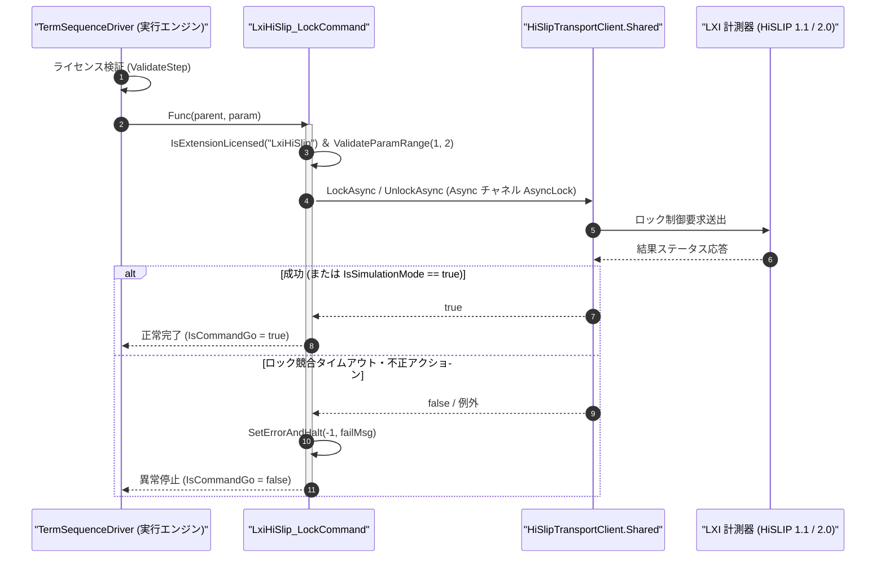

# コマンドリファレンス：LxiHiSlip_Lock

👉 [← LxiHiSlip アドイン取扱説明書に戻る](./LxiHiSlip取扱説明書.Md)

## 概要

**LxiHiSlip_Lock** は、複数の PC やテストシステムから同一 LXI 計測器へ同時アクセスされる環境において、シーケンス実行中の割り込みを防ぐ **ロック取得・解放** を制御するコマンドです。
`HiSlipTransportClient.Shared` を介して 非同期チャネル経由で `AsyncLock` を送出し、排他ロック（`EXCLUSIVE`）、共有ロック（`SHARED`）、またはロック解放（`UNLOCK`）を制御します。

---

## 💡 書式・パラメータ仕様

### コマンド構文

```csv
,SEQUENCE, [ステップキー], LxiHiSlip_Lock, "[Action: EXCLUSIVE/SHARED/UNLOCK]", "[TimeoutMs: 5000]"
```

### パラメータ（引数）一覧

| 引数位置 | 引数名 | 必須/任意 | 説明・制約 |
| :--- | :--- | :---: | :--- |
| 第 1 引数 | `Action` | 必須 | ロック操作種別（`"EXCLUSIVE"` で排他ロック取得、`"SHARED"` で共有ロック取得、`"UNLOCK"` でロック解放。大文字小文字不問）。 |
| 第 2 引数 | `TimeoutMs` | 任意 | ロック取得待機タイムアウト時間［ミリ秒］（`0`〜`300000`）。`UNLOCK` 時は無視され、省略時は現在の設定値を使用します。 |

---

## 🔄 特殊置換規約・分岐規約の適用

* **動的置換（`$`）**: 全引数で `$PARAMキー$` による動的置換に対応します。
* **ジャンプ先指定（`#`）**: 非適用。
* **共通コマンド指定（`@`）**: 非適用。
* **エイリアス（別名）**: `Analysis_LxiHiSlip_Lock`, `Sqn_LxiHiSlip_Lock`

---

## 💡 動作例（正しい構文での記述例）

### スクリプト記述例

```csv
COMMAND, "SAMPLE_LXIHISLIP_LOCK", "VAL"
,PARAM, "VAL", Work, "排他測定値", ""
,SEQUENCE, 010, LxiHiSlip_Open, "192.168.0.10", 4880, "hislip0"
; 排他ロックを取得して他クライアントの割り込みを防止
,SEQUENCE, 020, LxiHiSlip_Lock, "EXCLUSIVE", 5000
,SEQUENCE, 030, LxiHiSlip_Query, "MEAS:VOLT?", "VAL", 5000
; 測定完了後にロックを解放
,SEQUENCE, 040, LxiHiSlip_Lock, "UNLOCK"
,SEQUENCE, 050, LxiHiSlip_Close
,SEQUENCE, 060, Exit, "$VAL$", 0
```

### 実行時の挙動・変数変化

* **実行前の状態**: セッションがオープンされ、他クライアントと共有アクセス可能な状態。
* **実行後の状態**: ロック取得中は自セッションのみが制御権を保持し、`"UNLOCK"` 実行（またはセッション切断）でロックが解放されます。

---

## 🔄 動作フロー（シーケンス図）



---

## 🚫 エラーハンドリング・安全設計（仕様制限）

1. **ライセンス検証および引数ガード**:
   - `LxiHiSlip` 未認証時は `-100`、引数不足・超過（`ValidateParamRange(1, 2)` 違反）または規定外アクション文字列指定時は `SetErrorAndHalt(-1, failMsg)` で停止します。
2. **ロック競合タイムアウト制御**:
   - 他クライアントがロック保持中のまま `TimeoutMs` を超過した場合は `SetErrorAndHalt(-1, "Lock timeout")` で安全停止します。

---

## 🧪 ユニットテスト仕様

本コマンドクラス（`LxiHiSlip_LockCommand.cs`）の `RunUnitTest()` 検証仕様です。

### テスト実行前提条件

* **実行トリガー**: `RunUnitTest()` メソッドの呼び出し
* **有効化条件**: `ErrorLogger.MinimumLevel == LogLevel.Test`
* **検証結果出力**: `_log.LogTest` へ出力。`finally` で `IsSimulationMode` を復元。

### テストケース一覧

| No | テストカテゴリ | テスト条件（入力値） | 期待される結果（出力値） | 検証の目的 / 観点 |
| :---: | :--- | :--- | :--- | :--- |
| **1** | 正常系 | `IsSimulationMode = true` 下で引数 `"EXCLUSIVE"`, `"3000"` を実行後、`"UNLOCK"` を実行 | 双方とも `!param.HasError` かつ `IsCommandGo == true` となる | ロック取得および解放シーケンスの検証 |
| **2** | 異常系 | 不正なアクション文字列 `"INVALID_MODE"` を指定して実行 | `HasError == true` かつ `!IsCommandGo` となる | 規定外アクション指定の拒否検証 |