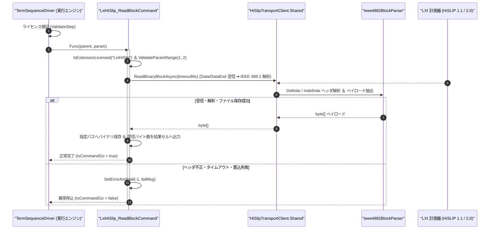

# コマンドリファレンス：LxiHiSlip_ReadBlock

👉 [← LxiHiSlip アドイン取扱説明書に戻る](./LxiHiSlip取扱説明書.Md)

## 概要

**LxiHiSlip_ReadBlock** は、オシロスコープ波形データや画面キャプチャ画像などの **IEEE 488.2 バイナリブロック（Arbitrary Block Data）** を受信・解析し、指定ファイルへ保存するバイナリ受信系コマンドです。
共通基底クラス `LxiReadBlockCommandBase`（`TermAnalysis.Lxi.Core`）を継承し、`HiSlipTransportClient.Shared` および `Ieee4882BlockParser` を介して 同期チャネルで高速転送される大容量バイナリフレーム（`Data` / `DataEnd`）を受信し、`Ieee4882BlockParser` で IEEE 488.2 バイナリブロックを抽出して指定ファイルへ保存します。

---

## 💡 書式・パラメータ仕様

### コマンド構文

```csv
,SEQUENCE, [ステップキー], LxiHiSlip_ReadBlock, "[SaveFilePath]", "[TimeoutMs(任意)]"
```

### パラメータ（引数）一覧

| 引数位置 | 引数名 | 必須/任意 | 説明・制約 |
| :--- | :--- | :---: | :--- |
| 第 1 引数 | `SaveFilePath` | 必須 | 抽出したバイナリペイロードを保存するファイルパス（相対パスまたは実行時変数展開パス）。親ディレクトリが存在しない場合は自動作成されます。 |
| 第 2 引数 | `TimeoutMs` | 任意 | 大容量ブロック受信のタイムアウト時間［ミリ秒］（`100`〜`300000`）。省略時は現在のモード設定値を使用。 |

---

## 🔄 特殊置換規約・分岐規約の適用

* **動的置換（`$`）**: 第 1 引数の保存ファイルパス（例: `"./out/wave_$SERIAL$.bin"`）および第 2 引数で `$PARAMキー$` の動的置換に対応します。
* **ジャンプ先指定（`#`）**: 非適用。
* **共通コマンド指定（`@`）**: 非適用。
* **エイリアス（別名）**: `Analysis_LxiHiSlip_ReadBlock`, `Sqn_LxiHiSlip_ReadBlock`

---

## 💡 動作例（正しい構文での記述例）

### スクリプト記述例

```csv
COMMAND, "SAMPLE_LXIHISLIP_READBLOCK", "BYTES"
,PARAM, "FILE_PATH", Input, "保存先パス", "./output/ch1_wave.bin"
,PARAM, "BYTES", Work, "受信バイト数", ""
,SEQUENCE, 010, LxiHiSlip_Open, "192.168.0.10", 4880, "hislip0"
; 波形データ送出を要求
,SEQUENCE, 020, LxiHiSlip_Send, ":WAV:DATA?"
; IEEE 488.2 バイナリブロックを受信してファイル保存
,SEQUENCE, 030, LxiHiSlip_ReadBlock, "$FILE_PATH$", 15000
,SEQUENCE, 040, LxiHiSlip_Close
,SEQUENCE, 050, Exit, "OK", 0
```

### 実行時の挙動・変数変化

* **実行前の状態**: 計測器へバイナリ返却コマンド（`:WAV:DATA?` や `:DISP:DATA? PNG` 等）を送信済みの状態。
* **実行後の状態**: ヘッダ（`#<d><len>` または `#0`）および末尾終端 LF を取り除いた純粋なバイナリペイロードが指定ファイルへ書き出され、結果セルには受信バイト数（例: `"1048576"`）が格納されます。

---

## 🔄 動作フロー（シーケンス図）



---

## 🚫 エラーハンドリング・安全設計（仕様制限）

1. **ライセンス検証・引数検証**:
   - `LxiHiSlip` 未認証時は `-100`、引数不足・超過（`ValidateParamRange(1, 2)` 違反）または空パス指定時は停止します。
2. **IEEE 488.2 ヘッダ検証とファイル I/O 保護**:
   - 先頭文字が `#` でない、あるいは桁数・データ長が仕様外の場合は `FormatException` を捕捉して `SetErrorAndHalt(-1, failMsg)` で停止します。書込権限不足時も例外を捕捉し安全停止します。

---

## 🧪 ユニットテスト仕様

本コマンドクラス（`LxiHiSlip_ReadBlockCommand.cs`）の `RunUnitTest()` 検証仕様です。

### テスト実行前提条件

* **実行トリガー**: `RunUnitTest()` メソッドの呼び出し
* **有効化条件**: `ErrorLogger.MinimumLevel == LogLevel.Test`
* **検証結果出力**: `_log.LogTest` へ出力。`finally` でテスト生成一時ファイルを完全削除し、`IsSimulationMode` を復元します。

### テストケース一覧

| No | テストカテゴリ | テスト条件（入力値） | 期待される結果（出力値） | 検証の目的 / 観点 |
| :---: | :--- | :--- | :--- | :--- |
| **1** | 正常系 | `IsSimulationMode = true`（模擬ブロック `#14ABCD\n`）下で一時ファイルパスを指定して実行 | `!param.HasError`、`IsCommandGo == true`、保存ファイル内容が `ABCD`（4 バイト）と一致する | Definite Block 解析およびファイル保存の検証 |
| **2** | 異常系 | 引数なし、または空パス `""` を指定して実行 | `HasError == true` かつ `!IsCommandGo` となる | 必須保存パス欠落の拒否検証 |