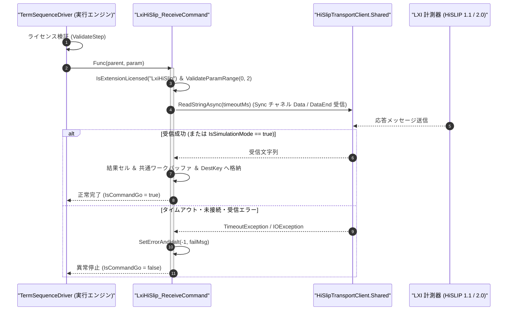

# コマンドリファレンス：LxiHiSlip_Receive

👉 [← LxiHiSlip アドイン取扱説明書に戻る](./LxiHiSlip取扱説明書.Md)

## 概要

**LxiHiSlip_Receive** は、コマンド送信を伴わず計測器から 1 メッセージを単独受信し、結果セル・共通受信ワークバッファ（`Set_Data` 連携対象）・指定変数へ格納する受信系コマンドです。
共通基底クラス `LxiReceiveCommandBase`（`TermAnalysis.Lxi.Core`）を継承し、`HiSlipTransportClient.Shared` を介して 同期チャネルから `Data` / `DataEnd` フレームを受信して結合し、結果セルおよび共通受信ワークバッファ（`Set_Data` 連携対象）へ格納します。

---

## 💡 書式・パラメータ仕様

### コマンド構文

```csv
,SEQUENCE, [ステップキー], LxiHiSlip_Receive, "[DestKey(任意)]", "[TimeoutMs(任意)]"
```

### パラメータ（引数）一覧

| 引数位置 | 引数名 | 必須/任意 | 説明・制約 |
| :--- | :--- | :---: | :--- |
| 第 1 引数 | `DestKey` | 任意 | 受信文字列を格納する `PARAM` 変数キー名。省略時は結果セルおよび共通受信ワークバッファのみへ格納されます。 |
| 第 2 引数 | `TimeoutMs` | 任意 | 今回の受信のみに適用するタイムアウト時間［ミリ秒］（`100`〜`300000`）。省略時は現在のモード設定値が適用されます。 |

---

## 🔄 特殊置換規約・分岐規約の適用

* **動的置換（`$`）**: 第 1・第 2 引数で `$PARAMキー$` による動的置換に対応します。
* **ジャンプ先指定（`#`）**: 非適用。
* **共通コマンド指定（`@`）**: 非適用。
* **エイリアス（別名）**: `Analysis_LxiHiSlip_Receive`, `Sqn_LxiHiSlip_Receive`

---

## 💡 動作例（正しい構文での記述例）

### スクリプト記述例

```csv
COMMAND, "SAMPLE_LXIHISLIP_RECV", "MEAS_VAL"
,PARAM, "MEAS_VAL", Work, "単独受信値", ""
,SEQUENCE, 010, LxiHiSlip_Open, "192.168.0.10", 4880, "hislip0"
; トリガ送出後に計測器から送られてくる測定結果を単独受信
,SEQUENCE, 020, LxiHiSlip_Send, "TRIG SGL"
,SEQUENCE, 030, LxiHiSlip_Receive, "MEAS_VAL", 10000
,SEQUENCE, 040, LxiHiSlip_Close
,SEQUENCE, 050, Exit, "$MEAS_VAL$", 0
```

### 実行時の挙動・変数変化

* **実行前の状態**: `"MEAS_VAL"` が空文字で、計測器から応答データが送出される待機状態。
* **実行後の状態**: 受信文字列（末尾の CR/LF は正規化除去）が結果セル・共通受信ワークバッファおよび `"MEAS_VAL"` へ格納され、後続の `Set_Data` や `Judge` からそのまま参照可能となります。

---

## 🔄 動作フロー（シーケンス図）



---

## 🚫 エラーハンドリング・安全設計（仕様制限）

1. **ライセンス検証および引数範囲ガード**:
   - `LxiHiSlip` 未認証時は `-100`、引数 3 個以上は `ValidateParamRange(0, 2)` 違反で停止します。
2. **タイムアウト安全停止**:
   - 指定時間内に応答終端が得られない場合は `SetErrorAndHalt(-1, "Receive timeout")` で停止し、ハングアップを防止します。

---

## 🧪 ユニットテスト仕様

本コマンドクラス（`LxiHiSlip_ReceiveCommand.cs`）の `RunUnitTest()` 検証仕様です。

### テスト実行前提条件

* **実行トリガー**: `RunUnitTest()` メソッドの呼び出し
* **有効化条件**: `ErrorLogger.MinimumLevel == LogLevel.Test`
* **検証結果出力**: `_log.LogTest` へ出力。`finally` で `IsSimulationMode` を復元。

### テストケース一覧

| No | テストカテゴリ | テスト条件（入力値） | 期待される結果（出力値） | 検証の目的 / 観点 |
| :---: | :--- | :--- | :--- | :--- |
| **1** | 正常系 | `IsSimulationMode = true`（模擬応答 `"+1.2345E+00"`）下で `DestKey="MEAS_VAL"`, `TimeoutMs="3000"` を指定 | `!param.HasError`、`IsCommandGo == true`、変数 `MEAS_VAL == "+1.2345E+00"` となる | 単独受信および変数・ワークバッファ格納の検証 |
| **2** | 異常系 | 余剰引数 3 個を指定して実行 | `ValidateParamRange(0, 2)` 違反で `HasError == true` かつ `!IsCommandGo` となる | 引数上限超過の拒否検証 |