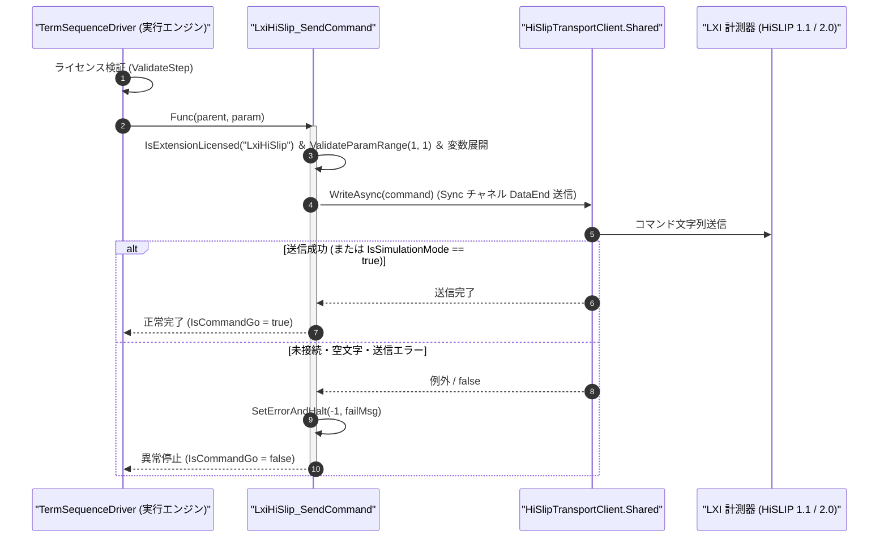

# コマンドリファレンス：LxiHiSlip_Send

👉 [← LxiHiSlip アドイン取扱説明書に戻る](./LxiHiSlip取扱説明書.Md)

## 概要

**LxiHiSlip_Send** は、接続中の LXI 計測器に対して SCPI コマンドまたは機器固有コマンド文字列を非同期送信（応答待機なし）する送信系コマンドです。
共通基底クラス `LxiSendCommandBase`（`TermAnalysis.Lxi.Core`）を継承し、`HiSlipTransportClient.Shared` を介して 同期チャネル上へ IVI-6.1 固定 16 バイトヘッダ（`"HS"` + MessageType=`DataEnd`）を付与してコマンド文字列を非同期送信します。

---

## 💡 書式・パラメータ仕様

### コマンド構文

```csv
,SEQUENCE, [ステップキー], LxiHiSlip_Send, "[CommandText]"
```

### パラメータ（引数）一覧

| 引数位置 | 引数名 | 必須/任意 | 説明・制約 |
| :--- | :--- | :---: | :--- |
| 第 1 引数 | `CommandText` | 必須 | 計測器へ送信するコマンド文字列（例: `"OUTP ON"`, `"VOLT 5.0"`, `"*TRG"`）。空文字は不可。変数展開（`$KEY$`）に対応します。 |

---

## 🔄 特殊置換規約・分岐規約の適用

* **動的置換（`$`）**: 第 1 引数内で `$PARAMキー$` を指定すると、実行時に変数プールの現在値へ動的置換されます。（適用可能な引数: 第 1 引数）
* **ジャンプ先指定（`#`）**: 非適用。
* **共通コマンド指定（`@`）**: 非適用。
* **カンマのエスケープ**: 送信文字列内にカンマ（例: `"SOUR:LIST:VOLT 1.0,2.0,3.0"`）が含まれる場合は、必ず `"..."` で囲んで記述します。
* **エイリアス（別名）**: `Analysis_LxiHiSlip_Send`, `Sqn_LxiHiSlip_Send`

---

## 💡 動作例（正しい構文での記述例）

### スクリプト記述例

```csv
COMMAND, "SAMPLE_LXIHISLIP_SEND", "RESULT"
,PARAM, "TARGET_VOLT", Input, "設定電圧(V)", "5.0"
,PARAM, "RESULT", Work, "実行結果", "OK"
,SEQUENCE, 010, LxiHiSlip_Open, "192.168.0.10", 4880, "hislip0"
; 変数展開を用いて電圧設定および出力 ON コマンドを送信
,SEQUENCE, 020, LxiHiSlip_Send, "VOLT $TARGET_VOLT$"
,SEQUENCE, 030, LxiHiSlip_Send, "OUTP ON"
,SEQUENCE, 040, LxiHiSlip_Close
,SEQUENCE, 050, Exit, "$RESULT$", 0
```

### 実行時の挙動・変数変化

* **実行前の状態**: `"TARGET_VOLT"` に `"5.0"` が設定され、計測器セッションがオープンされている状態。
* **実行後の状態**: `"VOLT 5.0"` および `"OUTP ON"` が計測器へ送信され、応答待機を行わずに次ステップへ遷移します。

---

## 🔄 動作フロー（シーケンス図）



---

## 🚫 エラーハンドリング・安全設計（仕様制限）

1. **ライセンス検証・引数検証**:
   - `LxiHiSlip` 未認証時は `-100`、引数不足・超過（`ValidateParamRange(1, 1)` 違反）または空文字送信指定時は `SetErrorAndHalt(-1, failMsg)` で停止します。
2. **未接続ガード**:
   - セッション未接続（`!IsConnected` かつ `!IsSimulationMode`）のまま呼び出された場合は通信エラーとして安全停止します。

---

## 🧪 ユニットテスト仕様

本コマンドクラス（`LxiHiSlip_SendCommand.cs`）の `RunUnitTest()` 検証仕様です。

### テスト実行前提条件

* **実行トリガー**: `RunUnitTest()` メソッドの呼び出し
* **有効化条件**: `ErrorLogger.MinimumLevel == LogLevel.Test`
* **検証結果出力**: `_log.LogTest` へ出力。`finally` で `IsSimulationMode` を復元。

### テストケース一覧

| No | テストカテゴリ | テスト条件（入力値） | 期待される結果（出力値） | 検証の目的 / 観点 |
| :---: | :--- | :--- | :--- | :--- |
| **1** | 正常系 | `IsSimulationMode = true` 下で `"OUTP ON"` を送信 | `!param.HasError` かつ `IsCommandGo == true`、`LastSentCommand == "OUTP ON"` となる | コマンド送信および履歴記録の検証 |
| **2** | 異常系 | 引数なし、または空文字列 `""` を指定して実行 | `HasError == true` かつ `!IsCommandGo` となる | 必須引数欠落・空送信拒否の検証 |