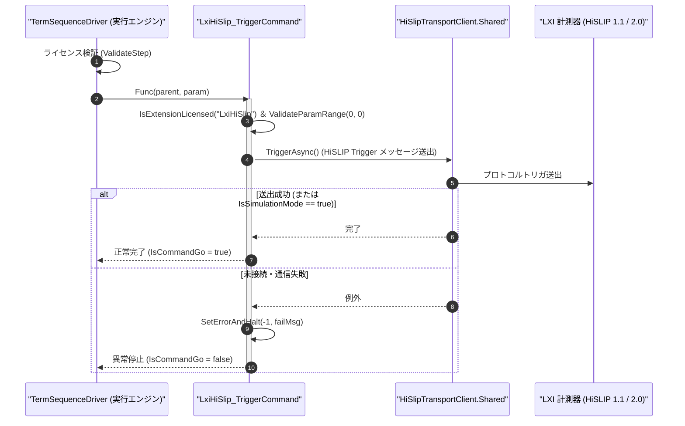

# コマンドリファレンス：LxiHiSlip_Trigger

👉 [← LxiHiSlip アドイン取扱説明書に戻る](./LxiHiSlip取扱説明書.Md)

## 概要

**LxiHiSlip_Trigger** は、GPIB の Group Execute Trigger（GET）に相当する **プロトコルレベルの計測トリガ** を送出する制御系コマンドです。
`HiSlipTransportClient.Shared` を介して 同期チャネルへ HiSLIP `Trigger` メッセージ（MessageType=`Trigger`）を送出し、プロトコルレベルの計測トリガを実行します。

---

## 💡 書式・パラメータ仕様

### コマンド構文

```csv
,SEQUENCE, [ステップキー], LxiHiSlip_Trigger
```

### パラメータ（引数）一覧

本コマンドは引数を必要としません（`ValidateParamRange(0, 0)`）。

| 引数位置 | 引数名 | 必須/任意 | 説明・制約 |
| :--- | :--- | :---: | :--- |
| － | （なし） | － | 引数を指定すると引数超過エラーとして拒否されます。 |

---

## 🔄 特殊置換規約・分岐規約の適用

* **動的置換（`$`）**: 非適用。
* **ジャンプ先指定（`#`）**: 非適用。
* **共通コマンド指定（`@`）**: 非適用。
* **エイリアス（別名）**: `Analysis_LxiHiSlip_Trigger`, `Sqn_LxiHiSlip_Trigger`

---

## 💡 動作例（正しい構文での記述例）

### スクリプト記述例

```csv
COMMAND, "SAMPLE_LXIHISLIP_TRIG", "VAL"
,PARAM, "VAL", Work, "トリガ測定値", ""
,SEQUENCE, 010, LxiHiSlip_Open, "192.168.0.10", 4880, "hislip0"
,SEQUENCE, 020, LxiHiSlip_Send, "TRIG:SOUR BUS"
,SEQUENCE, 030, LxiHiSlip_Send, "INIT"
; プロトコルレベルの計測トリガを送出
,SEQUENCE, 040, LxiHiSlip_Trigger
,SEQUENCE, 050, LxiHiSlip_Query, "FETC?", "VAL", 5000
,SEQUENCE, 060, LxiHiSlip_Close
,SEQUENCE, 070, Exit, "$VAL$", 0
```

### 実行時の挙動・変数変化

* **実行前の状態**: 計測器がバストリガ待機状態（`TRIG:SOUR BUS` + `INIT`）にある状態。
* **実行後の状態**: トリガが発火して測定が開始され、続く `FETC?` で測定結果を取得できます。

---

## 🔄 動作フロー（シーケンス図）



---

## 🚫 エラーハンドリング・安全設計（仕様制限）

1. **ライセンス検証・引数ガード**:
   - `LxiHiSlip` 未認証時は `-100`、余剰引数指定時は `ValidateParamRange(0, 0)` 違反で停止します。
2. **未接続・通信エラー時の安全停止**:
   - セッション未接続または送信失敗時は `SetErrorAndHalt(-1, failMsg)` で停止します。

---

## 🧪 ユニットテスト仕様

本コマンドクラス（`LxiHiSlip_TriggerCommand.cs`）の `RunUnitTest()` 検証仕様です。

### テスト実行前提条件

* **実行トリガー**: `RunUnitTest()` メソッドの呼び出し
* **有効化条件**: `ErrorLogger.MinimumLevel == LogLevel.Test`
* **検証結果出力**: `_log.LogTest` へ出力。`finally` で `IsSimulationMode` を復元。

### テストケース一覧

| No | テストカテゴリ | テスト条件（入力値） | 期待される結果（出力値） | 検証の目的 / 観点 |
| :---: | :--- | :--- | :--- | :--- |
| **1** | 正常系 | `IsSimulationMode = true` 下で引数なしで実行 | `!param.HasError` かつ `IsCommandGo == true` となる | プロトコルトリガ送出の正常完了検証 |
| **2** | 異常系 | 余剰引数 `"EXTRA"` を指定して実行 | `ValidateParamRange(0, 0)` 違反で `HasError == true` かつ `!IsCommandGo` となる | 引数上限超過の拒否検証 |