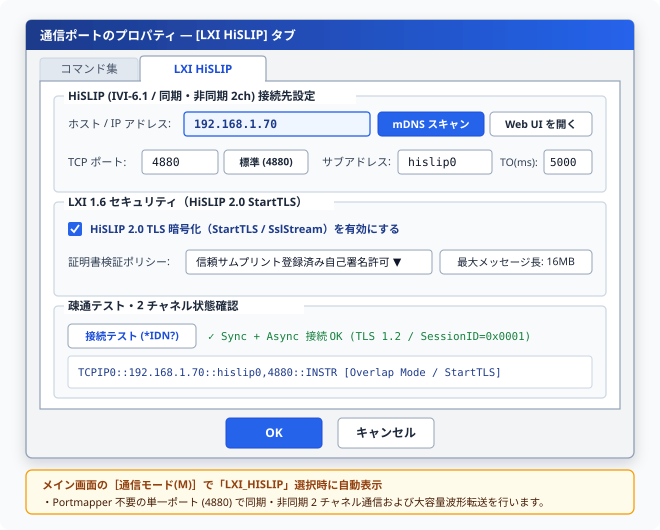
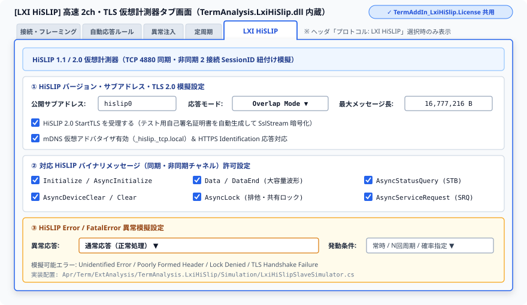

# LxiHiSlip（LAN［LXI］HiSLIP / TLS 2.0 高速通信）アドイン取扱説明書

👉 [← TermAddIn_LxiHiSlip 製品トップに戻る](https://github.com/Monaca-App/TermAddIn_LxiHiSlip)  
👉 [← プロパティ設定画面取扱説明書（共通）](../プロパティ設定画面取扱説明書.Md) ／ [← TermEmulator 操作説明書（共通）](https://github.com/Monaca-App/TermEmulator/blob/main/Manual/TermEmulator操作説明書.Md) ／ [← マクロスクリプト取扱説明書（共通）](../マクロスクリプト取扱説明書.Md)

---

本書は、**TermAddIn_LxiHiSlip**（`TermAnalysis.LxiHiSlip.dll`：IVI-6.1 HiSLIP・LXI 1.6 TLS 2.0 通信エクステンション）の **取扱説明書 兼 機能解説書** です。同期・非同期 2 チャネル構成（既定 TCP `4880`）および `SslStream` による `StartTLS` 暗号化を Pure C# で完結実装します。HiSLIP の仕組み解説、プロパティ設定画面の **「LXI HiSLIP」タブ**、**TermEmulator の `[LXI HiSLIP]` 仮想計測器タブ**、および全 11 コマンドのリファレンスを 1 冊にまとめています。

* **必須拡張ライセンス**: **`TermAddIn_LxiHiSlip.License`** （組み込み先: `TermAnalysis.LxiHiSlip.dll`、`TermEmulator` と相互共用）
* **共通同梱基盤**: `TermAnalysis.Lxi.Core.dll`（無償同梱：mDNS 自動発見・LXI XML 識別［HTTPS 対応］・Web UI 起動・IEEE 488.2 バイナリブロック解析）


### 関連する公式規格・仕様書（外部リンク）
* [IVI Foundation 公式仕様ポータル（IVI-6.1：High-Speed LAN Instrument Protocol［HiSLIP］）](https://www.ivifoundation.org/specifications/default.aspx) — HiSLIP 1.1 / 2.0（同期・非同期 2 チャネル、16 バイトバイナリヘッダ、`StartTLS` 暗号化等）の一次公式規格書です（本アドインは LXI 1.6 HiSLIP / LXI Security Extended Function に準拠）。
---

## 目次

- [1. 機能概要と基礎知識（はじめての方へ）](#1-機能概要と基礎知識はじめての方へ)
- [2. プロパティ設定画面：「LXI HiSLIP」タブの詳細](#2-プロパティ設定画面lxi-hislipタブの詳細)
- [3. TermEmulator 仮想スレーブ設定：「[LXI HiSLIP]」タブの詳細](#3-termemulator-仮想スレーブ設定lxi-hislipタブの詳細)
- [4. マクロコマンド一覧（全 11 コマンド）](#4-マクロコマンド一覧全-11-コマンド)

---

## 1. 機能概要と基礎知識（はじめての方へ）

### 対応する機能の概要
**LxiHiSlip（HiSLIP / TLS 2.0 高速通信）** アドインは、IVI-6.1 規格の次世代計測器プロトコル **HiSLIP 1.1 / 2.0** に対応し、高速オシロスコープやスペクトラムアナライザ等の大容量データ送受信、帯域外制御（`ReadStb` / `Clear` / `Trigger` / 排他・共有 `Lock`）、および LXI 1.6 準拠の **TLS 2.0 暗号化通信（`StartTLS`）** を行う高速・高セキュリティ通信機能です。

### 機能の実現方法
* **固定 16 バイトバイナリヘッダ ＋ 同期／非同期 2 チャネル実装**: `.NET Framework 4.8` 標準 `TcpClient` 上に IVI-6.1 バイナリプロトコルを Pure C# で実装し、同一ポート（TCP `4880`）に対して同期チャネル（`Data`/`DataEnd`）と非同期チャネル（`AsyncDeviceClear` / `AsyncStatusQuery` / `AsyncLock`）を `SessionID` で紐付けて並列運用します。
* **OS 標準 `SslStream` による TLS 2.0 暗号化**: 外部暗号ライブラリを追加せず、`StartTLS` ハンドシェイクと自己署名証明書の信頼サムプリント登録ポリシーにより安全な暗号化通信を実現します。
* **仮想 HiSLIP サーバー模擬**: `TermEmulator` の `[LXI HiSLIP]` タブで 2 チャネル接続およびテスト用自己署名証明書による `StartTLS` 通信まで実機なしで検証できます。

### このアドインを選択することの利点
* **大容量波形データの転送時間を大幅短縮**: VXI-11 のような RPC オーバーヘッドがなく、同期・非同期分離により高速な波形収集と並列ステータス監視を両立できます。
* **社内ネットワーク・ファイアウォール環境で導入しやすい**: Portmapper（ランダムポート割当）を使わず **TCP `4880` の 1 ポートのみ** で完結するため、情報システム部門へのポート開放申請や運用が極めてシンプルです。
* **セキュリティ要件の厳しい最新ラインに対応**: LXI 1.6 の TLS 2.0 暗号化にネイティブ対応しており、工場ネットワークのセキュリティ基準を満たしながら NI-VISA レスで運用できます。

### なぜ高速で安全なのか（通信の仕組みと特長）
* **2 本の専用レーン（同期・非同期チャネル）**: データのやり取りをする「データ用チャネル」と、状態確認や緊急停止を送る「帯域外制御用チャネル」の 2 本を標準ポート **`4880`** 上で同時に張ります。そのため、巨大な波形データを受信中でも、非同期チャネルからステータス確認（`ReadStb`）や強制クリア（`Clear`）が詰まらずに通ります。
* **ポートが 1 つだけ（ファイアウォールに優しい）**: VXI-11 のように毎回ランダムなポート番号を使わず、**TCP `4880` 番だけ** で完結するため、社内 LAN やファイアウォール環境でもトラブルが少ないのが特徴です。
* **TLS 2.0 暗号化（StartTLS）**: 計測器との通信内容を暗号化して盗聴・改ざんを防ぎます。

### 設定の妥当性を判断するためのチェックポイント
| 確認項目 | 項目の意味 | 設定値の目安・確認方法 |
| :--- | :--- | :--- |
| **ホスト / IP アドレス** | 計測器の LAN 住所 | 本体パネルで確認するか、**`LAN 機器スキャン (mDNS)`** で自動検出します。 |
| **ポート番号** | HiSLIP 専用の標準ポート番号 | 規格で **`4880`** と定められているため、通常は **`4880` のままで妥当** です。 |
| **サブアドレス** | 機器内の論理接続名 | 既定値の **`hislip0`** のままでほとんどの対応計測器に接続できます。 |
| **TLS 2.0 暗号化 (StartTLS)** | 通信を暗号化するかどうか | 計測器側で HiSLIP 2.0（TLS）が有効になっている場合のみ **ON** にします。従来の HiSLIP 1.1 機器では **OFF** のまま使います。 |

### 通信の仕組み解説（HiSLIP 2 チャネル構造と代表的なトラブル事例・対処法）
HiSLIP は、同じ TCP `4880` 番ポートへ「同期（データ用）」と「非同期（緊急制御用）」の 2 本を同時に接続し、共通の 16 バイト固定ヘッダ（先頭 `"HS"`）で高速通信します。

```text
同期チャネル   (TCP:4880): Initialize ➔ SessionID 取得 ➔ Data / DataEnd (コマンド・大容量波形)
非同期チャネル (TCP:4880): AsyncInitialize(SessionID) ➔ AsyncStatusQuery(STB) / AsyncDeviceClear / AsyncLock
[16B 固定ヘッダ]: "HS"(2B) + MessageType(1B) + ControlCode(1B) + Parameter(4B) + PayloadLength(8B)
```

* **事例①：TLS を ON にすると接続エラーになる** ➔ 計測器側が HiSLIP 1.1（非暗号化）のみ対応、または計測器の自己署名証明書が未信頼の状態です。非暗号化機は TLS を OFF にし、TLS 2.0 対応機はプロパティ画面で信頼サムプリントを登録してください。
* **事例②：ポート `4880` に繋がらない** ➔ 一部の計測器では初期状態で HiSLIP サービスが OFF になっています。計測器の Web UI またはフロントパネルの I/O 設定で HiSLIP を有効にしてください。
* **事例③：大容量波形取得が途中でタイムアウトする** ➔ 10 MB を超える波形データでは既定の `5000` ms では不足する場合があります。`LxiHiSlip_ReadBlock` の第 2 引数で `15000`〜`30000` ms を指定してください。

---

## 2. プロパティ設定画面：「LXI HiSLIP」タブの詳細



メイン画面で **`LXI_HISLIP`** モードを選択しているときに表示され、`LxiHiSlip_Open` 等の HiSLIP 接続条件を設定します。

| 項目名 | 設定値・範囲（既定値） | 詳しい意味と設定のポイント |
| :--- | :--- | :--- |
| **`ホスト / IP アドレス`** | IPv4 / IPv6 アドレスまたはホスト名 | 接続先 HiSLIP 対応計測器の IP アドレスを指定します。 |
| **`ポート番号`** | `1`〜`65535`（既定 `4880`） | HiSLIP 標準ポートは `4880` です（Portmapper 不要で同期・非同期 2 チャネルとも同一ポートへ接続）。 |
| **`サブアドレス`** | 文字列（既定 `hislip0`） | HiSLIP 機器の論理サブアドレスを指定します。 |
| **`TLS 2.0 暗号化 (StartTLS)`** | チェックボックス（OFF / ON）＋ 証明書検証ポリシー | LXI 1.6 HiSLIP 2.0 対応機との暗号化通信を有効化します（自己署名証明書の信頼サムプリント登録対応）。 |
| **`タイムアウト`** | ミリ秒（既定 `5000` ms） | 応答待機および大容量波形転送のタイムアウト時間です。 |
| **`LAN 機器スキャン (mDNS)` / `Web UI`** | 共通操作ボタン（`Lxi.Core` 提供） | `_hislip._tcp.local` の自動検出、HTTP / HTTPS LXI XML 識別、機器 Web UI 起動を行います。 |

---

## 3. TermEmulator 仮想スレーブ設定：`[LXI HiSLIP]` タブの詳細



* **主な用途**: 最新高速オシロスコープ・スペクトラムアナライザ等の HiSLIP 1.1 / 2.0 仮想スレーブ模擬（既定 TCP ポート `4880`）。
* **模擬機能**:
  * 同一 TCP ポート（`4880`）上で同期チャネル（`Initialize` ➔ `InitializeResponse`）および非同期チャネル（`AsyncInitialize` ➔ `AsyncInitializeResponse`）の 2 接続を `SessionID` で紐付けて完全模擬。
  * `Data` / `DataEnd` による大容量バイナリ波形返却、`AsyncDeviceClear` / `AsyncStatusQuery` / `AsyncLock` / `Trigger` 応答を模擬。
  * テスト用自己署名証明書＋`SslStream` による HiSLIP 2.0 `StartTLS` 模擬にも対応。

---

## 4. マクロコマンド一覧（全 11 コマンド）

| コマンド名 | 構文概要 | 主な役割・用途 |
| :--- | :--- | :--- |
| **[LxiHiSlip_Open](./LxiHiSlip_Open.Md)** | `,SEQUENCE, [ステップ], LxiHiSlip_Open, "[IP(任意)]", [Port(任意: 4880)], "[SubAddr(任意: hislip0)]"` | 同期・非同期 2 チャネルの HiSLIP セッションを確立 |
| **[LxiHiSlip_Close](./LxiHiSlip_Close.Md)** | `,SEQUENCE, [ステップ], LxiHiSlip_Close` | 同期・非同期セッションを正常切断・破棄 |
| **[LxiHiSlip_Mode](./LxiHiSlip_Mode.Md)** | `,SEQUENCE, [ステップ], LxiHiSlip_Mode, "[TLS(ON/OFF)]", [TimeoutMs]` | TLS 2.0 暗号化有無・タイムアウト等を動的変更 |
| **[LxiHiSlip_Send](./LxiHiSlip_Send.Md)** | `,SEQUENCE, [ステップ], LxiHiSlip_Send, "[送信文字列]"` | `DataEnd` によりコマンド文字列を非同期送信 |
| **[LxiHiSlip_Receive](./LxiHiSlip_Receive.Md)** | `,SEQUENCE, [ステップ], LxiHiSlip_Receive, "[格納先キー(任意)]", [TimeoutMs(任意)]` | 送信を伴わず 1 メッセージ受信し、結果セル・共通ワークバッファへ格納 |
| **[LxiHiSlip_Query](./LxiHiSlip_Query.Md)** | `,SEQUENCE, [ステップ], LxiHiSlip_Query, "[送信文字列]", "[格納先キー(任意)]", [TimeoutMs(任意)]` | コマンド送信＋応答取得を一括実行し、結果セル・共通ワークバッファ・指定変数へ格納 |
| **[LxiHiSlip_ReadBlock](./LxiHiSlip_ReadBlock.Md)** | `,SEQUENCE, [ステップ], LxiHiSlip_ReadBlock, "[保存先ファイルパス]", [TimeoutMs(任意)]` | IEEE 488.2 バイナリブロック（大容量波形等）を高速受信・ファイル保存 |
| **[LxiHiSlip_Clear](./LxiHiSlip_Clear.Md)** | `,SEQUENCE, [ステップ], LxiHiSlip_Clear` | 非同期チャネル経由 `AsyncDeviceClear` で入出力バッファ・状態をクリア |
| **[LxiHiSlip_ReadStb](./LxiHiSlip_ReadStb.Md)** | `,SEQUENCE, [ステップ], LxiHiSlip_ReadStb, "[格納先キー(任意)]"` | 非同期チャネル経由 `AsyncStatusQuery` で帯域外 STB を取得 |
| **[LxiHiSlip_Trigger](./LxiHiSlip_Trigger.Md)** | `,SEQUENCE, [ステップ], LxiHiSlip_Trigger` | プロトコルレベルの計測トリガを送出 |
| **[LxiHiSlip_Lock](./LxiHiSlip_Lock.Md)** | `,SEQUENCE, [ステップ], LxiHiSlip_Lock, "[EXCLUSIVE/SHARED/UNLOCK]", [TimeoutMs(任意)]` | 非同期チャネル経由 `AsyncLock` で排他／共有ロックを制御 |
