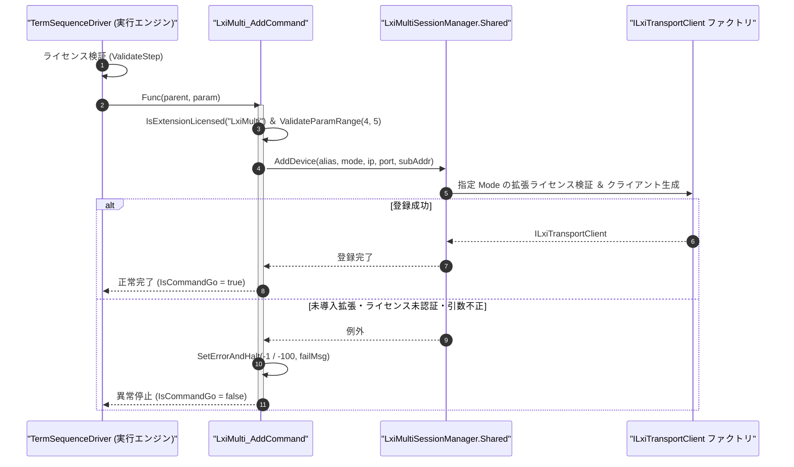

# コマンドリファレンス：LxiMulti_Add

👉 [← LxiMulti アドイン取扱説明書に戻る](./LxiMulti取扱説明書.Md)

## 概要

**LxiMulti_Add** は、複数台の LXI 計測器を 1 タスク内で同時統括するための管理テーブル（`LxiMultiSessionManager.Shared`）へ、任意の **エイリアス名** と接続先情報（通信方式・IP・ポート・サブアドレス）を動的登録する構成管理コマンドです。登録された通信方式に対応する基本通信拡張（`LxiRaw` / `LxiVxi11` / `LxiHiSlip`）の `ILxiTransportClient` ファクトリをバインドします。

---

## 💡 書式・パラメータ仕様

### コマンド構文

```csv
,SEQUENCE, [ステップキー], LxiMulti_Add, "[Alias]", "[Mode: LxiRaw/LxiVxi11/LxiHiSlip]", "[IP]", "[Port]", "[SubAddr(任意)]"
```

※ 同一エイリアス名で再登録した場合は、既存セッションを安全切断した上で設定を上書き更新します。

### パラメータ（引数）一覧

| 引数位置 | 引数名 | 必須/任意 | 説明・制約 |
| :--- | :--- | :---: | :--- |
| 第 1 引数 | `Alias` | 必須 | 計測器を識別する任意のエイリアス名（英数字・`_`・`-`、例: `"PSU1"`, `"DMM1"`, `"OSC1"`）。 |
| 第 2 引数 | `Mode` | 必須 | 使用する LXI 基本通信拡張名（`"LxiRaw"`, `"LxiVxi11"`, `"LxiHiSlip"` のいずれか。大文字小文字不問）。対象拡張が導入済み・ライセンス有効である必要があります。 |
| 第 3 引数 | `IP` | 必須 | 接続先計測器の IPv4 / IPv6 アドレスまたはホスト名。 |
| 第 4 引数 | `Port` | 必須 | 接続先 TCP ポート番号（`1`〜`65535`。例: Raw=`5025`, VXI-11=`111`, HiSLIP=`4880`）。 |
| 第 5 引数 | `SubAddr` | 任意 | VXI-11 / HiSLIP 使用時の論理サブアドレス（例: `"inst0"`, `"gpib0,22"`, `"hislip0"`）。`LxiRaw` では省略可能。 |

---

## 🔄 特殊置換規約・分岐規約の適用

* **動的置換（`$`）**: 全引数で `$PARAMキー$` による動的置換に対応します。
* **ジャンプ先指定（`#`）**: 非適用。
* **共通コマンド指定（`@`）**: 非適用。
* **カンマのエスケープ**: `SubAddr` にカンマを含む場合（例: `"gpib0,22"`）は必ず `"..."` で囲んで記述します。
* **エイリアス（別名）**: `Analysis_LxiMulti_Add`, `Sqn_LxiMulti_Add`

---

## 💡 動作例（正しい構文での記述例）

### スクリプト記述例

※COMMAND ブロック配下の子要素行（PARAM, SEQUENCE）は必ず行頭カンマから開始し、スペースインデントや行末コメント（`;`）は記述しないでください。

```csv
COMMAND, "SAMPLE_LXIMULTI_ADD", "MEAS_ALL"
,PARAM, "MEAS_ALL", Work, "並列測定結果", ""
; 電源(Raw)・DMM(VXI-11)・オシロ(HiSLIP) の 3 台を異種プロトコル混在で登録
,SEQUENCE, 010, LxiMulti_Add, "PSU1", "LxiRaw", "192.168.0.10", 5025
,SEQUENCE, 020, LxiMulti_Add, "DMM1", "LxiVxi11", "192.168.0.11", 111, "inst0"
,SEQUENCE, 030, LxiMulti_Add, "OSC1", "LxiHiSlip", "192.168.0.12", 4880, "hislip0"
,SEQUENCE, 040, LxiMulti_OpenAll
,SEQUENCE, 050, LxiMulti_ParallelQuery, "PSU1;DMM1;OSC1", "*IDN?", "MEAS_ALL"
,SEQUENCE, 060, LxiMulti_CloseAll
,SEQUENCE, 070, Exit, "$MEAS_ALL$", 0
```

### 実行時の挙動・変数変化

* **実行前の状態**: 対象エイリアスが `LxiMultiSessionManager.Shared` に未登録の状態。
* **実行後の状態**: エイリアスと接続定義・`ILxiTransportClient` インスタンスが登録され、`LxiMulti_OpenAll` や個別送受信コマンドの対象となります。

---

## 🔄 動作フロー（シーケンス図）



---

## 🚫 エラーハンドリング・安全設計（仕様制限）

1. **二段階ライセンス検証**: `LxiMulti` 自体のライセンスに加え、指定された `Mode`（`LxiRaw` / `LxiVxi11` / `LxiHiSlip`）の拡張 DLL 導入およびライセンス有効性を検証し、未認証時は `-100` で停止します。
2. **エイリアス・ポート妥当性検証**: 空エイリアスや範囲外ポート（`1`〜`65535` 以外）は `SetErrorAndHalt(-1, failMsg)` で拒否します。

---

## 🧪 ユニットテスト仕様

本コマンドクラス（`LxiMulti_AddCommand.cs`）に実装されている `RunUnitTest()` メソッドの検証仕様です。

### テスト実行前提条件

* **実行トリガー**: `RunUnitTest()` メソッドの呼び出し
* **有効化条件**: `ErrorLogger.MinimumLevel == LogLevel.Test` であること（それ以外は早期リターン）
* **検証結果出力**: `_log.LogTest` へ出力。`finally` でテスト登録したエイリアスを削除。

### テストケース一覧

| No | テストカテゴリ | テスト条件（入力値） | 期待される結果（出力値） | 検証の目的 / 観点 |
| :---: | :--- | :--- | :--- | :--- |
| **1** | 正常系 | `"PSU1"`, `"LxiRaw"`, `"192.168.0.10"`, `"5025"` を指定して実行 | `!HasError`、`IsCommandGo == true`、`ContainsAlias("PSU1") == true` となる | エイリアス登録およびファクトリバインド検証 |
| **2** | 異常系 | 未知の通信方式 `"LxiUnknown"` を指定して実行 | `HasError == true` かつ `!IsCommandGo` となる | 未対応プロトコル指定の拒否検証 |