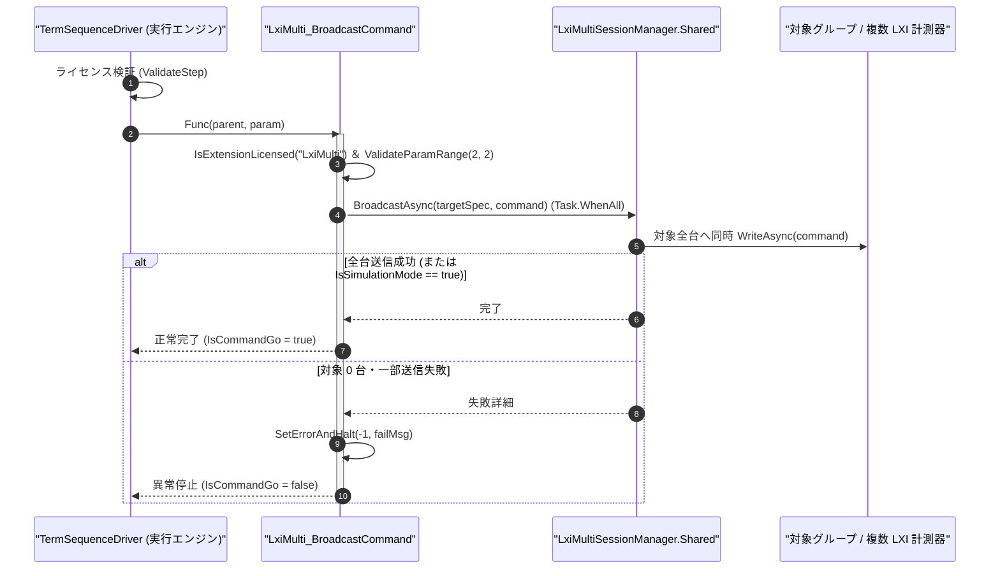

# コマンドリファレンス：LxiMulti_Broadcast

👉 [← LxiMulti アドイン取扱説明書に戻る](./LxiMulti取扱説明書.Md)

## 概要

**LxiMulti_Broadcast** は、指定されたグループ名またはエイリアス一覧に該当する複数台の LXI 計測器に対して、同一コマンド（`*TRG`、`OUTP ON`、`OUTP OFF` 等）を `Task.WhenAll` で **一斉並列送信** するコマンドです。`LxiMultiSessionManager.Shared.BroadcastAsync()` を実行します。

---

## 💡 書式・パラメータ仕様

### コマンド構文

```csv
,SEQUENCE, [ステップキー], LxiMulti_Broadcast, "[GroupOrAliasList]", "[CommandText]"
```

※ `GroupOrAliasList` にはグループ名（例: `"TRIG_GRP"`）、セミコロン区切りエイリアス一覧（例: `"PSU1;DMM1;OSC1"`）、または全機器対象の `"*"` / `"ALL"` を指定できます。

### パラメータ（引数）一覧

| 引数位置 | 引数名 | 必須/任意 | 説明・制約 |
| :--- | :--- | :---: | :--- |
| 第 1 引数 | `GroupOrAliasList` | 必須 | 送信対象とするグループ名、セミコロン区切りエイリアス一覧、または `"ALL"`（全登録機器）。 |
| 第 2 引数 | `CommandText` | 必須 | 対象全機器へ一斉送出するコマンド文字列（例: `"*TRG"`, `"OUTP OFF"`）。変数展開対応。 |

---

## 🔄 特殊置換規約・分岐規約の適用

* **動的置換（`$`）**: 全引数で `$PARAMキー$` による動的置換に対応します。
* **ジャンプ先指定（`#`）**: 非適用。
* **共通コマンド指定（`@`）**: 非適用。
* **エイリアス（別名）**: `Analysis_LxiMulti_Broadcast`, `Sqn_LxiMulti_Broadcast`

---

## 💡 動作例（正しい構文での記述例）

### スクリプト記述例

※COMMAND ブロック配下の子要素行（PARAM, SEQUENCE）は必ず行頭カンマから開始し、スペースインデントや行末コメント（`;`）は記述しないでください。

```csv
COMMAND, "SAMPLE_LXIMULTI_BCAST", "RES"
,PARAM, "RES", Work, "結果", "OK"
,SEQUENCE, 010, LxiMulti_Add, "DMM1", "LxiRaw", "192.168.0.11", 5025
,SEQUENCE, 020, LxiMulti_Add, "DMM2", "LxiRaw", "192.168.0.12", 5025
,SEQUENCE, 030, LxiMulti_OpenAll
; DMM1 と DMM2 へ *TRG を一斉並列送出
,SEQUENCE, 040, LxiMulti_Broadcast, "DMM1;DMM2", "*TRG"
,SEQUENCE, 050, LxiMulti_CloseAll
,SEQUENCE, 060, Exit, "$RES$", 0
```

### 実行時の挙動・変数変化

* **実行前の状態**: 対象全エイリアスのセッションがオープンされている状態。
* **実行後の状態**: 対象全機器へ並列にコマンドが送出され、全台の送信タスク完了後に次ステップへ進みます。

---

## 🔄 動作フロー（シーケンス図）



---

## 🚫 エラーハンドリング・安全設計（仕様制限）

1. **対象 0 件ガード**: 指定グループ・エイリアスに一致する機器が 0 台の場合は誤実行防止のため `SetErrorAndHalt(-1, failMsg)` で停止します。
2. **部分失敗の集約報告**: 一部の機器で送信失敗した場合でも、他機器のタスク完了を待ってから全失敗エイリアスをログ記録し安全停止します。

---

## 🧪 ユニットテスト仕様

本コマンドクラス（`LxiMulti_BroadcastCommand.cs`）に実装されている `RunUnitTest()` メソッドの検証仕様です。

### テスト実行前提条件

* **実行トリガー**: `RunUnitTest()` メソッドの呼び出し
* **有効化条件**: `ErrorLogger.MinimumLevel == LogLevel.Test` であること（それ以外は早期リターン）
* **検証結果出力**: `_log.LogTest` へ出力。`finally` で `IsSimulationMode` 復元および登録クリア。

### テストケース一覧

| No | テストカテゴリ | テスト条件（入力値） | 期待される結果（出力値） | 検証の目的 / 観点 |
| :---: | :--- | :--- | :--- | :--- |
| **1** | 正常系 | `IsSimulationMode = true` で 2 台オープン後、`"DMM1;DMM2"`, `"*TRG"` を実行 | `!HasError` かつ `IsCommandGo == true` となる | 一斉並列送信の検証 |
| **2** | 異常系 | 存在しないグループ `"NO_SUCH_GRP"` を指定して実行 | `HasError == true` かつ `!IsCommandGo` となる | 対象 0 台時の拒否検証 |