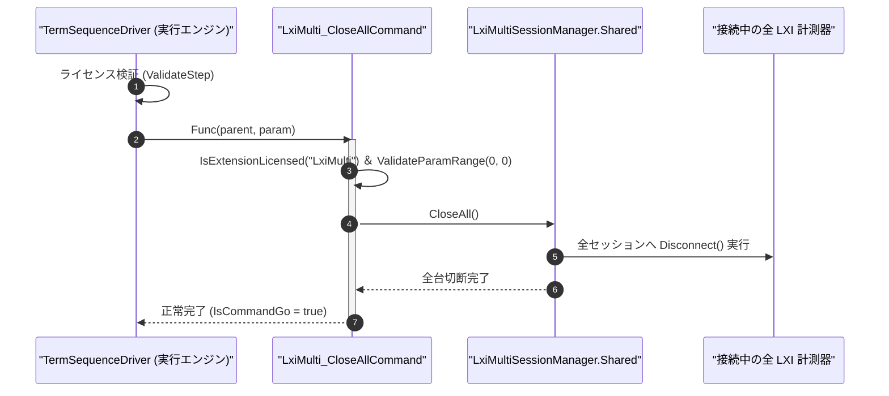

# コマンドリファレンス：LxiMulti_CloseAll

👉 [← LxiMulti アドイン取扱説明書に戻る](./LxiMulti取扱説明書.Md)

## 概要

**LxiMulti_CloseAll** は、`LxiMultiSessionManager.Shared` が保持している接続中の全 LXI 計測器セッションを一括で安全切断し、ソケット・ストリームリソースを解放する統括制御コマンドです。

---

## 💡 書式・パラメータ仕様

### コマンド構文

```csv
,SEQUENCE, [ステップキー], LxiMulti_CloseAll
```

### パラメータ（引数）一覧

| 引数位置 | 引数名 | 必須/任意 | 説明・制約 |
| :--- | :--- | :---: | :--- |
| － | （なし） | － | 引数を指定すると `ValidateParamRange(0, 0)` 違反として拒否されます。 |

---

## 🔄 特殊置換規約・分岐規約の適用

* **動的置換（`$`）**: 非適用。
* **ジャンプ先指定（`#`）**: 非適用。
* **共通コマンド指定（`@`）**: 非適用。
* **エイリアス（別名）**: `Analysis_LxiMulti_CloseAll`, `Sqn_LxiMulti_CloseAll`

---

## 💡 動作例（正しい構文での記述例）

### スクリプト記述例

※COMMAND ブロック配下の子要素行（PARAM, SEQUENCE）は必ず行頭カンマから開始し、スペースインデントや行末コメント（`;`）は記述しないでください。

```csv
COMMAND, "SAMPLE_LXIMULTI_CLOSEALL", "RES"
,PARAM, "RES", Work, "結果", "OK"
,SEQUENCE, 010, LxiMulti_Add, "PSU1", "LxiRaw", "192.168.0.10", 5025
,SEQUENCE, 020, LxiMulti_OpenAll
; 接続中の全計測器を一括クローズ
,SEQUENCE, 030, LxiMulti_CloseAll
,SEQUENCE, 040, Exit, "$RES$", 0
```

### 実行時の挙動・変数変化

* **実行前の状態**: 複数台の計測器セッションがオープンされている状態。
* **実行後の状態**: 全計測器の `Disconnect()` が実行されてリソースが解放されます（エイリアス登録定義自体は保持されるため、再度の `LxiMulti_OpenAll` が可能です）。

---

## 🔄 動作フロー（シーケンス図）



---

## 🚫 エラーハンドリング・安全設計（仕様制限）

1. **例外隔離による全台確実クローズ**: 1 台の切断処理で例外が発生しても他機器の切断を中断せず、全登録セッションの解放を最後まで完遂します。
2. **ライセンス・引数ガード**: `LxiMulti` 未認証時は `-100`、余剰引数指定時は `ValidateParamRange(0, 0)` 違反で停止します。

---

## 🧪 ユニットテスト仕様

本コマンドクラス（`LxiMulti_CloseAllCommand.cs`）に実装されている `RunUnitTest()` メソッドの検証仕様です。

### テスト実行前提条件

* **実行トリガー**: `RunUnitTest()` メソッドの呼び出し
* **有効化条件**: `ErrorLogger.MinimumLevel == LogLevel.Test` であること（それ以外は早期リターン）
* **検証結果出力**: `_log.LogTest` へ出力。`finally` で `IsSimulationMode` 復元および登録クリア。

### テストケース一覧

| No | テストカテゴリ | テスト条件（入力値） | 期待される結果（出力値） | 検証の目的 / 観点 |
| :---: | :--- | :--- | :--- | :--- |
| **1** | 正常系 | `IsSimulationMode = true` で 2 台オープン後に実行 | `!HasError`、`IsCommandGo == true`、全台が `IsConnected == false` となる | 一括クローズの検証 |
| **2** | 異常系 | 余剰引数 `"EXTRA"` を指定して実行 | `HasError == true` かつ `!IsCommandGo` となる | 余剰引数拒否の検証 |