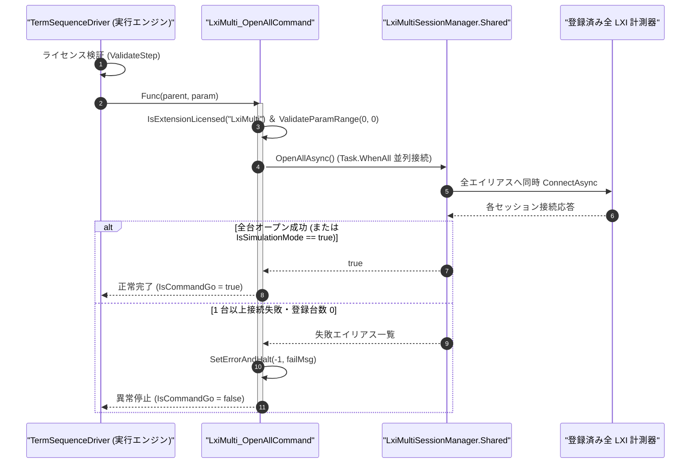

# コマンドリファレンス：LxiMulti_OpenAll

👉 [← LxiMulti アドイン取扱説明書に戻る](./LxiMulti取扱説明書.Md)

## 概要

**LxiMulti_OpenAll** は、プロパティ設定画面「LXI Multi」タブまたは `LxiMulti_Add` で登録済みの全 LXI 計測器に対して、`Task.WhenAll` による **一括並列接続オープン** を実行する統括制御コマンドです。`LxiMultiSessionManager.Shared.OpenAllAsync()` を呼び出します。

---

## 💡 書式・パラメータ仕様

### コマンド構文

```csv
,SEQUENCE, [ステップキー], LxiMulti_OpenAll
```

### パラメータ（引数）一覧

| 引数位置 | 引数名 | 必須/任意 | 説明・制約 |
| :--- | :--- | :---: | :--- |
| － | （なし） | － | 引数を指定すると `ValidateParamRange(0, 0)` 違反として拒否されます。 |

---

## 🔄 特殊置換規約・分岐規約の適用

* **動的置換（`$`）**: 非適用。
* **ジャンプ先指定（`#`）**: 非適用。
* **共通コマンド指定（`@`）**: 非適用。
* **エイリアス（別名）**: `Analysis_LxiMulti_OpenAll`, `Sqn_LxiMulti_OpenAll`

---

## 💡 動作例（正しい構文での記述例）

### スクリプト記述例

※COMMAND ブロック配下の子要素行（PARAM, SEQUENCE）は必ず行頭カンマから開始し、スペースインデントや行末コメント（`;`）は記述しないでください。

```csv
COMMAND, "SAMPLE_LXIMULTI_OPENALL", "RES"
,PARAM, "RES", Work, "結果", "OK"
,SEQUENCE, 010, LxiMulti_Add, "PSU1", "LxiRaw", "192.168.0.10", 5025
,SEQUENCE, 020, LxiMulti_Add, "DMM1", "LxiRaw", "192.168.0.11", 5025
; 登録済み全計測器を一括並列オープン
,SEQUENCE, 030, LxiMulti_OpenAll
,SEQUENCE, 040, LxiMulti_CloseAll
,SEQUENCE, 050, Exit, "$RES$", 0
```

### 実行時の挙動・変数変化

* **実行前の状態**: 複数台の LXI 計測器がエイリアス登録され、未接続の状態。
* **実行後の状態**: 全登録計測器のセッションが並列確立され、個別送受信・一斉送信・並列クエリが即座に実行可能な状態となります。

---

## 🔄 動作フロー（シーケンス図）



---

## 🚫 エラーハンドリング・安全設計（仕様制限）

1. **一部失敗時のロールバック保護**: 1 台でも接続に失敗した場合は、失敗した全エイリアス名と理由をログに集約記録した上で、中途半端に開いた他セッションも安全にクローズして `SetErrorAndHalt(-1, failMsg)` で停止します。
2. **0 台登録ガード**: 登録済みエイリアスが 0 件のまま呼び出された場合はエラー停止します。

---

## 🧪 ユニットテスト仕様

本コマンドクラス（`LxiMulti_OpenAllCommand.cs`）に実装されている `RunUnitTest()` メソッドの検証仕様です。

### テスト実行前提条件

* **実行トリガー**: `RunUnitTest()` メソッドの呼び出し
* **有効化条件**: `ErrorLogger.MinimumLevel == LogLevel.Test` であること（それ以外は早期リターン）
* **検証結果出力**: `_log.LogTest` へ出力。`finally` で `IsSimulationMode` 復元および登録クリア。

### テストケース一覧

| No | テストカテゴリ | テスト条件（入力値） | 期待される結果（出力値） | 検証の目的 / 観点 |
| :---: | :--- | :--- | :--- | :--- |
| **1** | 正常系 | `IsSimulationMode = true` 下で 2 台登録後に引数なしで実行 | `!HasError`、`IsCommandGo == true`、全登録クライアントが `IsConnected == true` となる | 一括並列オープンの検証 |
| **2** | 異常系 | 登録台数 0 件の状態で実行 | `HasError == true` かつ `!IsCommandGo` となる | 未登録状態での実行拒否検証 |