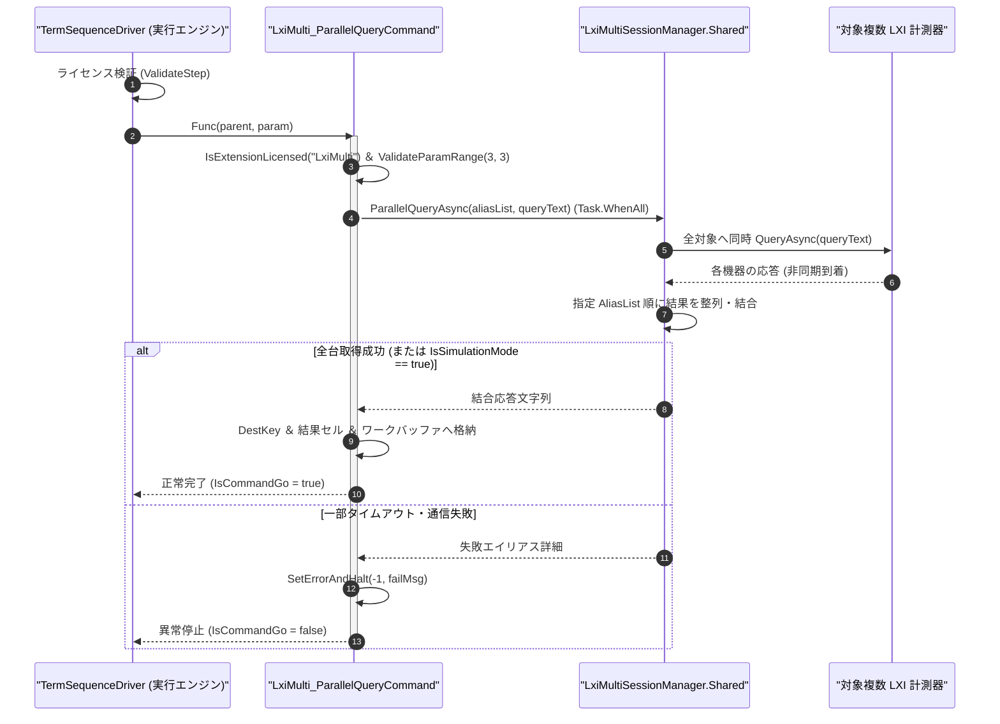

# コマンドリファレンス：LxiMulti_ParallelQuery

👉 [← LxiMulti アドイン取扱説明書に戻る](./LxiMulti取扱説明書.Md)

## 概要

**LxiMulti_ParallelQuery** は、指定された複数台の LXI 計測器に対して `Task.WhenAll` による **同時並列クエリ** を発行し、全台の応答を一括回収して指定順序通りに結合・変数格納（および Excel 隣接セル範囲への展開対応）を行う高速並列測定コマンドです。`LxiMultiSessionManager.Shared.ParallelQueryAsync()` を実行します。

---

## 💡 書式・パラメータ仕様

### コマンド構文

```csv
,SEQUENCE, [ステップキー], LxiMulti_ParallelQuery, "[AliasList]", "[QueryText]", "[DestKey]"
```

※ 返却結果は指定した `AliasList` の記述順を維持したタブ／カンマ区切り（例: `"5.001,4.998,12.03"`）で格納されるため、並列実行しても結果列の順序は常に決定的です。

### パラメータ（引数）一覧

| 引数位置 | 引数名 | 必須/任意 | 説明・制約 |
| :--- | :--- | :---: | :--- |
| 第 1 引数 | `AliasList` | 必須 | 並列クエリ対象のエイリアス一覧（セミコロン区切り、例: `"DMM1;DMM2;OSC1"`）または `"ALL"`。 |
| 第 2 引数 | `QueryText` | 必須 | 各機器へ同時送信するクエリ文字列（例: `"FETC?"`, `"MEAS:VOLT?"`）。変数展開対応。 |
| 第 3 引数 | `DestKey` | 必須 | 全台の応答を指定順に結合した文字列を格納する `PARAM` 変数キー名（`TermAddIn` 実行時は結果セル範囲へ横展開可能）。 |

---

## 🔄 特殊置換規約・分岐規約の適用

* **動的置換（`$`）**: 全引数で `$PARAMキー$` による動的置換に対応します。
* **ジャンプ先指定（`#`）**: 非適用。
* **共通コマンド指定（`@`）**: 非適用。
* **エイリアス（別名）**: `Analysis_LxiMulti_ParallelQuery`, `Sqn_LxiMulti_ParallelQuery`

---

## 💡 動作例（正しい構文での記述例）

### スクリプト記述例

※COMMAND ブロック配下の子要素行（PARAM, SEQUENCE）は必ず行頭カンマから開始し、スペースインデントや行末コメント（`;`）は記述しないでください。

```csv
COMMAND, "SAMPLE_LXIMULTI_PQUERY", "ALL_VOLTS"
,PARAM, "ALL_VOLTS", Work, "全台並列測定結果", ""
,SEQUENCE, 010, LxiMulti_Add, "DMM1", "LxiRaw", "192.168.0.11", 5025
,SEQUENCE, 020, LxiMulti_Add, "DMM2", "LxiRaw", "192.168.0.12", 5025
,SEQUENCE, 030, LxiMulti_OpenAll
,SEQUENCE, 040, LxiMulti_Broadcast, "DMM1;DMM2", "*TRG"
; DMM1・DMM2 から同時並列で測定値を回収し ALL_VOLTS へ格納
,SEQUENCE, 050, LxiMulti_ParallelQuery, "DMM1;DMM2", "FETC?", "ALL_VOLTS"
,SEQUENCE, 060, LxiMulti_CloseAll
,SEQUENCE, 070, Exit, "$ALL_VOLTS$", 0
```

### 実行時の挙動・変数変化

* **実行前の状態**: 対象全エイリアスがオープンされ、`"ALL_VOLTS"` が空文字の状態。
* **実行後の状態**: 全機器へのクエリが並列完了し、指定エイリアス順に並んだ応答一覧が `"ALL_VOLTS"`、結果セル、共通受信ワークバッファへ格納されます。直列実行と比較して測定タクトタイムを大幅に短縮できます。

---

## 🔄 動作フロー（シーケンス図）



---

## 🚫 エラーハンドリング・安全設計（仕様制限）

1. **決定的順序保証**: 非同期応答の到着順序に依存せず、引数 `AliasList` の記述順で配列スロットへ格納します。
2. **部分失敗の明確な検出**: 1 台でもタイムアウトまたは通信エラーが発生した場合は不完全データを採用せず、`SetErrorAndHalt(-1, failMsg)` で停止します。

---

## 🧪 ユニットテスト仕様

本コマンドクラス（`LxiMulti_ParallelQueryCommand.cs`）に実装されている `RunUnitTest()` メソッドの検証仕様です。

### テスト実行前提条件

* **実行トリガー**: `RunUnitTest()` メソッドの呼び出し
* **有効化条件**: `ErrorLogger.MinimumLevel == LogLevel.Test` であること（それ以外は早期リターン）
* **検証結果出力**: `_log.LogTest` へ出力。`finally` で `IsSimulationMode` 復元および登録クリア。

### テストケース一覧

| No | テストカテゴリ | テスト条件（入力値） | 期待される結果（出力値） | 検証の目的 / 観点 |
| :---: | :--- | :--- | :--- | :--- |
| **1** | 正常系 | `IsSimulationMode = true` で 2 台オープン後、`"DMM1;DMM2"`, `"FETC?"`, `"ALL_VOLTS"` を実行 | `!HasError`、`IsCommandGo == true`、`ALL_VOLTS` に 2 台分の応答が指定順で格納される | 同時並列クエリおよび順序保証の検証 |
| **2** | 異常系 | 引数 2 個のみ（`DestKey` 欠落）で実行 | `ValidateParamRange(3, 3)` 違反で `HasError == true` かつ `!IsCommandGo` となる | 必須引数欠落の拒否検証 |