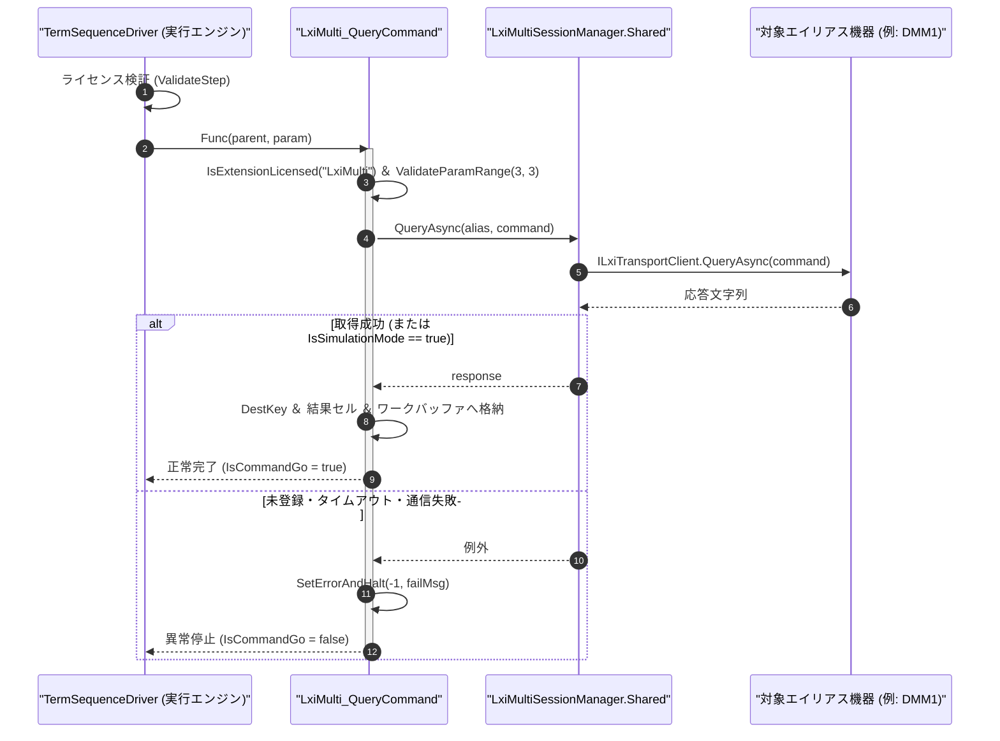

# コマンドリファレンス：LxiMulti_Query

👉 [← LxiMulti アドイン取扱説明書に戻る](./LxiMulti取扱説明書.Md)

## 概要

**LxiMulti_Query** は、指定した単一エイリアスの LXI 計測器へ問い合わせコマンドを送信し、応答文字列を取得して結果セル・共通受信ワークバッファ・指定変数へ格納する個別送受信コマンドです。`LxiMultiSessionManager.Shared.QueryAsync(alias, command)` を実行します。

---

## 💡 書式・パラメータ仕様

### コマンド構文

```csv
,SEQUENCE, [ステップキー], LxiMulti_Query, "[Alias]", "[CommandText]", "[DestKey]"
```

### パラメータ（引数）一覧

| 引数位置 | 引数名 | 必須/任意 | 説明・制約 |
| :--- | :--- | :---: | :--- |
| 第 1 引数 | `Alias` | 必須 | 問い合わせ先計測器のエイリアス名（例: `"DMM1"`）。 |
| 第 2 引数 | `CommandText` | 必須 | 送信するクエリ文字列（例: `"MEAS:VOLT:DC?"`）。変数展開対応。 |
| 第 3 引数 | `DestKey` | 必須 | 応答文字列を格納する `PARAM` 変数キー名。 |

---

## 🔄 特殊置換規約・分岐規約の適用

* **動的置換（`$`）**: 全引数で `$PARAMキー$` による動的置換に対応します。
* **ジャンプ先指定（`#`）**: 非適用。
* **共通コマンド指定（`@`）**: 非適用。
* **エイリアス（別名）**: `Analysis_LxiMulti_Query`, `Sqn_LxiMulti_Query`

---

## 💡 動作例（正しい構文での記述例）

### スクリプト記述例

※COMMAND ブロック配下の子要素行（PARAM, SEQUENCE）は必ず行頭カンマから開始し、スペースインデントや行末コメント（`;`）は記述しないでください。

```csv
COMMAND, "SAMPLE_LXIMULTI_QUERY", "V_OUT"
,PARAM, "V_OUT", Work, "DMM1電圧値", ""
,SEQUENCE, 010, LxiMulti_Add, "DMM1", "LxiVxi11", "192.168.0.11", 111, "inst0"
,SEQUENCE, 020, LxiMulti_OpenAll
; DMM1 から電圧値を個別取得
,SEQUENCE, 030, LxiMulti_Query, "DMM1", "MEAS:VOLT:DC?", "V_OUT"
,SEQUENCE, 040, LxiMulti_CloseAll
,SEQUENCE, 050, Exit, "$V_OUT$", 0
```

### 実行時の挙動・変数変化

* **実行前の状態**: `"DMM1"` がオープン済みで、`"V_OUT"` が空文字の状態。
* **実行後の状態**: `"DMM1"` からの応答文字列が `"V_OUT"`、結果セル、共通受信ワークバッファへ格納されます。

---

## 🔄 動作フロー（シーケンス図）



---

## 🚫 エラーハンドリング・安全設計（仕様制限）

1. **ライセンス・引数検証**: `LxiMulti` 未認証時は `-100`、引数不足・超過（`ValidateParamRange(3, 3)` 違反）時は停止します。
2. **セッション別排他制御**: 同一エイリアスへの同時アクセスをチャネル単位ロックで直列化し、他エイリアスとは並列性を維持します。

---

## 🧪 ユニットテスト仕様

本コマンドクラス（`LxiMulti_QueryCommand.cs`）に実装されている `RunUnitTest()` メソッドの検証仕様です。

### テスト実行前提条件

* **実行トリガー**: `RunUnitTest()` メソッドの呼び出し
* **有効化条件**: `ErrorLogger.MinimumLevel == LogLevel.Test` であること（それ以外は早期リターン）
* **検証結果出力**: `_log.LogTest` へ出力。`finally` で `IsSimulationMode` 復元および登録クリア。

### テストケース一覧

| No | テストカテゴリ | テスト条件（入力値） | 期待される結果（出力値） | 検証の目的 / 観点 |
| :---: | :--- | :--- | :--- | :--- |
| **1** | 正常系 | `IsSimulationMode = true` 下で `"DMM1"`, `"*IDN?"`, `"V_OUT"` を実行 | `!HasError`、`IsCommandGo == true`、`V_OUT` に模擬応答が格納される | エイリアス指定個別クエリの検証 |
| **2** | 異常系 | 未登録エイリアス `"NONE"` を指定して実行 | `HasError == true` かつ `!IsCommandGo` となる | 未登録エイリアス拒否の検証 |