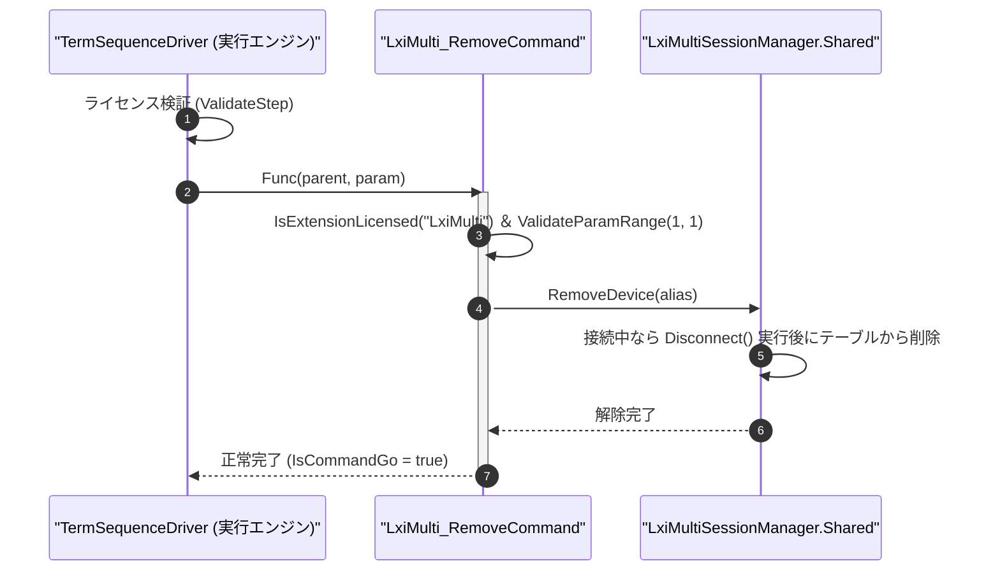

# コマンドリファレンス：LxiMulti_Remove

👉 [← LxiMulti アドイン取扱説明書に戻る](./LxiMulti取扱説明書.Md)

## 概要

**LxiMulti_Remove** は、`LxiMultiSessionManager.Shared` に登録されている指定エイリアスの計測器を管理テーブルから解除する構成管理コマンドです。対象エイリアスが接続中の場合は先に安全切断（`Disconnect()`）を行ってから破棄します。

---

## 💡 書式・パラメータ仕様

### コマンド構文

```csv
,SEQUENCE, [ステップキー], LxiMulti_Remove, "[Alias]"
```

### パラメータ（引数）一覧

| 引数位置 | 引数名 | 必須/任意 | 説明・制約 |
| :--- | :--- | :---: | :--- |
| 第 1 引数 | `Alias` | 必須 | 登録解除する計測器のエイリアス名（例: `"PSU1"`）。 |

---

## 🔄 特殊置換規約・分岐規約の適用

* **動的置換（`$`）**: 第 1 引数で `$PARAMキー$` による動的置換に対応します。
* **ジャンプ先指定（`#`）**: 非適用。
* **共通コマンド指定（`@`）**: 非適用。
* **エイリアス（別名）**: `Analysis_LxiMulti_Remove`, `Sqn_LxiMulti_Remove`

---

## 💡 動作例（正しい構文での記述例）

### スクリプト記述例

※COMMAND ブロック配下の子要素行（PARAM, SEQUENCE）は必ず行頭カンマから開始し、スペースインデントや行末コメント（`;`）は記述しないでください。

```csv
COMMAND, "SAMPLE_LXIMULTI_REMOVE", "RES"
,PARAM, "RES", Work, "結果", "OK"
,SEQUENCE, 010, LxiMulti_Add, "TMP_DMM", "LxiRaw", "192.168.0.20", 5025
; 不要になったエイリアスを安全切断＆登録解除
,SEQUENCE, 020, LxiMulti_Remove, "TMP_DMM"
,SEQUENCE, 030, Exit, "$RES$", 0
```

### 実行時の挙動・変数変化

* **実行前の状態**: `"TMP_DMM"` が `LxiMultiSessionManager.Shared` に登録されている状態。
* **実行後の状態**: 接続中セッションが切断され、`"TMP_DMM"` が管理テーブルから削除されます。

---

## 🔄 動作フロー（シーケンス図）



---

## 🚫 エラーハンドリング・安全設計（仕様制限）

1. **ライセンス・引数検証**: `LxiMulti` 未認証時は `-100`、引数不足・超過（`ValidateParamRange(1, 1)` 違反）時は停止します。
2. **未登録エイリアスの安全処理**: 既に削除済み・未登録のエイリアスを指定しても例外クラッシュさせず警告ログ記録の上で安全に終了します。

---

## 🧪 ユニットテスト仕様

本コマンドクラス（`LxiMulti_RemoveCommand.cs`）に実装されている `RunUnitTest()` メソッドの検証仕様です。

### テスト実行前提条件

* **実行トリガー**: `RunUnitTest()` メソッドの呼び出し
* **有効化条件**: `ErrorLogger.MinimumLevel == LogLevel.Test` であること（それ以外は早期リターン）
* **検証結果出力**: `_log.LogTest` へ出力。

### テストケース一覧

| No | テストカテゴリ | テスト条件（入力値） | 期待される結果（出力値） | 検証の目的 / 観点 |
| :---: | :--- | :--- | :--- | :--- |
| **1** | 正常系 | 登録済みエイリアス `"TMP_DMM"` を指定して実行 | `!HasError`、`IsCommandGo == true`、`ContainsAlias("TMP_DMM") == false` となる | 安全切断および登録解除の検証 |
| **2** | 異常系 | 引数なし（0 個）で実行 | `ValidateParamRange(1, 1)` 違反で `HasError == true` かつ `!IsCommandGo` となる | 必須引数欠落の拒否検証 |