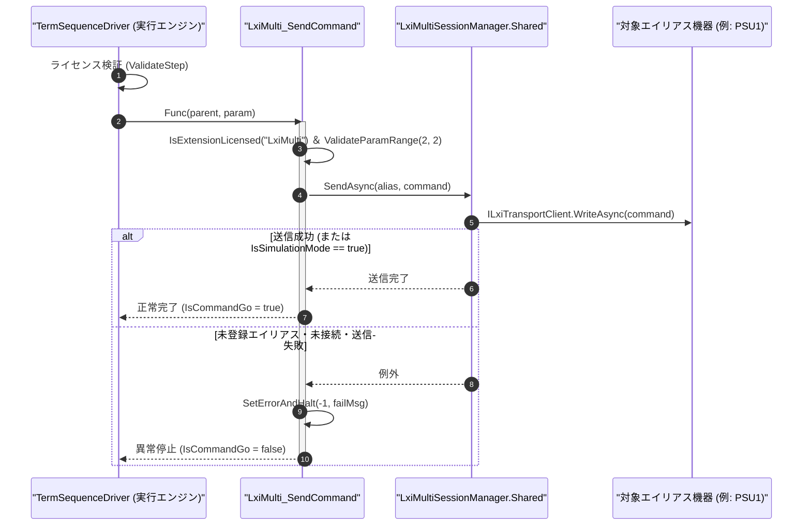

# コマンドリファレンス：LxiMulti_Send

👉 [← LxiMulti アドイン取扱説明書に戻る](./LxiMulti取扱説明書.Md)

## 概要

**LxiMulti_Send** は、マルチ管理中の計測器群から指定した単一エイリアスのセッションを選択し、コマンド文字列を個別非同期送信（応答待機なし）する送信系コマンドです。`LxiMultiSessionManager.Shared.SendAsync(alias, command)` を実行します。

---

## 💡 書式・パラメータ仕様

### コマンド構文

```csv
,SEQUENCE, [ステップキー], LxiMulti_Send, "[Alias]", "[CommandText]"
```

### パラメータ（引数）一覧

| 引数位置 | 引数名 | 必須/任意 | 説明・制約 |
| :--- | :--- | :---: | :--- |
| 第 1 引数 | `Alias` | 必須 | 送信先計測器のエイリアス名（例: `"PSU1"`）。 |
| 第 2 引数 | `CommandText` | 必須 | 送信するコマンド文字列（例: `"VOLT 5.0"`, `"OUTP ON"`）。変数展開対応。 |

---

## 🔄 特殊置換規約・分岐規約の適用

* **動的置換（`$`）**: 全引数で `$PARAMキー$` による動的置換に対応します。
* **ジャンプ先指定（`#`）**: 非適用。
* **共通コマンド指定（`@`）**: 非適用。
* **カンマのエスケープ**: コマンド文字列内にカンマが含まれる場合は `"..."` で囲みます。
* **エイリアス（別名）**: `Analysis_LxiMulti_Send`, `Sqn_LxiMulti_Send`

---

## 💡 動作例（正しい構文での記述例）

### スクリプト記述例

※COMMAND ブロック配下の子要素行（PARAM, SEQUENCE）は必ず行頭カンマから開始し、スペースインデントや行末コメント（`;`）は記述しないでください。

```csv
COMMAND, "SAMPLE_LXIMULTI_SEND", "RES"
,PARAM, "RES", Work, "結果", "OK"
,SEQUENCE, 010, LxiMulti_Add, "PSU1", "LxiRaw", "192.168.0.10", 5025
,SEQUENCE, 020, LxiMulti_OpenAll
; PSU1 のみへ電圧設定・出力 ON を個別送信
,SEQUENCE, 030, LxiMulti_Send, "PSU1", "VOLT 5.0"
,SEQUENCE, 040, LxiMulti_Send, "PSU1", "OUTP ON"
,SEQUENCE, 050, LxiMulti_CloseAll
,SEQUENCE, 060, Exit, "$RES$", 0
```

### 実行時の挙動・変数変化

* **実行前の状態**: `"PSU1"` がオープン済みセッションとして保持されている状態。
* **実行後の状態**: `"PSU1"` にバインドされた `ILxiTransportClient.WriteAsync` が実行され、他機器へ影響を与えずにコマンドが送信されます。

---

## 🔄 動作フロー（シーケンス図）



---

## 🚫 エラーハンドリング・安全設計（仕様制限）

1. **エイリアス存在・接続確認**: 未登録エイリアスまたは未接続状態での送信は `SetErrorAndHalt(-1, failMsg)` で即座に停止します。
2. **ライセンス・引数ガード**: `LxiMulti` 未認証時は `-100`、引数数不一致（`ValidateParamRange(2, 2)` 違反）時は停止します。

---

## 🧪 ユニットテスト仕様

本コマンドクラス（`LxiMulti_SendCommand.cs`）に実装されている `RunUnitTest()` メソッドの検証仕様です。

### テスト実行前提条件

* **実行トリガー**: `RunUnitTest()` メソッドの呼び出し
* **有効化条件**: `ErrorLogger.MinimumLevel == LogLevel.Test` であること（それ以外は早期リターン）
* **検証結果出力**: `_log.LogTest` へ出力。`finally` で `IsSimulationMode` 復元および登録クリア。

### テストケース一覧

| No | テストカテゴリ | テスト条件（入力値） | 期待される結果（出力値） | 検証の目的 / 観点 |
| :---: | :--- | :--- | :--- | :--- |
| **1** | 正常系 | `IsSimulationMode = true` で `"PSU1"` をオープン後、`"PSU1"`, `"OUTP ON"` を実行 | `!HasError` かつ `IsCommandGo == true` となる | エイリアス指定個別送信の検証 |
| **2** | 異常系 | 未登録エイリアス `"UNKNOWN"` を指定して実行 | `HasError == true` かつ `!IsCommandGo` となる | 未登録エイリアス拒否の検証 |