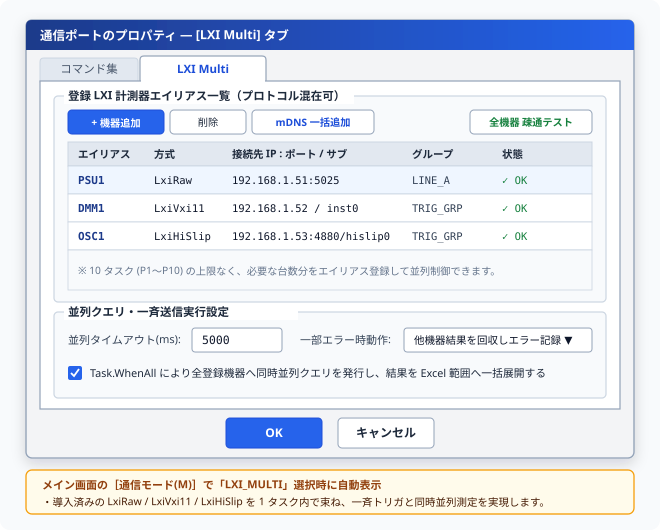
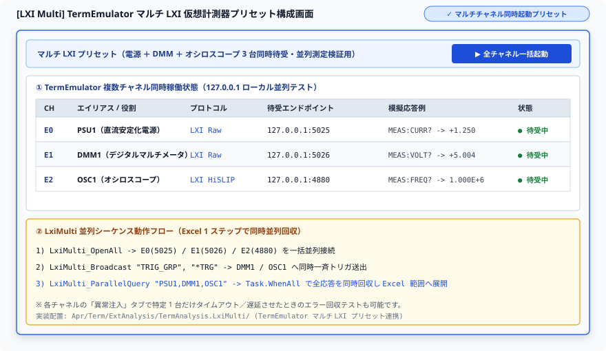

# LxiMulti（マルチ LXI 計測器 並列・同時セッション統括）アドイン取扱説明書

👉 [← TermAddIn_LxiMulti 製品トップに戻る](https://github.com/Monaca-App/TermAddIn_LxiMulti)  
👉 [← プロパティ設定画面取扱説明書（共通）](../プロパティ設定画面取扱説明書.Md) ／ [← TermEmulator 操作説明書（共通）](https://github.com/Monaca-App/TermEmulator/blob/main/Manual/TermEmulator操作説明書.Md) ／ [← マクロスクリプト取扱説明書（共通）](../マクロスクリプト取扱説明書.Md)

---

本書は、**TermAddIn_LxiMulti**（`TermAnalysis.LxiMulti.dll`：複数 LXI 計測器の同時セッション保持・エイリアス管理・一斉送信・並列クエリ統括エクステンション）の **取扱説明書 兼 機能解説書** です。導入済みの LXI 基本通信拡張（[LxiRaw](../LxiRaw/LxiRaw取扱説明書.Md) / [LxiVxi11](../LxiVxi11/LxiVxi11取扱説明書.Md) / [LxiHiSlip](../LxiHiSlip/LxiHiSlip取扱説明書.Md) のいずれか 1 つ以上）と組み合わせて動作します。並列統括の仕組み解説、プロパティ設定画面の **「LXI Multi」タブ**、**TermEmulator マルチ LXI プリセット構成**、および全 8 コマンドのリファレンスを 1 冊にまとめています。

* **必須拡張ライセンス**: **`TermAddIn_LxiMulti.License`** （組み込み先: `TermAnalysis.LxiMulti.dll`）


### 関連する公式規格・仕様書（外部リンク・連携アドイン）
* [IVI Foundation 公式仕様ポータル（IVI-6.1 HiSLIP / VXI-11 / SCPI 規格）](https://www.ivifoundation.org/specifications/default.aspx) — 統括対象となる LXI / HiSLIP / VXI-11 / SCPI 関連の一次公式規格ポータルです。
* **連携する基本通信アドインの取扱説明書**: [LxiRaw](../LxiRaw/LxiRaw取扱説明書.Md) ／ [LxiVxi11](../LxiVxi11/LxiVxi11取扱説明書.Md) ／ [LxiHiSlip](../LxiHiSlip/LxiHiSlip取扱説明書.Md)
---

## 目次

- [1. 機能概要と基礎知識（はじめての方へ）](#1-機能概要と基礎知識はじめての方へ)
- [2. プロパティ設定画面：「LXI Multi」タブの詳細](#2-プロパティ設定画面lxi-multiタブの詳細)
- [3. 既存の Term.exe 複数起動（P1〜P10）との違いと使い分け](#3-既存の-termexe-複数起動p1p10との違いと使い分け)
- [4. TermEmulator マルチ LXI プリセット連携](#4-termemulator-マルチ-lxi-プリセット連携)
- [5. マクロコマンド一覧（全 8 コマンド）](#5-マクロコマンド一覧全-8-コマンド)

---

## 1. 機能概要と基礎知識（はじめての方へ）

### 対応する機能の概要
**LxiMulti（マルチ LXI 計測器 並列・同時セッション統括）** アドインは、電源・DMM・オシロスコープなどの **複数台の LAN（LXI）計測器を 1 つの画面・1 つのマクロ内で同時に接続保持** し、エイリアス名（`PSU1`, `DMM1`, `OSC1` 等）による一括接続／切断、個別送受信、グループ一斉送信（`Broadcast`）、および複数台同時並列クエリ（`ParallelQuery`）を行う統括運用機能です。

### 機能の実現方法
* **共通契約 `ILxiTransportClient` による異種プロトコル混在統括**: `TermAnalysis.Lxi.Core` の共通ファクトリ経由で、導入済みの基本通信拡張（`LxiRaw` / `LxiVxi11` / `LxiHiSlip`）のセッションを機器ごとに動的生成してエイリアステーブルで一元管理します。
* **`Task.WhenAll` による真の並列実行と順序保証**: `LxiMulti_OpenAll`・`LxiMulti_Broadcast`・`LxiMulti_ParallelQuery` を非同期並列タスクで同時実行し、応答の到着順に関係なく指定したエイリアス順で決定的に結果を集約・出力します。
* **マルチ LXI 仮想プリセット連携**: `TermEmulator` のマルチチャネル機能で電源・DMM・オシロをワンクリック同時起動し、並列測定フロー全体を実機なしで検証できます。

### このアドインを選択することの利点
* **検査ラインのタクトタイムを大幅短縮**: 1 台ずつ順番に測る直列処理と異なり、複数台の計測器へ同時にクエリを投げて結果を一括回収できるため、台数が増えるほど時短効果が大きくなります。
* **10 台上限（`P1`〜`P10`）の制約なく 1 画面で一元管理**: ウィンドウを何枚も並べる必要がなく、1 つの設定表と 1 つの Excel シートだけで多チャネル検査システムを保守できます。
* **メーカー・プロトコル混在でも統一操作**: 古い VXI-11 機器と最新の HiSLIP / Raw Socket 機器が混在する現場でも、エイリアス名を指定するだけで同じコマンドから統一的に操縦できます。

### 通常の単体アドイン（`LxiRaw` 等）との違い
* 単体アドイン（`LxiRaw` / `LxiVxi11` / `LxiHiSlip`）は、基本は「1 つの画面 ＝ 1 台の計測器」を順番に操作します。
* **`LxiMulti`** を導入すると、それぞれの計測器に **`PSU1`（電源 1 号機）、`DMM1`（マルチメータ 1 号機）** のような分かりやすい **任意の識別名（エイリアス）** を付けて登録し、以下の操作が 1 行のコマンドでできるようになります。
  * 全台を一気に接続・切断（`LxiMulti_OpenAll` / `LxiMulti_CloseAll`）
  * 全台へ同時にスタート合図を送る（`LxiMulti_Broadcast`）
  * 全台から **同時並列で測定値を回収** し、検査時間を大幅短縮（`LxiMulti_ParallelQuery`）

### 設定の妥当性を判断するためのチェックポイント
| 確認項目 | 項目の意味 | 設定値の目安・確認方法 |
| :--- | :--- | :--- |
| **前提となる基本通信アドイン** | 実際のプロトコル通信を担う下位の通信機能 | `LxiMulti` は束ねる役割のため、対象機器で使う **[LxiRaw](../LxiRaw/LxiRaw取扱説明書.Md) / [LxiVxi11](../LxiVxi11/LxiVxi11取扱説明書.Md) / [LxiHiSlip](../LxiHiSlip/LxiHiSlip取扱説明書.Md)** のいずれか 1 つ以上が導入・ライセンス認証されている必要があります。 |
| **エイリアス名** | 機器ごとの任意の識別名 | 用途や機器種別を判別しやすい英数字（例: `PSU1`, `DMM1`, `OSC1`）にします。同じ名前は重複登録できません。 |
| **通信方式（プロトコル混在可）** | 各機器ごとにどの通信方式で繋ぐか | 1 台目は `LxiRaw`、2 台目は `LxiVxi11`、3 台目は `LxiHiSlip` のように **異なる方式の機器を混ぜて登録できます**。 |
| **グループ名** | 一斉送信の対象をまとめるグループ識別名 | 同時にトリガをかけたい機器同士に同じグループ名（例: `TRIG_GRP`）を付けておくと、`LxiMulti_Broadcast` でまとめて指示できます。 |

### 通信の仕組み解説（並列セッション統括と代表的なトラブル事例・対処法）
`LxiMulti` は、1 つの管理テーブル内に複数台の通信クライアントを同時接続を維持したまま、`Task.WhenAll` で一斉に並列通信を行います。

```text
[LxiMulti 管理テーブル]
  ├─ "PSU1" ➔ LxiRaw    (192.168.0.10:5025)  ┐
  ├─ "DMM1" ➔ LxiVxi11  (192.168.0.11:111)   ├─ Task.WhenAll で同時並列クエリ ➔ 指定順に結合出力
  └─ "OSC1" ➔ LxiHiSlip (192.168.0.12:4880)  ┘
```

* **事例①：`LxiMulti_Add` でライセンスエラー（`-100`）が出る** ➔ `LxiMulti` のライセンスだけでなく、登録しようとした方式（例: `LxiVxi11`）の基本通信アドインのライセンスも必要です。導入済みの通信方式と一致しているか確認してください。
* **事例②：`LxiMulti_OpenAll` で 1 台だけ失敗して全体が止まる** ➔ 安全設計として、1 台でも接続できない場合は全セッションをクローズして停止します。ログに出力された失敗エイリアス名の IP・電源・ポートを確認してください。
* **事例③：並列クエリの結果の並び順が分からなくなる** ➔ 応答の到着が早い機器から並ぶのではなく、必ず第 1 引数 `AliasList` に書いた順（例: `"DMM1;DMM2;OSC1"`）で固定整列されるため安心して列割り当てできます。

---

## 2. プロパティ設定画面：「LXI Multi」タブの詳細



メイン画面で **`LXI_MULTI`** モードを選択しているときに表示され、複数台の LXI 計測器エイリアス一覧を登録・管理します。

| 項目名 | 設定値・範囲 | 詳しい意味と設定のポイント |
| :--- | :--- | :--- |
| **`エイリアス名`** | 任意識別名（例: `PSU1`, `DMM1`, `OSC1`） | シーケンスコマンドから各計測器を指定するための短い名前です。 |
| **`通信方式`** | `LxiRaw` / `LxiVxi11` / `LxiHiSlip` | 導入済み・ライセンス有効な基本通信拡張から機器ごとに選択できます（プロトコル混在可）。 |
| **`接続先（IP / ポート / サブアドレス）`** | IPv4 / IPv6、ポート、サブアドレス | 各機器の接続パラメータを一覧テーブルで一括管理します。 |
| **`グループ名`** | 任意グループ名（例: `TRIG_GRP`） | `LxiMulti_Broadcast` で一斉送信する対象グループを定義します。 |

---

## 3. 既存の `Term.exe` 複数起動（`P1`〜`P10`）との違いと使い分け

| 比較項目 | `Term.exe` 複数起動（`P1`〜`P10`） | マルチ機器管理（`LxiMulti`） |
| :--- | :--- | :--- |
| **基本モデル** | **1 タスク ＝ 1 機器** を独立したプロセス／画面で並べる | **1 タスク内で複数機器** をエイリアス名で同時保持 |
| **並列実行・一斉同期** | **不可（逐次実行）** （Excel 上でも 1 行ずつ直列実行） | **可能（真の並列実行）** （`Broadcast` / `Task.WhenAll` 並列クエリ） |
| **接続台数の上限** | **最大 10 台** （`P1`〜`P10` 固定） | **10 タスク上限の制約なし** （エイリアス動的登録） |
| **一括管理・画面数** | 台数分のウィンドウ・設定が分散 | 1 画面・1 ワーク空間で完結（一括開閉・一括セル展開） |
| **対象プロトコル** | **全通信モード対応** （PLC・シリアル・LXI 混在可） | **LXI 計測器専用** （`LxiRaw` / `LxiVxi11` / `LxiHiSlip`） |

---

## 4. TermEmulator マルチ LXI プリセット連携



* **[TermEmulator](https://github.com/Monaca-App/TermEmulator/blob/main/Manual/TermEmulator操作説明書.Md)** の複数チャネル同時稼働機能を用い、電源（`5025`）・DMM（`5026`）・オシロスコープ（`5027` / `4880`）等をワンクリック同時起動する **「マルチ LXI プリセット」** を利用できます。
* 実機ゼロの環境で、`LxiMulti_OpenAll` ➔ `LxiMulti_Broadcast "*TRG"` ➔ `LxiMulti_ParallelQuery` の一連の並列動作を検証できます。

---

## 5. マクロコマンド一覧（全 8 コマンド）

| コマンド名 | 構文概要 | 主な役割・用途 |
| :--- | :--- | :--- |
| **[LxiMulti_Add](./LxiMulti_Add.Md)** | `,SEQUENCE, [ステップ], LxiMulti_Add, "[Alias]", "[Mode]", "[IP]", [Port], "[SubAddr(任意)]"` | エイリアス名と接続先（IP・通信方式）を動的登録 |
| **[LxiMulti_Remove](./LxiMulti_Remove.Md)** | `,SEQUENCE, [ステップ], LxiMulti_Remove, "[Alias]"` | 指定エイリアスの登録を解除（接続中は安全切断） |
| **[LxiMulti_OpenAll](./LxiMulti_OpenAll.Md)** | `,SEQUENCE, [ステップ], LxiMulti_OpenAll` | 登録済みの全 LXI 計測器を一括並列オープン |
| **[LxiMulti_CloseAll](./LxiMulti_CloseAll.Md)** | `,SEQUENCE, [ステップ], LxiMulti_CloseAll` | 接続中の全 LXI 計測器を一括クローズ・リソース解放 |
| **[LxiMulti_Send](./LxiMulti_Send.Md)** | `,SEQUENCE, [ステップ], LxiMulti_Send, "[Alias]", "[送信文字列]"` | 指定エイリアスの機器へ個別送信 |
| **[LxiMulti_Query](./LxiMulti_Query.Md)** | `,SEQUENCE, [ステップ], LxiMulti_Query, "[Alias]", "[送信文字列]", "[格納先キー]"` | 指定エイリアスの機器へ個別送信＋応答取得 |
| **[LxiMulti_Broadcast](./LxiMulti_Broadcast.Md)** | `,SEQUENCE, [ステップ], LxiMulti_Broadcast, "[グループまたはエイリアス一覧]", "[送信文字列]"` | 複数機器へ同一コマンド（`*TRG`・出力 ON/OFF 等）を一斉送出 |
| **[LxiMulti_ParallelQuery](./LxiMulti_ParallelQuery.Md)** | `,SEQUENCE, [ステップ], LxiMulti_ParallelQuery, "[エイリアス一覧]", "[クエリ文字列]", "[格納先キー]"` | 複数機器へ同時並列クエリ（`Task.WhenAll`）を発行し、全応答を一括回収してセル範囲へ展開 |
