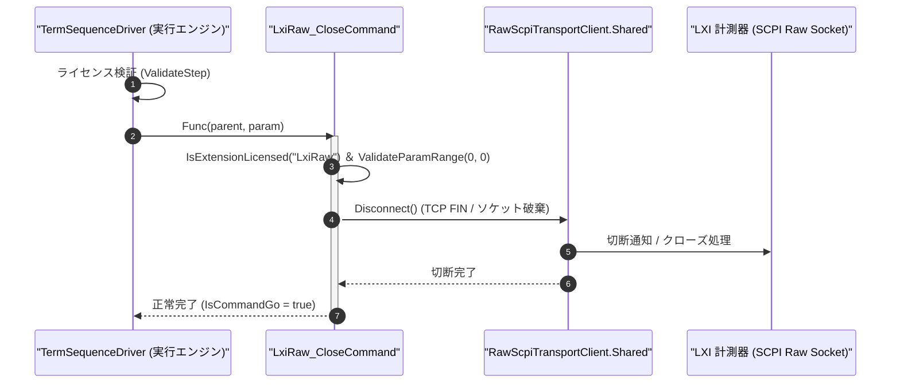

# コマンドリファレンス：LxiRaw_Close

👉 [← LxiRaw アドイン取扱説明書に戻る](./LxiRaw取扱説明書.Md)

## 概要

**LxiRaw_Close** は、現在接続中の **SCPI Raw Socket 通信セッション** を正常切断し、通信リソースを解放する通信制御系コマンドです。
共通基底クラス `LxiCloseCommandBase`（`TermAnalysis.Lxi.Core`）を継承し、`RawScpiTransportClient.Shared` を介して TCP ソケットを正常切断し、内部ストリームおよびバッファリソースを解放します。

---

## 💡 書式・パラメータ仕様

### コマンド構文

```csv
,SEQUENCE, [ステップキー], LxiRaw_Close
```

### パラメータ（引数）一覧

本コマンドは引数を必要としません（`ValidateParamRange(0, 0)`）。

| 引数位置 | 引数名 | 必須/任意 | 説明・制約 |
| :--- | :--- | :---: | :--- |
| － | （なし） | － | 引数を指定すると引数超過エラーとして拒否されます。 |

---

## 🔄 特殊置換規約・分岐規約の適用

* **動的置換（`$`）**: 引数を持たないため非適用。
* **ジャンプ先指定（`#`）**: 非適用。
* **共通コマンド指定（`@`）**: 非適用。
* **エイリアス（別名）**: `Analysis_LxiRaw_Close`, `Sqn_LxiRaw_Close`

---

## 💡 動作例（正しい構文での記述例）

### スクリプト記述例

```csv
COMMAND, "SAMPLE_LXIRAW_CLOSE", "VAL"
,PARAM, "VAL", Work, "測定値", ""
,SEQUENCE, 010, LxiRaw_Open, "192.168.0.10", 5025, 5000
,SEQUENCE, 020, LxiRaw_Query, "MEAS:VOLT?", "VAL", 5000
; 測定完了後にセッションを正常切断
,SEQUENCE, 030, LxiRaw_Close
,SEQUENCE, 040, Exit, "$VAL$", 0
```

### 実行時の挙動・変数変化

* **実行前の状態**: `LxiRaw_Open` により計測器とのセッションが確立されている状態。
* **実行後の状態**: `RawScpiTransportClient.Shared.Disconnect()` が実行され、セッションが切断・解放されます。未接続状態で呼び出された場合も例外を投げず安全に正常終了（冪等動作）します。

---

## 🔄 動作フロー（シーケンス図）



---

## 🚫 エラーハンドリング・安全設計（仕様制限）

1. **ライセンス検証および引数ガード**:
   - `LxiRaw` ライセンス未認証時は `-100`、引数指定時は `ValidateParamRange(0, 0)` 違反で安全停止します。
2. **冪等なリソース解放**:
   - すでに切断済みの状態やエラー分岐（`#NG_PROC#`）からの呼び出しでも二重解放エラーを起こさず安全に終了します。

---

## 🧪 ユニットテスト仕様

本コマンドクラス（`LxiRaw_CloseCommand.cs`）に実装されている `RunUnitTest()` メソッドの検証仕様です。

### テスト実行前提条件

* **実行トリガー**: `RunUnitTest()` メソッドの呼び出し
* **有効化条件**: `ErrorLogger.MinimumLevel == LogLevel.Test`
* **検証結果出力**: `_log.LogTest` へ出力。`finally` ブロックで `IsSimulationMode` を復元。

### テストケース一覧

| No | テストカテゴリ | テスト条件（入力値） | 期待される結果（出力値） | 検証の目的 / 観点 |
| :---: | :--- | :--- | :--- | :--- |
| **1** | 正常系 | `IsSimulationMode = true` でオープン後に引数なしで実行 | `!param.HasError`、`IsCommandGo == true`、`IsConnected == false` となる | 正常切断および接続状態フラグ更新の検証 |
| **2** | 異常系 | 不要な引数 `"EXTRA"` を 1 個指定して実行 | `ValidateParamRange(0, 0)` 違反で `HasError == true` かつ `!IsCommandGo` となる | 余剰引数拒否の検証 |