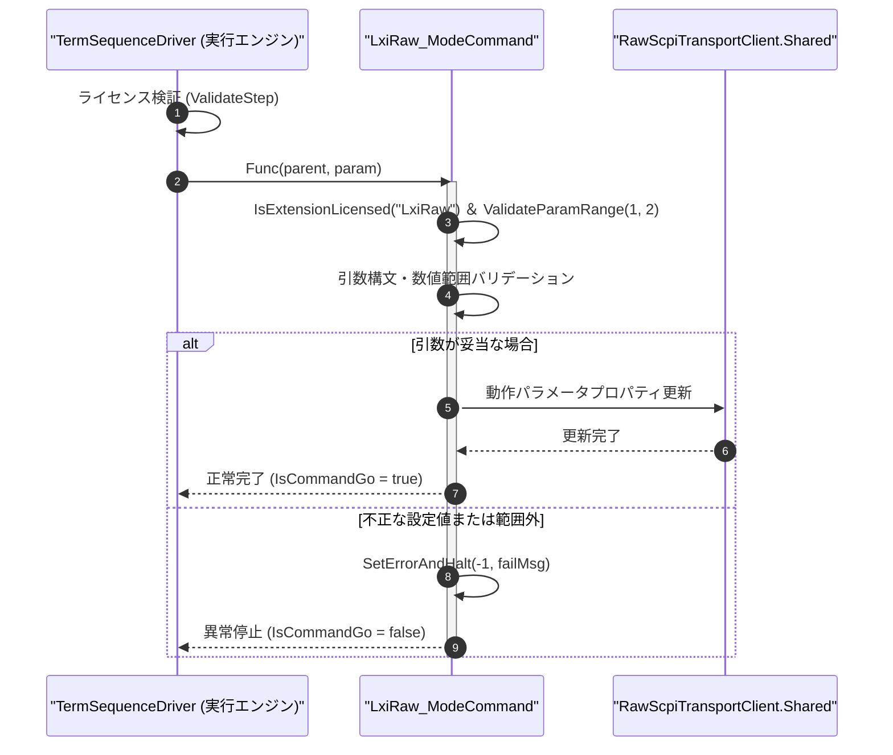

# コマンドリファレンス：LxiRaw_Mode

👉 [← LxiRaw アドイン取扱説明書に戻る](./LxiRaw取扱説明書.Md)

## 概要

**LxiRaw_Mode** は、**SCPI Raw Socket 通信** における動作パラメータをシーケンス実行中に動的に切り替える設定変更コマンドです。
`RawScpiTransportClient.Shared` に対し、SCPI Raw Socket 通信の送信ターミネータ（`LF` / `CRLF`）および送受信タイムアウト時間を動的に変更します。

---

## 💡 書式・パラメータ仕様

### コマンド構文

```csv
,SEQUENCE, [ステップキー], LxiRaw_Mode, "[Terminator: LF/CRLF]", "[TimeoutMs: 5000]"
```

### パラメータ（引数）一覧

| 引数位置 | 引数名 | 必須/任意 | 説明・制約 |
| :--- | :--- | :---: | :--- |
| 第 1 引数 | `Terminator` | 必須 | 送信コマンド末尾へ自動付与する改行コード（`"LF"` または `"CRLF"`、大文字小文字不問、既定: `"LF"`）。 |
| 第 2 引数 | `TimeoutMs` | 任意 | 送受信タイムアウト時間［ミリ秒］（`100`〜`300000`、省略時は現在値を維持）。 |

---

## 🔄 特殊置換規約・分岐規約の適用

* **動的置換（`$`）**: 全引数で `$PARAMキー$` による動的置換に対応します。
* **ジャンプ先指定（`#`）**: 非適用。
* **共通コマンド指定（`@`）**: 非適用。
* **エイリアス（別名）**: `Analysis_LxiRaw_Mode`, `Sqn_LxiRaw_Mode`

---

## 💡 動作例（正しい構文での記述例）

### スクリプト記述例

```csv
COMMAND, "SAMPLE_LXIRAW_MODE", "RES"
,PARAM, "RES", Work, "応答結果", ""
; 1. 動作モード・タイムアウトを動的変更
,SEQUENCE, 010, LxiRaw_Mode, "CRLF", 10000
; 2. 変更後の条件で接続・問い合わせを実行
,SEQUENCE, 020, LxiRaw_Open, "192.168.0.10", 5025, 5000
,SEQUENCE, 030, LxiRaw_Query, "*IDN?", "RES"
,SEQUENCE, 040, LxiRaw_Close
,SEQUENCE, 050, Exit, "$RES$", 0
```

### 実行時の挙動・変数変化

* **実行前の状態**: プロパティ画面の既定設定が適用されている状態。
* **実行後の状態**: `RawScpiTransportClient.Shared` の対象動作パラメータが引数指定値へ即座に更新され、後続のオープン・送受信コマンドへ反映されます。

---

## 🔄 動作フロー（シーケンス図）



---

## 🚫 エラーハンドリング・安全設計（仕様制限）

1. **ライセンス検証および引数範囲ガード**:
   - `LxiRaw` 未認証時は `-100`、引数不足・超過時は `ValidateParamRange(1, 2)` で停止します。
2. **設定値妥当性検証**:
   - 規定外のキーワードやタイムアウト範囲外（`100`〜`300000` ms 以外）の値が渡された場合は現在値を破壊せず `SetErrorAndHalt(-1, failMsg)` で停止します。

---

## 🧪 ユニットテスト仕様

本コマンドクラス（`LxiRaw_ModeCommand.cs`）の `RunUnitTest()` 検証仕様です。

### テスト実行前提条件

* **実行トリガー**: `RunUnitTest()` メソッドの呼び出し
* **有効化条件**: `ErrorLogger.MinimumLevel == LogLevel.Test`
* **検証結果出力**: `_log.LogTest` へ出力。終了時に変更したクライアント設定を元値へ復元します。

### テストケース一覧

| No | テストカテゴリ | テスト条件（入力値） | 期待される結果（出力値） | 検証の目的 / 観点 |
| :---: | :--- | :--- | :--- | :--- |
| **1** | 正常系 | 引数 `"CRLF"`, `"8000"` を指定して実行 | `!param.HasError` かつ `IsCommandGo == true`、`Terminator == "\r\n"`、`TimeoutMs == 8000` となる | 動作モードパラメータの正常反映検証 |
| **2** | 異常系 | 余剰引数（`"CRLF"`, `"8000"`, `"EXTRA"`）または不正値を指定して実行 | `HasError == true` かつ `!IsCommandGo` となる | 不正引数・範囲外入力の拒否検証 |