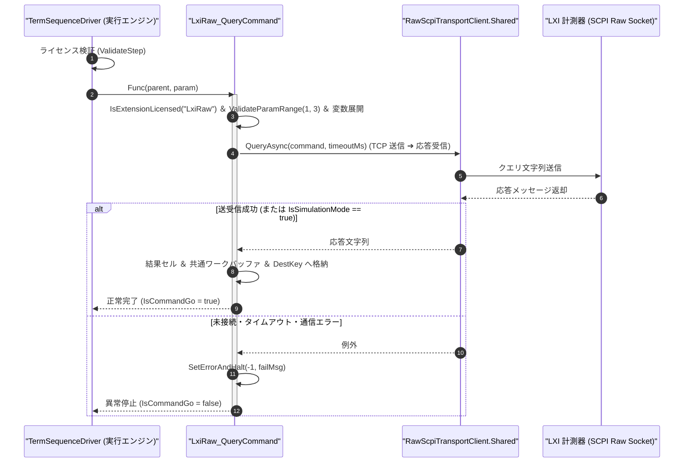

# コマンドリファレンス：LxiRaw_Query

👉 [← LxiRaw アドイン取扱説明書に戻る](./LxiRaw取扱説明書.Md)

## 概要

**LxiRaw_Query** は、接続中の LXI 計測器へ問い合わせコマンド（`*IDN?`, `MEAS:VOLT?`, `SYST:ERR?` 等）を送信し、直後の応答メッセージを一括受信して結果セル・共通受信ワークバッファ・指定変数へ格納する送受信系コマンドです。
共通基底クラス `LxiQueryCommandBase`（`TermAnalysis.Lxi.Core`）を継承し、`RawScpiTransportClient.Shared` を介して コマンド文字列送信（`WriteAsync`）と応答受信（`ReadStringAsync`）を連続実行し、結果セル・共通受信ワークバッファ・指定変数へ格納します。

---

## 💡 書式・パラメータ仕様

### コマンド構文

```csv
,SEQUENCE, [ステップキー], LxiRaw_Query, "[CommandText]", "[DestKey(任意)]", "[TimeoutMs(任意)]"
```

### パラメータ（引数）一覧

| 引数位置 | 引数名 | 必須/任意 | 説明・制約 |
| :--- | :--- | :---: | :--- |
| 第 1 引数 | `CommandText` | 必須 | 計測器へ送信するクエリ文字列（例: `"*IDN?"`, `"MEAS:VOLT:DC?"`）。変数展開（`$KEY$`）対応。 |
| 第 2 引数 | `DestKey` | 任意 | 応答文字列を格納する `PARAM` 変数キー名。省略時は結果セルおよび共通受信ワークバッファのみへ格納。 |
| 第 3 引数 | `TimeoutMs` | 任意 | 応答待機タイムアウト時間［ミリ秒］（`100`〜`300000`）。省略時は現在のモード設定値を使用。 |

---

## 🔄 特殊置換規約・分岐規約の適用

* **動的置換（`$`）**: 全引数で `$PARAMキー$` による動的置換に対応します。
* **ジャンプ先指定（`#`）**: 非適用。
* **共通コマンド指定（`@`）**: 非適用。
* **カンマのエスケープ**: クエリ文字列にカンマが含まれる場合は `"..."` で囲んで記述します。
* **エイリアス（別名）**: `Analysis_LxiRaw_Query`, `Sqn_LxiRaw_Query`

---

## 💡 動作例（正しい構文での記述例）

### スクリプト記述例

```csv
COMMAND, "SAMPLE_LXIRAW_QUERY", "VOLT_VAL"
,PARAM, "VOLT_VAL", Work, "DC電圧測定値", ""
,SEQUENCE, 010, LxiRaw_Open, "192.168.0.10", 5025, 5000
; DC 電圧測定クエリを実行し VOLT_VAL へ格納
,SEQUENCE, 020, LxiRaw_Query, "MEAS:VOLT:DC?", "VOLT_VAL", 5000
; 測定値が 4.9V 以上か判定
,SEQUENCE, 030, Judge, "GE", "$VOLT_VAL$", "4.9", "#NG_PROC#"
,SEQUENCE, 040, LxiRaw_Close
,SEQUENCE, 050, Exit, "$VOLT_VAL$", 0
,SEQUENCE, #NG_PROC#, LxiRaw_Close
,SEQUENCE, 070, Exit, "NG:$VOLT_VAL$", -1
```

### 実行時の挙動・変数変化

* **実行前の状態**: セッションがオープンされ、`"VOLT_VAL"` が空文字の状態。
* **実行後の状態**: `"MEAS:VOLT:DC?"` に対する計測器応答が `"VOLT_VAL"`、結果セル、共通受信ワークバッファへ格納され、次ステップの `Judge` で良否判定されます。

---

## 🔄 動作フロー（シーケンス図）



---

## 🚫 エラーハンドリング・安全設計（仕様制限）

1. **ライセンス検証および引数範囲ガード**:
   - `LxiRaw` 未認証時は `-100`、引数不足・超過（`ValidateParamRange(1, 3)` 違反）時は `SetErrorAndHalt` で停止します。
2. **アトミックな送受信排他制御**:
   - 送信から応答取得までをクライアント内部ロックで保護し、並行呼び出しによる応答混信を防止します。タイムアウト時は `SetErrorAndHalt(-1, failMsg)` で安全停止します。

---

## 🧪 ユニットテスト仕様

本コマンドクラス（`LxiRaw_QueryCommand.cs`）の `RunUnitTest()` 検証仕様です。

### テスト実行前提条件

* **実行トリガー**: `RunUnitTest()` メソッドの呼び出し
* **有効化条件**: `ErrorLogger.MinimumLevel == LogLevel.Test`
* **検証結果出力**: `_log.LogTest` へ出力。`finally` で `IsSimulationMode` を復元。

### テストケース一覧

| No | テストカテゴリ | テスト条件（入力値） | 期待される結果（出力値） | 検証の目的 / 観点 |
| :---: | :--- | :--- | :--- | :--- |
| **1** | 正常系 | `IsSimulationMode = true` 下で `"*IDN?"`, `"IDN_RES"`, `"5000"` を指定して実行 | `!param.HasError`、`IsCommandGo == true`、変数 `IDN_RES` に模擬識別文字列が格納される | クエリ送受信および変数格納の検証 |
| **2** | 異常系 | 引数 0 個または 4 個以上を指定して実行 | `ValidateParamRange(1, 3)` 違反で `HasError == true` かつ `!IsCommandGo` となる | 引数範囲チェックの検証 |