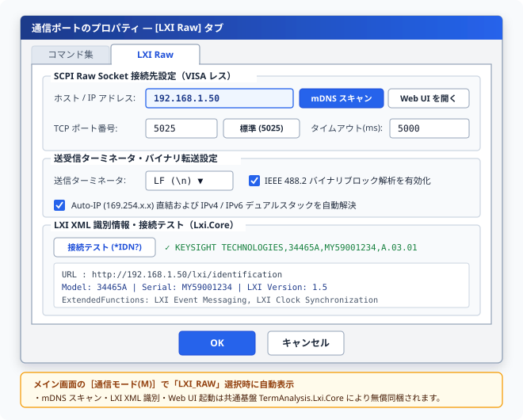
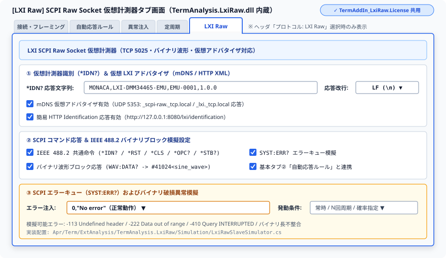

# LxiRaw（LAN［LXI］SCPI Raw Socket 通信）アドイン取扱説明書

👉 [← TermAddIn_LxiRaw 製品トップに戻る](https://github.com/Monaca-App/TermAddIn_LxiRaw)  
👉 [← プロパティ設定画面取扱説明書（共通）](../プロパティ設定画面取扱説明書.Md) ／ [← TermEmulator 操作説明書（共通）](https://github.com/Monaca-App/TermEmulator/blob/main/Manual/TermEmulator操作説明書.Md) ／ [← マクロスクリプト取扱説明書（共通）](../マクロスクリプト取扱説明書.Md)

---

本書は、**TermAddIn_LxiRaw**（`TermAnalysis.LxiRaw.dll`：SCPI Raw Socket 通信エクステンション）の **取扱説明書 兼 機能解説書** です。外部 VISA ドライバ（NI-VISA / Keysight IO Libraries 等）や Bonjour を一切使用せず、`.NET Framework 4.8` 標準機能のみで LAN 計測器を制御します。SCPI Raw Socket の仕組み解説、プロパティ設定画面の **「LXI Raw」タブ**、**TermEmulator の `[LXI Raw]` 仮想計測器タブ**、および全 8 コマンドのリファレンスを 1 冊にまとめています。

* **必須拡張ライセンス**: **`TermAddIn_LxiRaw.License`** （組み込み先: `TermAnalysis.LxiRaw.dll`、`TermEmulator` と相互共用）
* **共通同梱基盤**: `TermAnalysis.Lxi.Core.dll`（無償同梱：mDNS 自動発見・LXI XML 識別・Web UI 起動・IEEE 488.2 バイナリブロック解析）


### 関連する公式規格・仕様書（外部リンク）
* [IVI Foundation 公式仕様ポータル（SCPI / 計測器制御規格）](https://www.ivifoundation.org/specifications/default.aspx) — SCPI / IEEE 488.2 関連プロトコル仕様を参照できます（本アドインは LXI Consortium 策定の LXI Device Specification 1.5 / 1.6［XML Identification `/lxi/identification`］に準拠）。
* [IETF RFC 6762：Multicast DNS（mDNS）](https://datatracker.ietf.org/doc/rfc6762/) ／ [IETF RFC 6763：DNS-Based Service Discovery（DNS-SD）](https://datatracker.ietf.org/doc/rfc6763/) — `LAN 機器スキャン (mDNS)` が準拠する自動機器発見規格です。
---

## 目次

- [1. 機能概要と基礎知識（はじめての方へ）](#1-機能概要と基礎知識はじめての方へ)
- [2. プロパティ設定画面：「LXI Raw」タブの詳細](#2-プロパティ設定画面lxi-rawタブの詳細)
- [3. TermEmulator 仮想スレーブ設定：「[LXI Raw]」タブの詳細](#3-termemulator-仮想スレーブ設定lxi-rawタブの詳細)
- [4. マクロコマンド一覧（全 8 コマンド）](#4-マクロコマンド一覧全-8-コマンド)

---

## 1. 機能概要と基礎知識（はじめての方へ）

### 対応する機能の概要
**LxiRaw（SCPI Raw Socket 通信）** アドインは、LAN ポートを備えた電子計測器（デジタルマルチメータ、直流電源、オシロスコープ、電子負荷など）に対して、**SCPI Raw Socket（標準 TCP ポート `5025`）** によるコマンド送信・単独受信・問い合わせ（Query）・IEEE 488.2 バイナリブロック波形取得・デバイスクリア（`*CLS`）を行う基本通信機能です。
さらに共通基盤（`TermAnalysis.Lxi.Core`）により、LAN 内計測器の **mDNS 自動発見・LXI XML 識別情報取得・内蔵 Web 画面起動** にも対応します。

### 機能の実現方法
* **VISA レスの Pure C# TCP ソケット実装**: `.NET Framework 4.8` 標準の TCP ソケット通信と `Ieee4882BlockParser`（`#<d><len><data>` / `#0<data>\n` 自動解析）のみで完結しており、NI-VISA や Keysight IO Libraries、Bonjour などの外部ドライバを一切必要としません。
* **言語非依存のミニシーケンス連携**: 通信の土台（接続・送受信・バイナリ保存）を本アドインが担い、計測器固有の SCPI 命令や完了待ちループ（`*OPC?`）は Excel / CSV マクロ側で自由に組み立てられる構造です。
* **仮想 LXI 計測器による E2E 検証**: `TermEmulator` の `[LXI Raw]` タブ（仮想 mDNS アドバタイザ＋HTTP `/lxi/identification` 内蔵）により、実機なしで機器発見から波形取得までテストできます。

### このアドインを選択することの利点
* **最小コスト・最小構成で即導入**: 重い VISA ドライバのインストールやバージョン競合に悩まされず、LAN ケーブル 1 本で現行の一般的な LAN 計測器をすぐ自動化できます。
* **波形や画面キャプチャもそのまま保存**: 通常の汎用 TCP ツール（Telnet 等）では扱いが難しい IEEE 488.2 バイナリブロックを、`LxiRaw_ReadBlock` の 1 行で純粋なデータファイルへ抽出保存できます。
* **IP アドレスが分からなくても見つけられる**: 付属の `LAN 機器スキャン (mDNS)` ボタンで LAN 内の計測器を自動検出し、メーカー・型番・シリアルを確認してからそのまま接続できます。

### 他の LXI 基本通信アドイン（`LxiVxi11` / `LxiHiSlip`）との違い
LAN 計測器の通信方式には主に 3 種類あります。**「まずはこれ（`LxiRaw`）から」** が基本です。

| 通信方式 | 特徴と向いているケース |
| :--- | :--- |
| **`LxiRaw`（本書）** | **最もシンプル・高速**。標準 TCP ポート `5025` に直接文字コマンドを送るだけ。現行の一般的な DMM・電源・オシロスコープのほとんどが対応しています。 |
| **[LxiVxi11](../LxiVxi11/LxiVxi11取扱説明書.Md)** | 古い GPIB 計測器を LAN 変換器（ゲートウェイ）経由で繋ぐ場合や、測定中の割り込み状態確認（STB）・排他ロックが必要な場合に使います。 |
| **[LxiHiSlip](../LxiHiSlip/LxiHiSlip取扱説明書.Md)** | 最新高速オシロスコープ等の大容量波形転送や、通信の暗号化（TLS 2.0）が必要な場合に使います。 |

### 設定の妥当性を判断するためのチェックポイント
| 確認項目 | 項目の意味 | 設定値の目安・確認方法 |
| :--- | :--- | :--- |
| **ホスト / IP アドレス** | 計測器の LAN 住所 | 計測器の本体パネル（`Utility` ➔ `I/O` ➔ `LAN`）で確認するか、本画面の **`LAN 機器スキャン (mDNS)`** ボタンを押せば自動で見つかります。 |
| **ポート番号** | 計測器側の SCPI 受付ポート番号 | 業界標準は **`5025`** です（変更していなければ `5025` のままで妥当。メーカーによっては `5024` や `4000` の場合もあるためマニュアルで確認）。 |
| **送信ターミネータ** | 命令の終わりを伝える改行コード | 計測器（SCPI 規格）の標準は **`LF`** です。応答がない場合のみ `CRLF` を試してください。 |
| **タイムアウト** | 返事を待つ最大時間 | 通常の測定は既定の **`5000` ms（5 秒）** で十分です。平均化回数が多く測定に 10 秒以上かかる場合のみ増やします。 |

### 通信の仕組み解説（プロトコル構造と代表的なトラブル事例・対処法）
SCPI Raw Socket は、TCP ソケット（既定 `5025`）上で直接テキスト命令と応答を流し、波形データだけは IEEE 488.2 バイナリブロック形式で受け取ります。

```text
テキスト応答   PC ➔ 計測器: "*IDN?\n"         /  計測器 ➔ PC: "Keysight,34461A,MY1234,1.0\n"
バイナリ波形   PC ➔ 計測器: ":WAV:DATA?\n"    /  計測器 ➔ PC: "#41024<1024バイトの生データ>\n"
自動機器発見   PC ➔ LAN(224.0.0.251:5353): mDNS 探索 ➔ 計測器: IP/ポート応答 ➔ HTTP GET /lxi/identification
```

* **事例①：`*IDN?` を送ってもタイムアウトする** ➔ 機器側の「Socket / Raw ポート」が OFF になっているか、ポート番号が `5025` 以外（例: `5024` や `4000`）、またはターミネータが `CRLF` 指定の機種であることが多いです。
* **事例②：mDNS スキャンで機器が出てこない** ➔ PC と計測器が異なる VLAN / サブネットにいる、または企業ファイアウォールが UDP `5353` を遮断しています。その場合は計測器パネルに表示された IP アドレスを直接入力すれば通信できます。
* **事例③：測定エラーが残ったままになる** ➔ 前のコマンドの構文エラーが計測器内部に残っていると次の応答が乱れることがあります。シーケンス先頭で `LxiRaw_Clear`（`*CLS`）を入れると安定します。

---

## 2. プロパティ設定画面：「LXI Raw」タブの詳細



メイン画面で **`LXI_RAW`** モードを選択しているときに表示され、`LxiRaw_Open` 等の SCPI Raw Socket 接続条件を設定します。

| 項目名 | 設定値・範囲（既定値） | 詳しい意味と設定のポイント |
| :--- | :--- | :--- |
| **`ホスト / IP アドレス`** | IPv4 / IPv6 アドレスまたはホスト名 | 接続先 LXI 計測器の IP アドレスを指定します（Auto-IP `169.254.x.x` 直結・ローカル `127.0.0.1` 対応）。 |
| **`ポート番号`** | `1`〜`65535`（既定 `5025`） | SCPI Raw Socket の標準ポートは `5025` です。 |
| **`送信ターミネータ`** | `LF`（既定） / `CRLF` | コマンド送信時に末尾へ付与する改行コードを選択します。 |
| **`タイムアウト`** | ミリ秒（既定 `5000` ms） | 接続確立および応答・バイナリブロック受信のタイムアウト時間です。 |
| **`LAN 機器スキャン (mDNS)`** | 共通操作ボタン（`Lxi.Core` 提供） | マルチキャスト `224.0.0.251:5353` で `_scpi-raw._tcp.local` / `_lxi._tcp.local` を自動検出し、LXI XML Identification（`http(s)://<ip>/lxi/identification`）からメーカー・型番・シリアルを一覧表示します。 |
| **`接続テスト / Web UI を開く`** | 共通操作ボタン（`Lxi.Core` 提供） | `*IDN?` 応答・XML 識別情報の疎通確認、および機器内蔵 Web 画面のブラウザ起動を行います。 |

---

## 3. TermEmulator 仮想スレーブ設定：`[LXI Raw]` タブの詳細



* **主な用途**: SCPI Raw Socket 対応計測器（DMM・電源・オシロスコープ等）の仮想スレーブ模擬（既定 TCP ポート `5025`）。
* **模擬機能**:
  * SCPI コマンド応答（`*IDN?`, `*OPC?`, `*STB?`, `MEAS:VOLT?` 等）およびエラーキュー（`SYST:ERR?`）の模擬。
  * IEEE 488.2 Definite / Indefinite バイナリブロック（ダミー波形データ）の返却模擬。
  * 基本タブ③「異常注入」と連動した応答遅延・無応答ドロップ・フレーム分割・破損テスト。
  * `TermAnalysis.Lxi.Core` 内蔵の **仮想 LXI 機器アドバタイザ**（mDNS UDP `5353` 応答＋簡易 HTTP `/lxi/identification`）を ON にすることで、実機ゼロ環境で「mDNS スキャン ➔ XML 識別 ➔ SCPI 通信」の E2E 検証が可能。

---

## 4. マクロコマンド一覧（全 8 コマンド）

※ SCPI 固有命令（`*OPC?` 完了待機ループや `SYST:ERR?` 監視分岐等）は CSV マクロスクリプト（ミニシーケンス）側で柔軟に構成する言語非依存設計です。

| コマンド名 | 構文概要 | 主な役割・用途 |
| :--- | :--- | :--- |
| **[LxiRaw_Open](./LxiRaw_Open.Md)** | `,SEQUENCE, [ステップ], LxiRaw_Open, "[IP(任意)]", [Port(任意: 5025)], [TimeoutMs(任意)]` | ライセンス検証後、指定 IP・TCP ポートへ SCPI Raw Socket 接続を確立 |
| **[LxiRaw_Close](./LxiRaw_Close.Md)** | `,SEQUENCE, [ステップ], LxiRaw_Close` | 接続中のセッションを正常切断・破棄 |
| **[LxiRaw_Mode](./LxiRaw_Mode.Md)** | `,SEQUENCE, [ステップ], LxiRaw_Mode, "[Terminator(LF/CRLF)]", [TimeoutMs]` | 送信改行コードやタイムアウト時間等を動的変更 |
| **[LxiRaw_Send](./LxiRaw_Send.Md)** | `,SEQUENCE, [ステップ], LxiRaw_Send, "[送信文字列]"` | コマンド文字列を非同期送信（変数展開対応・応答待機なし） |
| **[LxiRaw_Receive](./LxiRaw_Receive.Md)** | `,SEQUENCE, [ステップ], LxiRaw_Receive, "[格納先キー(任意)]", [TimeoutMs(任意)]` | 送信を伴わず 1 メッセージ受信し、結果セルおよび共通受信ワークバッファへ格納（`Set_Data` 連携対応） |
| **[LxiRaw_Query](./LxiRaw_Query.Md)** | `,SEQUENCE, [ステップ], LxiRaw_Query, "[送信文字列]", "[格納先キー(任意)]", [TimeoutMs(任意)]` | コマンド送信＋応答取得を一括実行し、結果セル・共通ワークバッファ・指定変数へ格納 |
| **[LxiRaw_ReadBlock](./LxiRaw_ReadBlock.Md)** | `,SEQUENCE, [ステップ], LxiRaw_ReadBlock, "[保存先ファイルパス]", [TimeoutMs(任意)]` | IEEE 488.2 バイナリブロック（`#<d><len><data>` / `#0<data>\n`）を受信・ファイル保存 |
| **[LxiRaw_Clear](./LxiRaw_Clear.Md)** | `,SEQUENCE, [ステップ], LxiRaw_Clear` | デバイスクリア（`*CLS`）を送出し、機器の入出力状態・エラーキューをクリア |
