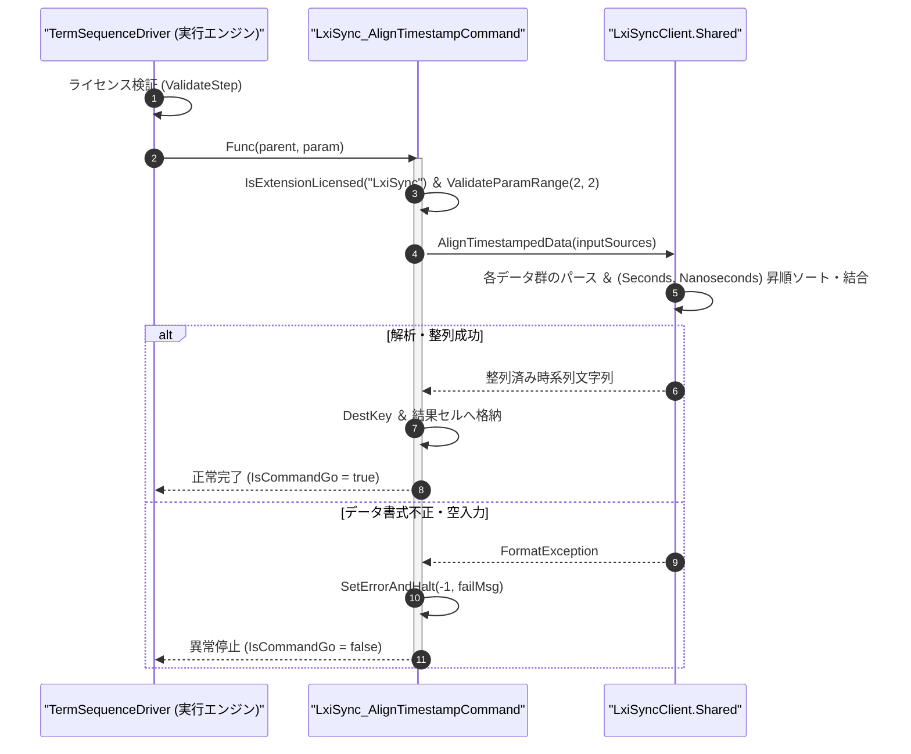

# コマンドリファレンス：LxiSync_AlignTimestamp

👉 [← LxiSync アドイン取扱説明書に戻る](./LxiSync取扱説明書.Md)

## 概要

**LxiSync_AlignTimestamp** は、複数台の LXI 計測器から収集したタイムスタンプ付き測定データ（LXI Timestamped Data：`"<Timestamp>,<Value>"` 形式の複数行または CSV 列群）を共通の PTP 時刻軸で昇順整列・結合し、Excel シート出力用の整形結果を変数および結果セルへ格納するデータ整合コマンドです。

---

## 💡 書式・パラメータ仕様

### コマンド構文

```csv
,SEQUENCE, [ステップキー], LxiSync_AlignTimestamp, "[InputDataSources]", "[DestKey]"
```

※ `InputDataSources` には複数変数またはファイルパスをセミコロン区切り（例: `"$DMM1_TS_DATA$;$DMM2_TS_DATA$"`）で指定します。

### パラメータ（引数）一覧

| 引数位置 | 引数名 | 必須/任意 | 説明・制約 |
| :--- | :--- | :---: | :--- |
| 第 1 引数 | `InputDataSources` | 必須 | 整列対象となる複数機器のタイムスタンプ付きデータ群（セミコロン区切りのデータ文字列または CSV ファイルパス群）。 |
| 第 2 引数 | `DestKey` | 必須 | 時刻軸昇順に整列・結合された結果（`"<Timestamp>,<DeviceIndex>,<Value>"` の改行区切り文字列）を格納する `PARAM` 変数キー名。 |

---

## 🔄 特殊置換規約・分岐規約の適用

* **動的置換（`$`）**: 第 1 引数に複数の `$PARAMキー$` を組み合わせて渡すことができます。
* **ジャンプ先指定（`#`）**: 非適用。
* **共通コマンド指定（`@`）**: 非適用。
* **エイリアス（別名）**: `Analysis_LxiSync_AlignTimestamp`, `Sqn_LxiSync_AlignTimestamp`

---

## 💡 動作例（正しい構文での記述例）

### スクリプト記述例

※COMMAND ブロック配下の子要素行（PARAM, SEQUENCE）は必ず行頭カンマから開始し、スペースインデントや行末コメント（`;`）は記述しないでください。

```csv
COMMAND, "SAMPLE_LXISYNC_ALIGN", "ALIGNED"
,PARAM, "DATA_A", Input, "機器Aデータ", "1735689600.200000000,5.01"
,PARAM, "DATA_B", Input, "機器Bデータ", "1735689600.100000000,4.99"
,PARAM, "ALIGNED", Work, "整列後データ", ""
; 複数機器のタイムスタンプ付きデータを時刻軸で昇順整列・結合
,SEQUENCE, 010, LxiSync_AlignTimestamp, "$DATA_A$;$DATA_B$", "ALIGNED"
,SEQUENCE, 020, Exit, "$ALIGNED$", 0
```

### 実行時の挙動・変数変化

* **実行前の状態**: 機器 A・機器 B の測定データが個別変数に分散している状態。
* **実行後の状態**: 秒・ナノ秒を厳密な精度（`long` 秒部＋`int` ナノ秒部比較）で昇順ソートし、結合した時系列テーブル文字列が `"ALIGNED"` および結果セルへ格納されます。

---

## 🔄 動作フロー（シーケンス図）



---

## 🚫 エラーハンドリング・安全設計（仕様制限）

1. **ライセンス・引数検証**: `LxiSync` 未認証時は `-100`、引数不足・超過（`ValidateParamRange(2, 2)` 違反）時は停止します。
2. **ナノ秒精度保持**: 浮動小数点（`double`）による丸め誤差を避け、秒部（`long`）とナノ秒部（`int`）の厳密比較で時刻順を保証します。

---

## 🧪 ユニットテスト仕様

本コマンドクラス（`LxiSync_AlignTimestampCommand.cs`）に実装されている `RunUnitTest()` メソッドの検証仕様です。

### テスト実行前提条件

* **実行トリガー**: `RunUnitTest()` メソッドの呼び出し
* **有効化条件**: `ErrorLogger.MinimumLevel == LogLevel.Test` であること（それ以外は早期リターン）
* **検証結果出力**: `_log.LogTest` へ出力。

### テストケース一覧

| No | テストカテゴリ | テスト条件（入力値） | 期待される結果（出力値） | 検証の目的 / 観点 |
| :---: | :--- | :--- | :--- | :--- |
| **1** | 正常系 | `"1735689600.200000000,5.01;1735689600.100000000,4.99"`, `"ALIGNED"` を実行 | `!HasError`、`IsCommandGo == true`、`.100000000` の行が `.200000000` より前に整列される | ナノ秒精度の時刻軸整列検証 |
| **2** | 異常系 | 不正タイムスタンプ文字列 `"INVALID_TS,1.0"`, `"ALIGNED"` を実行 | `HasError == true` かつ `!IsCommandGo` となる | 不正レコード拒否の検証 |