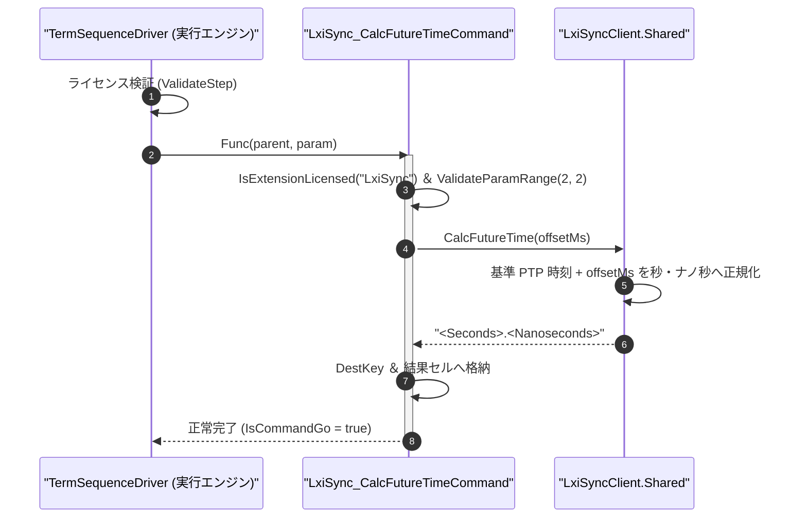

# コマンドリファレンス：LxiSync_CalcFutureTime

👉 [← LxiSync アドイン取扱説明書に戻る](./LxiSync取扱説明書.Md)

## 概要

**LxiSync_CalcFutureTime** は、現在の PTP 基準時刻（TAI / UTC）に指定されたオフセット［ミリ秒］を加算し、複数 LXI 計測器へ一斉配布するための **未来時刻タイムスタンプ（`<Seconds>.<Nanoseconds>` 形式）** を算出して変数へ格納する時刻計算コマンドです。`LxiSyncClient.Shared.CalcFutureTime()` を実行します。

---

## 💡 書式・パラメータ仕様

### コマンド構文

```csv
,SEQUENCE, [ステップキー], LxiSync_CalcFutureTime, "[OffsetMs]", "[DestKey]"
```

※ 算出したタイムスタンプ変数は、`LxiEvent_Send` の第 2 引数や SCPI タイムトリガ設定コマンドへそのまま `$変数名$` で渡せます。

### パラメータ（引数）一覧

| 引数位置 | 引数名 | 必須/任意 | 説明・制約 |
| :--- | :--- | :---: | :--- |
| 第 1 引数 | `OffsetMs` | 必須 | 現在 PTP 時刻へ加算する未来オフセット時間［ミリ秒］（`10`〜`3600000`、例: `500`＝500 ms 後）。 |
| 第 2 引数 | `DestKey` | 必須 | 算出された未来タイムスタンプ（`"<UnixSeconds>.<9桁Nanoseconds>"` 形式）を格納する `PARAM` 変数キー名。 |

---

## 🔄 特殊置換規約・分岐規約の適用

* **動的置換（`$`）**: 全引数で `$PARAMキー$` による動的置換に対応します。
* **ジャンプ先指定（`#`）**: 非適用。
* **共通コマンド指定（`@`）**: 非適用。
* **エイリアス（別名）**: `Analysis_LxiSync_CalcFutureTime`, `Sqn_LxiSync_CalcFutureTime`

---

## 💡 動作例（正しい構文での記述例）

### スクリプト記述例

※COMMAND ブロック配下の子要素行（PARAM, SEQUENCE）は必ず行頭カンマから開始し、スペースインデントや行末コメント（`;`）は記述しないでください。

```csv
COMMAND, "SAMPLE_LXISYNC_FUTURE", "TRIG_TS"
,PARAM, "TRIG_TS", Work, "未来トリガ時刻", ""
; 現在 PTP 時刻 + 500ms の未来タイムスタンプを算出
,SEQUENCE, 010, LxiSync_CalcFutureTime, 500, "TRIG_TS"
; 算出した未来時刻で LXI Event トリガを一斉配布
,SEQUENCE, 020, LxiEvent_Open, "224.0.23.159", 5044, 0
,SEQUENCE, 030, LxiEvent_Send, "LAN0", "$TRIG_TS$"
,SEQUENCE, 040, LxiEvent_Close
,SEQUENCE, 050, Exit, "$TRIG_TS$", 0
```

### 実行時の挙動・変数変化

* **実行前の状態**: `"TRIG_TS"` が空文字の状態。
* **実行後の状態**: 現在 PTP 時刻（または同期観測済みオフセット補正済みシステム時刻）に `OffsetMs` を加算した `"<Seconds>.<Nanoseconds>"` 文字列が `"TRIG_TS"` および結果セルへ格納されます。

---

## 🔄 動作フロー（シーケンス図）



---

## 🚫 エラーハンドリング・安全設計（仕様制限）

1. **ライセンス・引数検証**: `LxiSync` 未認証時は `-100`、引数不足・超過（`ValidateParamRange(2, 2)` 違反）時は停止します。
2. **過去時刻・過小オフセット防止**: `OffsetMs < 10` または数値変換不可時はネットワーク伝搬遅延を下回る危険があるため `SetErrorAndHalt(-1, failMsg)` で拒否します。

---

## 🧪 ユニットテスト仕様

本コマンドクラス（`LxiSync_CalcFutureTimeCommand.cs`）に実装されている `RunUnitTest()` メソッドの検証仕様です。

### テスト実行前提条件

* **実行トリガー**: `RunUnitTest()` メソッドの呼び出し
* **有効化条件**: `ErrorLogger.MinimumLevel == LogLevel.Test` であること（それ以外は早期リターン）
* **検証結果出力**: `_log.LogTest` へ出力。`finally` で `IsSimulationMode` を復元。

### テストケース一覧

| No | テストカテゴリ | テスト条件（入力値） | 期待される結果（出力値） | 検証の目的 / 観点 |
| :---: | :--- | :--- | :--- | :--- |
| **1** | 正常系 | 引数 `"500"`, `"TRIG_TS"` を指定して実行 | `!HasError`、`IsCommandGo == true`、`TRIG_TS` が `^\d+\.\d{9}$` 形式となる | 未来タイムスタンプ算出およびフォーマット検証 |
| **2** | 異常系 | オフセット `"0"` または `"ABC"` を指定して実行 | `HasError == true` かつ `!IsCommandGo` となる | 不正オフセット拒否の検証 |