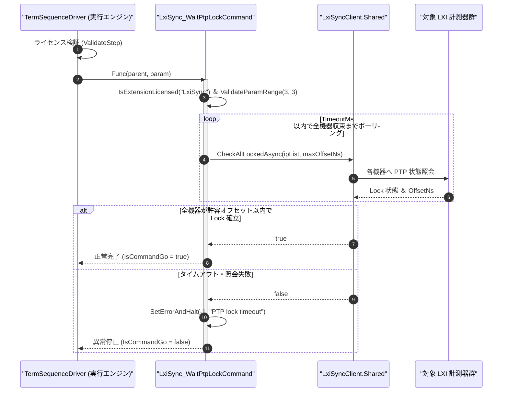

# コマンドリファレンス：LxiSync_WaitPtpLock

👉 [← LxiSync アドイン取扱説明書に戻る](./LxiSync取扱説明書.Md)

## 概要

**LxiSync_WaitPtpLock** は、指定された 1 台以上の LXI 計測器すべてが IEEE 1588 PTPv2 同期確立（`LOCKED`）かつ許容オフセット値［ナノ秒］以内に収束するまでポーリング待機する同期保証コマンドです。`LxiSyncClient.Shared.WaitPtpLockAsync()` を実行します。

---

## 💡 書式・パラメータ仕様

### コマンド構文

```csv
,SEQUENCE, [ステップキー], LxiSync_WaitPtpLock, "[TargetIpList]", "[MaxOffsetNs]", "[TimeoutMs]"
```

※ 複数 IP を指定する場合はセミコロンまたはカンマ区切り（例: `"192.168.0.10;192.168.0.11"`）で二重引用符内に記述します。

### パラメータ（引数）一覧

| 引数位置 | 引数名 | 必須/任意 | 説明・制約 |
| :--- | :--- | :---: | :--- |
| 第 1 引数 | `TargetIpList` | 必須 | 同期確立を待機する計測器 IP 一覧（セミコロンまたはカンマ区切り、例: `"192.168.0.10;192.168.0.11"`）。 |
| 第 2 引数 | `MaxOffsetNs` | 必須 | 同期確立とみなす許容絶対オフセット閾値［ナノ秒］（`1`〜`1000000000`、例: `1000`＝1 μs）。 |
| 第 3 引数 | `TimeoutMs` | 必須 | 全機器の同期収束を待機する最大時間［ミリ秒］（`1000`〜`600000`）。 |

---

## 🔄 特殊置換規約・分岐規約の適用

* **動的置換（`$`）**: 全引数で `$PARAMキー$` による動的置換に対応します。
* **ジャンプ先指定（`#`）**: 非適用。
* **共通コマンド指定（`@`）**: 非適用。
* **カンマのエスケープ**: IP 一覧にカンマ区切りを用いる場合は必ず `"..."` で囲んで記述します。
* **エイリアス（別名）**: `Analysis_LxiSync_WaitPtpLock`, `Sqn_LxiSync_WaitPtpLock`

---

## 💡 動作例（正しい構文での記述例）

### スクリプト記述例

※COMMAND ブロック配下の子要素行（PARAM, SEQUENCE）は必ず行頭カンマから開始し、スペースインデントや行末コメント（`;`）は記述しないでください。

```csv
COMMAND, "SAMPLE_LXISYNC_WAITLOCK", "RES"
,PARAM, "RES", Work, "同期結果", "LOCKED"
; 2 台の計測器が ±500 ns 以内に PTP 同期するまで最大 30 秒待機
,SEQUENCE, 010, LxiSync_WaitPtpLock, "192.168.0.10;192.168.0.11", 500, 30000
,SEQUENCE, 020, Exit, "$RES$", 0
```

### 実行時の挙動・変数変化

* **実行前の状態**: 対象計測器群が PTP 同期収束中または未確認の状態。
* **実行後の状態**: 全対象計測器が `LOCKED` かつ `|OffsetNs| <= MaxOffsetNs` を満たした時点で正常終了し、次ステップ（未来時刻トリガ設定等）へ進みます。

---

## 🔄 動作フロー（シーケンス図）



---

## 🚫 エラーハンドリング・安全設計（仕様制限）

1. **ライセンス・引数検証**: `LxiSync` 未認証時は `-100`、引数不足・超過（`ValidateParamRange(3, 3)` 違反）または閾値・タイムアウト範囲外時は停止します。
2. **タイムアウト安全停止**: 制限時間内に 1 台でも同期未達が残る場合は、非同期状態での誤計測を防ぐため `SetErrorAndHalt(-1, failMsg)` で停止します。

---

## 🧪 ユニットテスト仕様

本コマンドクラス（`LxiSync_WaitPtpLockCommand.cs`）に実装されている `RunUnitTest()` メソッドの検証仕様です。

### テスト実行前提条件

* **実行トリガー**: `RunUnitTest()` メソッドの呼び出し
* **有効化条件**: `ErrorLogger.MinimumLevel == LogLevel.Test` であること（それ以外は早期リターン）
* **検証結果出力**: `_log.LogTest` へ出力。`finally` で `IsSimulationMode` を復元。

### テストケース一覧

| No | テストカテゴリ | テスト条件（入力値） | 期待される結果（出力値） | 検証の目的 / 観点 |
| :---: | :--- | :--- | :--- | :--- |
| **1** | 正常系 | `IsSimulationMode = true`（模擬オフセット `50 ns`）で `"192.168.0.10;192.168.0.11"`, `"500"`, `"5000"` を実行 | `!HasError` かつ `IsCommandGo == true` となる | 複数機器 PTP Lock 収束判定の検証 |
| **2** | 異常系 | 許容オフセットに負数 `"-10"` を指定して実行 | `HasError == true` かつ `!IsCommandGo` となる | 不正閾値拒否の検証 |