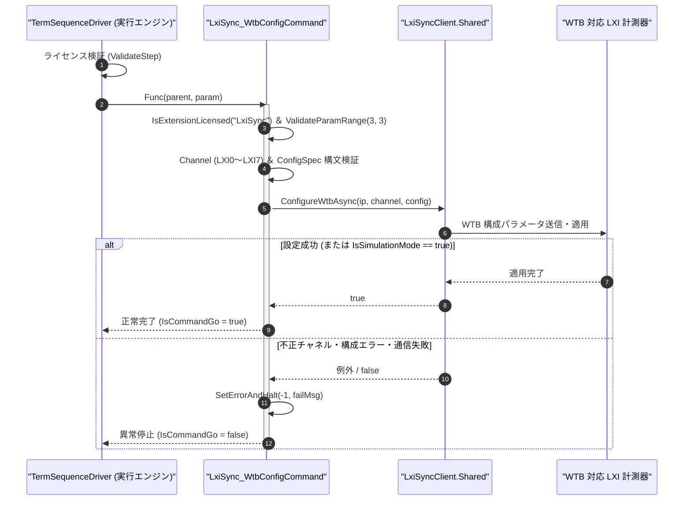

# コマンドリファレンス：LxiSync_WtbConfig

👉 [← LxiSync アドイン取扱説明書に戻る](./LxiSync取扱説明書.Md)

## 概要

**LxiSync_WtbConfig** は、LXI Wired Trigger Bus（WTB）対応計測器の 8 チャネル差動トリガバス（`LXI0`〜`LXI7`）について、入出力方向・駆動モード（Driven / Wired-OR）・極性・終端設定を一括構成するハードウェア同期設定コマンドです。`LxiSyncClient.Shared.ConfigureWtbAsync()` を実行します。

---

## 💡 書式・パラメータ仕様

### コマンド構文

```csv
,SEQUENCE, [ステップキー], LxiSync_WtbConfig, "[IP]", "[Channel: LXI0〜LXI7]", "[ConfigSpec]"
```

※ `ConfigSpec` は `"DIR=OUT;MODE=WIRED_OR;POL=POS;TERM=ON"` のようにセミコロン区切りの `KEY=VALUE` 形式で指定します。

### パラメータ（引数）一覧

| 引数位置 | 引数名 | 必須/任意 | 説明・制約 |
| :--- | :--- | :---: | :--- |
| 第 1 引数 | `IP` | 必須 | WTB 設定対象の LXI 計測器の IPv4 / IPv6 アドレスまたはホスト名。 |
| 第 2 引数 | `Channel` | 必須 | 対象 WTB チャネル名（`"LXI0"`〜`"LXI7"`、大文字小文字不問）。 |
| 第 3 引数 | `ConfigSpec` | 必須 | 構成パラメータ文字列（`DIR=IN/OUT`, `MODE=DRIVEN/WIRED_OR`, `POL=POS/NEG`, `TERM=ON/OFF` をセミコロン区切りで指定）。 |

---

## 🔄 特殊置換規約・分岐規約の適用

* **動的置換（`$`）**: 全引数で `$PARAMキー$` による動的置換に対応します。
* **ジャンプ先指定（`#`）**: 非適用。
* **共通コマンド指定（`@`）**: 非適用。
* **エイリアス（別名）**: `Analysis_LxiSync_WtbConfig`, `Sqn_LxiSync_WtbConfig`

---

## 💡 動作例（正しい構文での記述例）

### スクリプト記述例

※COMMAND ブロック配下の子要素行（PARAM, SEQUENCE）は必ず行頭カンマから開始し、スペースインデントや行末コメント（`;`）は記述しないでください。

```csv
COMMAND, "SAMPLE_LXISYNC_WTBCFG", "RES"
,PARAM, "RES", Work, "設定結果", "OK"
; 192.168.0.10 の WTB チャネル LXI0 を出力・Wired-OR・正極性・終端 ON に構成
,SEQUENCE, 010, LxiSync_WtbConfig, "192.168.0.10", "LXI0", "DIR=OUT;MODE=WIRED_OR;POL=POS;TERM=ON"
,SEQUENCE, 020, Exit, "$RES$", 0
```

### 実行時の挙動・変数変化

* **実行前の状態**: 対象計測器の WTB チャネル `LXI0` が既定（未構成）状態。
* **実行後の状態**: 対象計測器へ WTB 構成設定が適用され、`LxiSync_WtbTrigger` によるバストリガ駆動または受信待機が可能な状態になります。

---

## 🔄 動作フロー（シーケンス図）



---

## 🚫 エラーハンドリング・安全設計（仕様制限）

1. **チャネル範囲検証**: `LXI0`〜`LXI7` 以外のチャネル名（例: `LXI8`）や未知の `ConfigSpec` キーは `SetErrorAndHalt(-1, failMsg)` で拒否します。
2. **バス競合防止**: 同一バス上で複数機器を `MODE=DRIVEN` かつ `DIR=OUT` に誤設定しないよう、設定内容をログへ明示記録します。

---

## 🧪 ユニットテスト仕様

本コマンドクラス（`LxiSync_WtbConfigCommand.cs`）に実装されている `RunUnitTest()` メソッドの検証仕様です。

### テスト実行前提条件

* **実行トリガー**: `RunUnitTest()` メソッドの呼び出し
* **有効化条件**: `ErrorLogger.MinimumLevel == LogLevel.Test` であること（それ以外は早期リターン）
* **検証結果出力**: `_log.LogTest` へ出力。`finally` で `IsSimulationMode` を復元。

### テストケース一覧

| No | テストカテゴリ | テスト条件（入力値） | 期待される結果（出力値） | 検証の目的 / 観点 |
| :---: | :--- | :--- | :--- | :--- |
| **1** | 正常系 | `IsSimulationMode = true` 下で `"192.168.0.10"`, `"LXI0"`, `"DIR=OUT;MODE=WIRED_OR;POL=POS;TERM=ON"` を実行 | `!HasError` かつ `IsCommandGo == true` となる | WTB チャネル構成の正常適用検証 |
| **2** | 異常系 | 範囲外チャネル `"LXI9"` を指定して実行 | `HasError == true` かつ `!IsCommandGo` となる | 範囲外 WTB チャネル拒否の検証 |