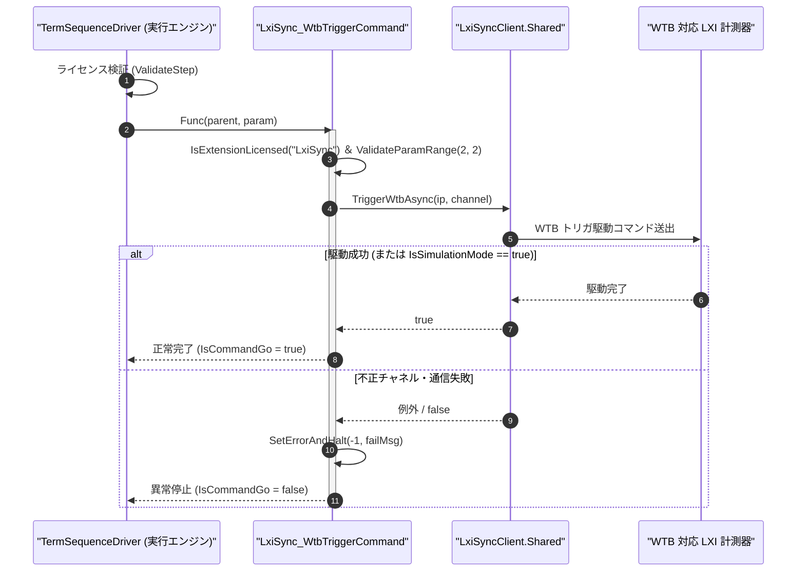

# コマンドリファレンス：LxiSync_WtbTrigger

👉 [← LxiSync アドイン取扱説明書に戻る](./LxiSync取扱説明書.Md)

## 概要

**LxiSync_WtbTrigger** は、構成済みの LXI Wired Trigger Bus（WTB）チャネル（`LXI0`〜`LXI7`）に対してハードウェアバストリガパルスを駆動する同期トリガ送出コマンドです。`LxiSyncClient.Shared.TriggerWtbAsync()` を実行します。

---

## 💡 書式・パラメータ仕様

### コマンド構文

```csv
,SEQUENCE, [ステップキー], LxiSync_WtbTrigger, "[IP]", "[Channel: LXI0〜LXI7]"
```

### パラメータ（引数）一覧

| 引数位置 | 引数名 | 必須/任意 | 説明・制約 |
| :--- | :--- | :---: | :--- |
| 第 1 引数 | `IP` | 必須 | バストリガを駆動する LXI 計測器の IPv4 / IPv6 アドレスまたはホスト名。 |
| 第 2 引数 | `Channel` | 必須 | 駆動対象の WTB チャネル名（`"LXI0"`〜`"LXI7"`、大文字小文字不問）。 |

---

## 🔄 特殊置換規約・分岐規約の適用

* **動的置換（`$`）**: 全引数で `$PARAMキー$` による動的置換に対応します。
* **ジャンプ先指定（`#`）**: 非適用。
* **共通コマンド指定（`@`）**: 非適用。
* **エイリアス（別名）**: `Analysis_LxiSync_WtbTrigger`, `Sqn_LxiSync_WtbTrigger`

---

## 💡 動作例（正しい構文での記述例）

### スクリプト記述例

※COMMAND ブロック配下の子要素行（PARAM, SEQUENCE）は必ず行頭カンマから開始し、スペースインデントや行末コメント（`;`）は記述しないでください。

```csv
COMMAND, "SAMPLE_LXISYNC_WTBTRIG", "RES"
,PARAM, "RES", Work, "結果", "OK"
,SEQUENCE, 010, LxiSync_WtbConfig, "192.168.0.10", "LXI0", "DIR=OUT;MODE=WIRED_OR;POL=POS;TERM=ON"
; WTB チャネル LXI0 へバストリガを駆動
,SEQUENCE, 020, LxiSync_WtbTrigger, "192.168.0.10", "LXI0"
,SEQUENCE, 030, Exit, "$RES$", 0
```

### 実行時の挙動・変数変化

* **実行前の状態**: 対象計測器の WTB チャネル `LXI0` がトリガ出力可能に構成されている状態。
* **実行後の状態**: 指定された WTB チャネルにトリガ信号が駆動され、同一 WTB ケーブルで接続された全計測器が一斉にハードウェア同期トリガを受け取ります。

---

## 🔄 動作フロー（シーケンス図）



---

## 🚫 エラーハンドリング・安全設計（仕様制限）

1. **ライセンス・チャネル検証**: `LxiSync` 未認証時は `-100`、`LXI0`〜`LXI7` 以外のチャネル指定または引数数不一致（`ValidateParamRange(2, 2)` 違反）時は停止します。
2. **通信失敗時の安全停止**: 対象機器への到達不可またはタイムアウト時は `SetErrorAndHalt(-1, failMsg)` で停止します。

---

## 🧪 ユニットテスト仕様

本コマンドクラス（`LxiSync_WtbTriggerCommand.cs`）に実装されている `RunUnitTest()` メソッドの検証仕様です。

### テスト実行前提条件

* **実行トリガー**: `RunUnitTest()` メソッドの呼び出し
* **有効化条件**: `ErrorLogger.MinimumLevel == LogLevel.Test` であること（それ以外は早期リターン）
* **検証結果出力**: `_log.LogTest` へ出力。`finally` で `IsSimulationMode` を復元。

### テストケース一覧

| No | テストカテゴリ | テスト条件（入力値） | 期待される結果（出力値） | 検証の目的 / 観点 |
| :---: | :--- | :--- | :--- | :--- |
| **1** | 正常系 | `IsSimulationMode = true` 下で `"192.168.0.10"`, `"LXI0"` を実行 | `!HasError` かつ `IsCommandGo == true` となる | WTB トリガ駆動の正常完了検証 |
| **2** | 異常系 | 不正チャネル `"LXI8"` を指定して実行 | `HasError == true` かつ `!IsCommandGo` となる | 範囲外チャネル拒否の検証 |