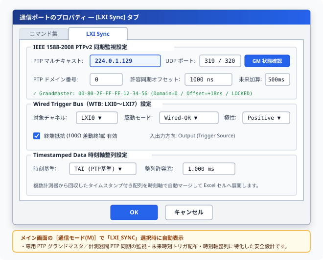
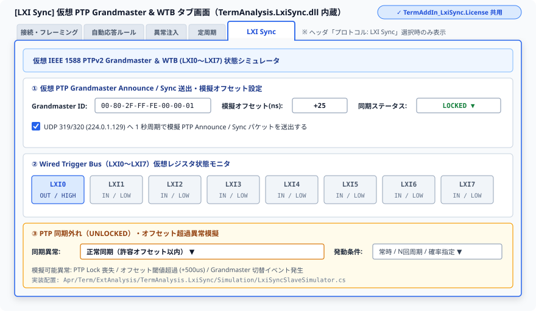

# LxiSync（IEEE 1588 PTPv2 時刻同期 & WTB）アドイン取扱説明書

👉 [← TermAddIn_LxiSync 製品トップに戻る](https://github.com/Monaca-App/TermAddIn_LxiSync)  
👉 [← プロパティ設定画面取扱説明書（共通）](../プロパティ設定画面取扱説明書.Md) ／ [← TermEmulator 操作説明書（共通）](https://github.com/Monaca-App/TermEmulator/blob/main/Manual/TermEmulator操作説明書.Md) ／ [← マクロスクリプト取扱説明書（共通）](../マクロスクリプト取扱説明書.Md)

---

本書は、**TermAddIn_LxiSync**（`TermAnalysis.LxiSync.dll`：IEEE 1588-2008 PTPv2 時刻同期監視・Timestamped Data 整列・Wired Trigger Bus［WTB］制御エクステンション）の **取扱説明書 兼 機能解説書** です。PTP / WTB 同期の仕組み解説、プロパティ設定画面の **「LXI Sync」タブ**、**TermEmulator の `[LXI Sync]` 仮想 PTP/WTB タブ**、および全 6 コマンドのリファレンスを 1 冊にまとめています。

* **必須拡張ライセンス**: **`TermAddIn_LxiSync.License`** （組み込み先: `TermAnalysis.LxiSync.dll`、`TermEmulator` と相互共用）


### 関連する公式規格・仕様書（外部リンク）
* [IEEE Standards Association：IEEE Std 1588 Precision Time Protocol（PTP）公式規格ページ](https://standards.ieee.org/standard/1588-2019.html) — IEEE 1588-2008（PTPv2）および後方互換改訂版（IEEE 1588-2019）の一次公式規格ページです。
* [IVI Foundation 公式仕様ポータル（計測器制御関連規格）](https://www.ivifoundation.org/specifications/default.aspx) — 関連する計測器制御規格を参照できます（本アドインは LXI Consortium 策定の *LXI Clock Synchronization* / *Timestamped Data* / *Wired Trigger Bus［WTB］* Extended Functions に準拠）。
---

## 目次

- [1. 機能概要と基礎知識（はじめての方へ）](#1-機能概要と基礎知識はじめての方へ)
- [2. プロパティ設定画面：「LXI Sync」タブの詳細](#2-プロパティ設定画面lxi-syncタブの詳細)
- [3. TermEmulator 仮想スレーブ設定：「[LXI Sync]」タブの詳細](#3-termemulator-仮想スレーブ設定lxi-syncタブの詳細)
- [4. マクロコマンド一覧（全 6 コマンド）](#4-マクロコマンド一覧全-6-コマンド)

---

## 1. 機能概要と基礎知識（はじめての方へ）

### 対応する機能の概要
**LxiSync（IEEE 1588 PTPv2 時刻同期 & WTB）** アドインは、LXI 拡張規格の **Clock Synchronization（IEEE 1588-2008 PTPv2）**・**Timestamped Data**・**Wired Trigger Bus（WTB）** に対応し、LAN 内計測器の時刻同期状態監視・同期収束待機・未来時刻トリガ用タイムスタンプ算出・複数機器データのナノ秒精度時刻軸整列・WTB 8 チャネル（`LXI0`〜`LXI7`）構成およびトリガ駆動を行う高度同期機能です。

### 機能の実現方法
* **PTP パケット監視＋計測器ステータス照会の安全設計**: マルチキャスト `224.0.1.129`（UDP `319`/`320`）の PTPv2 状態監視と各機器への同期照会を組み合わせ、汎用 Windows PC 自身を PTP マスタにせず専用グランドマスタ同期を監視・活用する実用的な設計を採用しています。
* **未来時刻算出＆ナノ秒精度ソートエンジン**: `LxiSync_CalcFutureTime` で現在 PTP 時刻＋オフセット（ms）の未来タイムスタンプを生成して `LxiEvent_Send` 等へ連携し、`LxiSync_AlignTimestamp` で秒部（`long`）とナノ秒部（`int`）を丸め誤差なく昇順整列します。
* **仮想 PTP / WTB 模擬**: `TermEmulator` の `[LXI Sync]` タブで PTP Lock 状態や WTB レジスタを模擬でき、高価な PTP グランドマスタ実機がない段階でも同期手順を検証できます。

### このアドインを選択することの利点
* **ネットワーク遅延に左右されない高精度な同時計測**: 「今すぐ測れ」ではなく「全機器共通の未来時刻に一斉測定」を指示できるため、LAN 遅延の揺らぎを排除した同時サンプリングが可能です。
* **複数計測器データの突合作業（手作業の時刻合わせ）を自動化**: 異なる機器から取得したタイムスタンプ付きデータを `LxiSync_AlignTimestamp` 1 行で共通時系列へ整列・結合でき、Excel 解析の手間を劇的に減らせます。
* **ハードウェア WTB 制御もマクロへ統合**: 差動トリガバス（`LXI0`〜`LXI7`）の入出力設定・駆動まで同じシート内で一元管理でき、配線変更や機種切替時の設定ミスを防げます。

### 主要な専門用語の解説
* **PTP（IEEE 1588 時刻同期）**: LAN に繋がった全計測器の時計を、基準時計（グランドマスタ）に合わせて誤差 100 万分の 1 秒以下まで揃える仕組みです。パソコンから「今すぐ測れ」と送ると LAN の通信遅れで機器ごとに実行タイミングに差が生じますが、**全機器の時計が合っていれば「12 時 00 分 05.500 秒に一斉測定せよ」と未来の時刻を指定することで時間差なく同時測定できます**。
* **Timestamped Data（タイムスタンプ付きデータ）**: 測定値と一緒に「正確にいつ測ったか」の時刻が付いたデータです。`LxiSync_AlignTimestamp` を使うと、別々の計測器から集めたデータを 1 本の時系列表に自動整列できます。
* **WTB（Wired Trigger Bus）**: LXI 計測器の背面にある専用ケーブルで 8 本の信号線（`LXI0`〜`LXI7`）を繋ぎ、ハードウェア電気信号で直接トリガを掛け合う機能です。

### 設定の妥当性を判断するためのチェックポイント
| 確認項目 | 項目の意味 | 設定値の目安・確認方法 |
| :--- | :--- | :--- |
| **PTP マルチキャスト / ポート** | グランドマスタの時刻同期信号が配信されるアドレスとポート | IEEE 1588 規格で **`224.0.1.129` / UDP `319`・`320`** に決まっています。**既定値のまま変更しません**。 |
| **PTP ドメイン番号（`0`〜`127`）** | 同期対象とする PTP グループ番号 | 通常の標準構成は **`0`**（既定値）です。計測器側の PTP 設定と同じ番号に合わせます。 |
| **許容同期オフセット** | 「時刻誤差がこの範囲内に収まった時点で同期完了と判定」とする合格基準 | 計測器の仕様に合わせ、一般には **`1000` ns（1 μs）** 程度を目安にします。厳しすぎる値（例: `1` ns）にすると待機が終わらなくなるため注意してください。 |
| **WTB チャネル構成（`LXI0`〜`LXI7`）** | 8 本の専用トリガ線の「送る側・受ける側」の役割分担 | 同じ信号線（例: `LXI0`）で **送る側（`OUT`）と受ける側（`IN`）** が衝突しないように割り当てます。 |

### 通信の仕組み解説（時刻同期トリガの原理と代表的なトラブル事例・対処法）
通常の LAN 送信では機器ごとに数ミリ秒の到着時間差が生じますが、PTP 時刻同期と未来時刻トリガを組み合わせることで到達時間差を解消します。

```text
① 同期確認: Grandmaster ➔ 全計測器の時計を誤差 < 1μs に同期 (LxiSync_WaitPtpLock)
② 未来時刻配布: PC が「現在時刻 + 500ms」を算出 (LxiSync_CalcFutureTime) ➔ LxiEvent_Send で全台へ事前配布
③ 同時発火: 各計測器は内蔵時計が「指定時刻」になった瞬間に一斉測定 ➔ 結果を LxiSync_AlignTimestamp で整列
```

* **事例①：`LxiSync_WaitPtpLock` がタイムアウトして進まない** ➔ LAN 内に PTP グランドマスタが存在しない、または許容オフセット（例: `10` ns）がネットワークスイッチ（非 PTP スイッチ）の実力に対して厳しすぎるケースです。まず `LxiSync_GetPtpStatus` で実測オフセットを確認してから閾値を決めてください。
* **事例②：未来時刻トリガが発火しない** ➔ `LxiSync_CalcFutureTime` のオフセットが短すぎる（例: `10` ms）と、パケットが計測器へ届いた時点で既に過去時刻になって無視されます。余裕を見て `200`〜`500` ms 程度を指定するのが安全です。
* **事例③：WTB で信号が出ない／衝突する** ➔ 複数機器が同じチャネルを `MODE=DRIVEN` かつ `DIR=OUT` にすると電気的に衝突します。複数機器で共有する場合は `MODE=WIRED_OR` を使用してください。

---

## 2. プロパティ設定画面：「LXI Sync」タブの詳細



メイン画面で **`LXI_SYNC`** モードを選択しているときに表示され、PTP 同期監視および WTB 制御条件を設定します。

| 項目名 | 設定値・範囲（既定値） | 詳しい意味と設定のポイント |
| :--- | :--- | :--- |
| **`PTP マルチキャスト / ポート`** | `224.0.1.129` / UDP `319`・`320` | IEEE 1588 PTPv2 の Announce / Sync パケット監視先です。 |
| **`PTP ドメイン番号`** | `0`〜`127`（既定 `0`） | 監視対象の PTP ドメイン番号を指定します。 |
| **`許容同期オフセット`** | ナノ秒 / マイクロ秒単位 | `LxiSync_WaitPtpLock` で同期確立（Lock）と判定する許容オフセット閾値です。 |
| **`WTB 既定チャネル構成`** | `LXI0`〜`LXI7`（8 チャネル） | Wired Trigger Bus の入出力方向・駆動モード（Driven / Wired-OR）・極性・終端の既定値を設定します。 |

> [!IMPORTANT]
> **Windows 標準環境における精度制約**:
> 汎用 Windows PC（ハードウェア PTP タイムスタンプ非対応 NIC）を PTP マスタとする構成はサブマイクロ秒精度を保証できないため、本拡張は **「専用 PTP グランドマスタ／計測器間 PTP 同期の監視・未来時刻指定トリガ発行・タイムスタンプ付き測定データの時刻軸整列」** を主責務とする安全設計です。

---

## 3. TermEmulator 仮想スレーブ設定：`[LXI Sync]` タブの詳細



* **主な用途**: 仮想 PTP Grandmaster の Announce / Sync 送出、仮想計測器の PTP Lock 状態・オフセット値、および WTB（`LXI0`〜`LXI7`）状態レジスタのソフトウェア模擬。
* **模擬機能**:
  * PC ソフトウェア模擬のため物理ナノ秒精度は非保証とし、同期 Lock 判定・未来時刻計算・タイムスタンプ整列ロジックおよび WTB 設定手順の事前検証に特化して利用できます。

---

## 4. マクロコマンド一覧（全 6 コマンド）

| コマンド名 | 構文概要 | 主な役割・用途 |
| :--- | :--- | :--- |
| **[LxiSync_GetPtpStatus](./LxiSync_GetPtpStatus.Md)** | `,SEQUENCE, [ステップ], LxiSync_GetPtpStatus, "[対象IP(任意)]", "[格納先キー]"` | LAN 内 PTP Grandmaster 状態および対象機器の同期 Lock 状態・オフセット値を取得 |
| **[LxiSync_WaitPtpLock](./LxiSync_WaitPtpLock.Md)** | `,SEQUENCE, [ステップ], LxiSync_WaitPtpLock, "[対象IP一覧]", [許容オフセットns], [TimeoutMs]` | 指定した全機器が PTP 同期（許容オフセット以内）に達するまで待機 |
| **[LxiSync_CalcFutureTime](./LxiSync_CalcFutureTime.Md)** | `,SEQUENCE, [ステップ], LxiSync_CalcFutureTime, [オフセットms], "[格納先キー]"` | 現在 PTP 時刻＋指定オフセット（ms）から同期トリガ用未来タイムスタンプ（秒・ナノ秒）を算出 |
| **[LxiSync_AlignTimestamp](./LxiSync_AlignTimestamp.Md)** | `,SEQUENCE, [ステップ], LxiSync_AlignTimestamp, "[入力データ群]", "[格納先キー]"` | 複数機器から取得した Timestamped Data を時刻軸で整列・結合して Excel 出力 |
| **[LxiSync_WtbConfig](./LxiSync_WtbConfig.Md)** | `,SEQUENCE, [ステップ], LxiSync_WtbConfig, "[IP]", "[LXI0〜LXI7]", "[方向/駆動/極性/終端]"` | WTB チャネル（`LXI0`〜`LXI7`）の構成設定を一括適用 |
| **[LxiSync_WtbTrigger](./LxiSync_WtbTrigger.Md)** | `,SEQUENCE, [ステップ], LxiSync_WtbTrigger, "[IP]", "[LXI0〜LXI7]"` | 指定した WTB チャネルへバストリガを駆動 |
