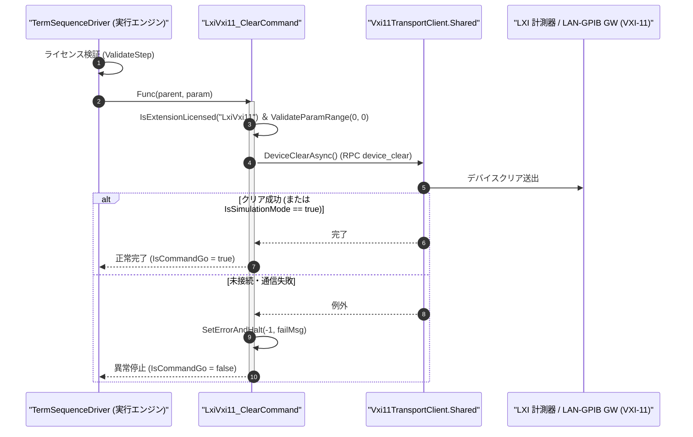

# コマンドリファレンス：LxiVxi11_Clear

👉 [← LxiVxi11 アドイン取扱説明書に戻る](./LxiVxi11取扱説明書.Md)

## 概要

**LxiVxi11_Clear** は、接続中の LXI 計測器に対してデバイスクリアを実行し、計測器の入出力バッファ・実行中コマンド・エラー状態を初期化する制御系コマンドです。
共通基底クラス `LxiClearCommandBase`（`TermAnalysis.Lxi.Core`）を継承し、`Vxi11TransportClient.Shared` を介して 帯域外 RPC `device_clear` を送出し、GPIB の Selected Device Clear（SDC）相当の入出力バッファ・実行状態クリアを実行します。

---

## 💡 書式・パラメータ仕様

### コマンド構文

```csv
,SEQUENCE, [ステップキー], LxiVxi11_Clear
```

### パラメータ（引数）一覧

本コマンドは引数を必要としません（`ValidateParamRange(0, 0)`）。

| 引数位置 | 引数名 | 必須/任意 | 説明・制約 |
| :--- | :--- | :---: | :--- |
| － | （なし） | － | 引数を指定すると引数超過エラーとして拒否されます。 |

---

## 🔄 特殊置換規約・分岐規約の適用

* **動的置換（`$`）**: 非適用。
* **ジャンプ先指定（`#`）**: 非適用。
* **共通コマンド指定（`@`）**: 非適用。
* **エイリアス（別名）**: `Analysis_LxiVxi11_Clear`, `Sqn_LxiVxi11_Clear`

---

## 💡 動作例（正しい構文での記述例）

### スクリプト記述例

```csv
COMMAND, "SAMPLE_LXIVXI11_CLEAR", "RES"
,PARAM, "RES", Work, "識別情報", ""
,SEQUENCE, 010, LxiVxi11_Open, "192.168.0.10", "inst0", 5000
; 通信開始前に計測器の残留バッファ・エラー状態をクリア
,SEQUENCE, 020, LxiVxi11_Clear
,SEQUENCE, 030, LxiVxi11_Query, "*IDN?", "RES", 5000
,SEQUENCE, 040, LxiVxi11_Close
,SEQUENCE, 050, Exit, "$RES$", 0
```

### 実行時の挙動・変数変化

* **実行前の状態**: セッションがオープンされ、前回測定の残留データやエラーキューが残っている可能性がある状態。
* **実行後の状態**: デバイスクリアが完了し、計測器の入出力バッファが初期化されたクリーンな状態で後続コマンドを実行できます。

---

## 🔄 動作フロー（シーケンス図）



---

## 🚫 エラーハンドリング・安全設計（仕様制限）

1. **ライセンス検証・引数ガード**:
   - `LxiVxi11` 未認証時は `-100`、余剰引数指定時は `ValidateParamRange(0, 0)` 違反で停止します。
2. **未接続・クリア失敗時の安全停止**:
   - セッション未接続またはタイムアウト時は `SetErrorAndHalt(-1, failMsg)` で停止します。

---

## 🧪 ユニットテスト仕様

本コマンドクラス（`LxiVxi11_ClearCommand.cs`）の `RunUnitTest()` 検証仕様です。

### テスト実行前提条件

* **実行トリガー**: `RunUnitTest()` メソッドの呼び出し
* **有効化条件**: `ErrorLogger.MinimumLevel == LogLevel.Test`
* **検証結果出力**: `_log.LogTest` へ出力。`finally` で `IsSimulationMode` を復元。

### テストケース一覧

| No | テストカテゴリ | テスト条件（入力値） | 期待される結果（出力値） | 検証の目的 / 観点 |
| :---: | :--- | :--- | :--- | :--- |
| **1** | 正常系 | `IsSimulationMode = true` 下で引数なしで実行 | `!param.HasError` かつ `IsCommandGo == true` となる | デバイスクリア送出の正常完了検証 |
| **2** | 異常系 | 余剰引数 `"EXTRA"` を指定して実行 | `ValidateParamRange(0, 0)` 違反で `HasError == true` かつ `!IsCommandGo` となる | 引数上限超過の拒否検証 |