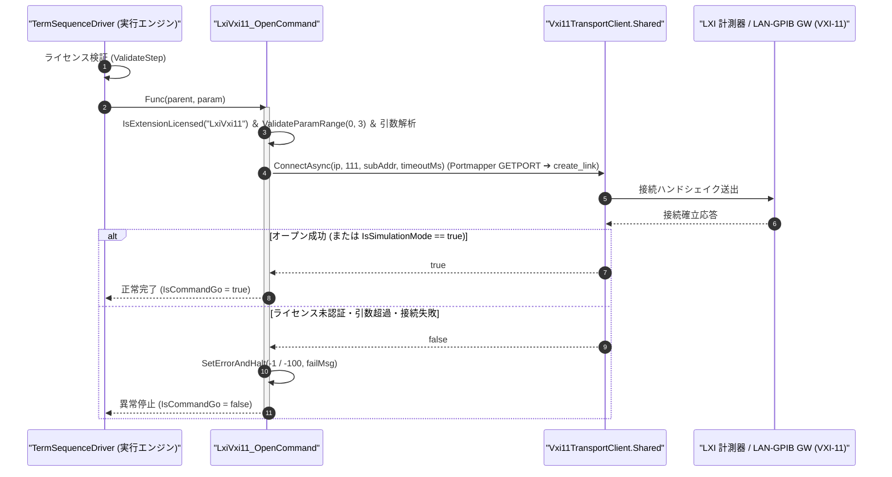

# コマンドリファレンス：LxiVxi11_Open

👉 [← LxiVxi11 アドイン取扱説明書に戻る](./LxiVxi11取扱説明書.Md)

## 概要

**LxiVxi11_Open** は、指定された接続先情報またはプロパティ設定値に基づき、LXI 計測器との **VXI-11 / ONC RPC 通信セッション** を開設する通信制御系コマンドです。
共通基底クラス `LxiOpenCommandBase`（`TermAnalysis.Lxi.Core`）を継承し、`Vxi11TransportClient.Shared` を介して ONC RPC Portmapper（TCP `111` / `GETPORT`）により `DEVICE_CORE`（Program `0x0607AF` / Version `1`）の動的ポートを解決し、RPC `create_link` を実行して VXI-11 セッション（`lid`）を確立します。

---

## 💡 書式・パラメータ仕様

### コマンド構文

```csv
,SEQUENCE, [ステップキー], LxiVxi11_Open, "[IP: 192.168.0.10]", "[SubAddress: inst0]", "[TimeoutMs: 5000]"
```

※ 引数を省略した場合は、プロパティ設定画面の現在値が自動適用されます。

### パラメータ（引数）一覧

| 引数位置 | 引数名 | 必須/任意 | 説明・制約 |
| :--- | :--- | :---: | :--- |
| 第 1 引数 | `IP` | 任意 | 接続先 LXI 計測器または LAN / GPIB ゲートウェイ（E5810A/B 等）の IPv4 / IPv6 アドレスまたはホスト名（既定: UI 設定値）。 |
| 第 2 引数 | `SubAddress` | 任意 | VXI-11 論理デバイス名（通常は `"inst0"`、LAN / GPIB ゲートウェイ経由時は `"gpib0,22"` のように二重引用符で囲んで指定）。 |
| 第 3 引数 | `TimeoutMs` | 任意 | Portmapper 解決および RPC 応答のタイムアウト時間［ミリ秒］（`100`〜`300000`、既定: `"5000"`）。 |

---

## 🔄 特殊置換規約・分岐規約の適用

本コマンドの引数における特殊記法および解釈ルールです。
* **動的置換（`$`）**: 引数内で `$PARAMキー$` のように記述すると、実行時に変数プール（PARAM）の値へ動的置換されます。（適用可能な引数: 全引数対応）
* **ジャンプ先指定（`#`）**: 本コマンドはジャンプ制御を行わないため適用されません。（適用可能な引数: 非適用）
* **共通コマンド指定（`@`）**: 本コマンドは外部マクロを呼び出さないため、共通コマンド呼び出し記法は適用されません。（適用可能な引数: 非適用）
* **カンマのエスケープ**: カンマを含むサブアドレス（例: `"gpib0,22"`）を指定する場合は、必ず `"..."` と二重引用符で囲んで記述します。
* **エイリアス（別名）**: `Analysis_LxiVxi11_Open`, `Sqn_LxiVxi11_Open`

---

## 💡 動作例（正しい構文での記述例）

### スクリプト記述例

※COMMAND ブロック配下の子要素行（PARAM, SEQUENCE）は必ず行頭カンマから開始し、スペースインデントや行末コメント（`;`）は記述しないでください。

```csv
COMMAND, "SAMPLE_LXIVXI11_OPEN", "IDN_STR"
,PARAM, "IDN_STR", Work, "機器識別情報", ""
; 1. LXI 計測器へ接続
,SEQUENCE, 010, LxiVxi11_Open, "192.168.0.10", "inst0", 5000
; 2. *IDN? を問い合わせて IDN_STR へ格納
,SEQUENCE, 020, LxiVxi11_Query, "*IDN?", "IDN_STR", 5000
; 3. 接続を安全にクローズして正常終了
,SEQUENCE, 030, LxiVxi11_Close
,SEQUENCE, 040, Exit, "$IDN_STR$", 0
```

### 実行時の挙動・変数変化

* **実行前の状態**: Term 通信エンジンが初期化され、変数プール（`PARAM`）に `"IDN_STR"` が定義されている状態。
* **実行後の状態**: `LxiVxi11_Open` により `Vxi11TransportClient.Shared` の接続が確立され、続く `LxiVxi11_Query` で取得された計測器識別応答が `"IDN_STR"` に格納されます。

---

## 🔄 動作フロー（シーケンス図）



---

## 🚫 エラーハンドリング・安全設計（仕様制限）

1. **ライセンス検証および引数範囲ガード**:
   - `LxiVxi11` 拡張ライセンスが未認証の場合はエラーコード `-100` で停止し、引数が 4 個以上指定された場合（`ValidateParamRange(0, 3)` 違反）は `_log.LogError` に記録して `SetErrorAndHalt` で停止します。
2. **既存セッションの安全解放と接続失敗停止**:
   - 再オープン時は既存セッションを先に切断してから新規接続します。ネットワーク到達不可・タイムアウト・ポート拒否時は `SetErrorAndHalt(-1, failMsg)` で安全停止します。

---

## 🧪 ユニットテスト仕様

本コマンドクラス（`LxiVxi11_OpenCommand.cs`）に実装されている `RunUnitTest()` メソッドが検証するユニットテストの仕様です。

### テスト実行前提条件

* **実行トリガー**: `RunUnitTest()` メソッドの呼び出し
* **有効化条件**: `ErrorLogger.MinimumLevel == LogLevel.Test` であること（それ以外は早期リターン）
* **検証結果出力**: `_log.LogTest` へ出力。`finally` ブロックで `Vxi11TransportClient.Shared.IsSimulationMode` を開始前の状態へ復元します。

### テストケース一覧

| No | テストカテゴリ | テスト条件（入力値） | 期待される結果（出力値） | 検証の目的 / 観点 |
| :---: | :--- | :--- | :--- | :--- |
| **1** | 正常系 | `IsSimulationMode = true` 下で引数 `"192.168.0.20"`, `"gpib0,22"`, `"5000"` を指定して実行 | `!param.HasError` かつ `param.IsCommandGo == true`、`Host == "192.168.0.20"`、`SubAddress == "gpib0,22"`、`TimeoutMs == 5000` となる | 接続先パラメータ反映およびセッションオープンの検証 |
| **2** | 異常系 | 余剰引数（`"192.168.0.20"`, `"inst0"`, `"5000"`, `"EXTRA"`）を指定して実行 | `ValidateParamRange(0, 3)` により拒否され、`HasError == true` かつ `!IsCommandGo` となる | 引数上限超過時のバリデーション拒否検証 |